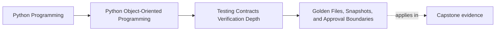

# Golden Files, Snapshots, and Approval Boundaries

<!-- page-maps:start -->
## Page Maps

<!-- page-maps:end -->

This lesson is about choosing which outputs deserve human review as stable contracts.

Snapshot-style tests feel efficient because one stored artifact can cover a lot of
surface.
They also fail in predictable ways:

- they freeze internal noise
- they become so large that diffs stop being reviewed honestly

The real design question is not:

- should we snapshot this because we can dump it easily?

It is:

- is this output a boundary we genuinely want humans to review as a stable contract?

If the answer is no, a golden file is usually the wrong tool.

## Keep one boundary visible

Use a capstone-facing output such as:

- an operator report
- one CLI summary
- one stable outward JSON or text representation

Now compare it with something like:

- an in-memory aggregate dump
- a large internal debug structure

The first may deserve approval review.
The second usually does not.

That contrast is the lesson.

## Approval artifacts are contract-review tools

A golden file or approval test is strongest when the exact representation matters to a
real consumer or reviewer.

Good candidates include:

- public CLI output
- generated reports
- stable wire-format payloads
- reviewer-facing debug or audit summaries

In those cases, the stored artifact is not just test data.
It is the reviewed shape of a public promise.

## Do not snapshot unstable internal detail

Weak snapshot targets often include:

- object dumps with incidental ordering
- timestamps that change every run
- random identifiers
- large internal structures with no public consumer

These artifacts teach the wrong lesson.
They imply that every implementation detail should be frozen, which makes refactoring
harder without adding real confidence.

If the representation is not a real boundary, the approval artifact is probably
performing theater.

## Normalize noise before freezing meaning

If an output is worth snapshotting, strip away the volatility that would make the proof
dishonest.

That may mean normalizing:

- timestamps
- ordering
- nondeterministic identifiers
- platform-specific paths
- environment-specific metadata

The goal is not to fake stability.
The goal is to preserve the meaningful contract while removing accidental churn.

## Approval boundaries should stay small enough to read

One giant snapshot is often worse than several focused artifacts.

A reviewer should be able to answer:

- what surface changed?
- why does this representation matter?
- which part of the contract moved?

If the artifact is too large for that, it is serving the test runner better than the
human reviewer.

Approval tests are valuable only if a changed artifact triggers a real contract
conversation.

## Use direct assertions when the contract is small

If an output has only a few meaningful facts, direct assertions are often better.

Examples:

- one error code
- one status line
- one normalized field set

In those cases, a stored artifact can be heavier than the claim it is proving.

The broader the representation contract, the more approval review tends to make sense.

## Worked capstone example

Suppose the capstone exposes a CLI summary of enrollments or incidents for human
operators.

That output may deserve a golden file if:

- column layout matters
- wording matters
- ordering matters
- reviewers should notice formatting drift explicitly

Before freezing it, normalize:

- timestamps
- irrelevant ids
- unstable ordering

What should probably not be snapshotted:

- the entire aggregate graph
- private repository internals
- giant debug structures whose exact shape no real boundary consumer relies on

That is the difference between an approval boundary and an implementation dump.

## Build an approval packet

For each candidate artifact, keep a short packet with:

- boundary consumer
- exact contract being protected
- fields or formatting that matter
- unstable details normalized out
- reason a diff should trigger human review

If the packet is weak, the snapshot is probably weak too.

## Common failure modes

- snapshotting internal structures because they are easy to dump
- keeping noisy unstable fields in the artifact
- storing artifacts too large for meaningful review
- auto-approving changed snapshots without discussing contract drift
- using snapshots where a few direct assertions would be clearer

## Approval review card

Use this short card when reviewing a snapshot:

| Question | What you want to see |
| --- | --- |
| is the snapshot protecting a real boundary contract? | yes |
| have unstable details been normalized out? | yes |
| is the artifact small enough for a human to review honestly? | yes |
| would a diff trigger a real conversation about contract drift? | yes |

## Capstone connection

Use this page to ask:

- which capstone outputs are truly reviewer-facing enough to deserve approval tests
- which current representation checks are freezing internal shape instead of boundary
  meaning
- what should be normalized so stored artifacts highlight only real contract changes

That is how approval testing becomes a review tool instead of a churn generator.

## Exit check

Leave this lesson only when you can do all of these:

- explain what makes an output worthy of a golden-file test
- identify one noisy field that should be normalized before approval review
- point to one capstone output that deserves direct assertions instead of a snapshot
