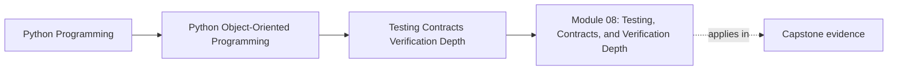

# Module 08: Testing, Contracts, and Verification Depth

<!-- page-maps:start -->
## Page Maps

<!-- page-maps:end -->

This module turns testing into design evidence. The question is no longer "how many
tests do we have?" It is:

> Which proof should fail first if one important design claim stops being true?

That question forces verification to follow architecture instead of habit.

## What this module is really about

This module is not a catalog of testing styles.

It is about keeping these distinctions honest:

- behavior proof versus contract proof
- lifecycle proof versus single-call proof
- fake versus mock versus compatibility suite
- approval artifact versus noisy snapshot
- stronger proof versus heavier theater

If those distinctions blur, the suite may stay green while confidence stays thin.

## Running capstone claims

Keep two claims in view while you read:

1. `WorkshopEnrollment` must never confirm more attendees than the seat limit
2. `CertificateIssuanceService` must not duplicate visible issuance when retried

The first is aggregate-owned and lifecycle-heavy.
The second spans workflow, durability, and external side effects.

Together they force you to choose different proof routes on purpose.

## Preflight

Before going further, you should already be able to:

- name one important invariant without talking about tests yet
- explain which boundary owns one workflow promise
- distinguish domain truth from downstream convenience

If the design claim itself is still fuzzy, better tests will not fix that.

## What you should be able to do by the end

By the end of this module, you should be able to:

- choose the first-failing suite for a meaningful claim
- decide when a sequence needs lifecycle proof rather than isolated examples
- protect repositories and adapters with shared contracts instead of optimistic mocks
- keep fixtures, builders, and snapshots honest enough to teach rather than hide
- build a confidence ladder that matches risk instead of defaulting to one style

## Read this module as one proof-design day

Use the pages in this order:

1. behavior-first domain tests
2. stateful and transition coverage
3. repository and adapter contracts
4. property-based proof where breadth matters
5. fixtures, builders, and doubles
6. runtime checks and approval boundaries
7. integration suites and confidence ladders
8. the refactor page
9. the exercises and answer packet

That order matters because the later choices only make sense if the earlier proof target
is already clear.

## Lesson map

- [Behavior-First Tests for Domain Objects](behavior-first-tests-for-domain-objects.md)
- [Stateful Testing and Transition Coverage](stateful-testing-and-transition-coverage.md)
- [Contract Tests for Repositories and Adapters](contract-tests-for-repositories-and-adapters.md)
- [Property-Based Testing for Object Models](property-based-testing-for-object-models.md)
- [Fixtures, Builders, and Test Data Ownership](fixtures-builders-and-test-data-ownership.md)
- [Fakes, Stubs, Spies, and When Mocks Hurt](fakes-stubs-spies-and-when-mocks-hurt.md)
- [Runtime Contracts, Assertions, and Defensive Checks](runtime-contracts-assertions-and-defensive-checks.md)
- [Golden Files, Snapshots, and Approval Boundaries](golden-files-snapshots-and-approval-boundaries.md)
- [Integration Suites and Confidence Ladders](integration-suites-and-confidence-ladders.md)
- [Refactor: Tests toward Contract-Driven Confidence](refactor-tests-toward-contract-driven-confidence.md)
- [Exercises](exercises.md)
- [Exercise Answers](exercise-answers.md)
- [Glossary](glossary.md)

## Keep these support surfaces open

- `../guides/proof-matrix.md` when you want one claim tied to one proof route
- `../guides/proof-ladder.md` when you need to size proof honestly instead of reaching
  for the heaviest suite first
- `../reference/self-review-prompts.md` when you want to test whether your testing
  language still sounds like design rather than ritual

## Study route through the capstone

If this module still feels abstract, take this route:

1. choose one capstone claim
2. ask which suite should fail first
3. ask what a weaker proof would miss
4. ask what a heavier proof would add later, not immediately
5. compare that answer with the exercise packet

That route turns the module into a proof-design review instead of a style debate.

## Questions to keep explicit

- Which claim belongs to a local behavior test and which belongs to a workflow or
  contract test?
- Which fixture helps the invariant stay visible, and which one hides it?
- Which boundary needs substitute compatibility rather than just a convenient mock?
- Which snapshot is protecting a real public representation instead of frozen noise?

## Common failure modes

- testing helper choreography instead of visible behavior
- proving lifecycle rules one call at a time
- trusting substitute boundaries without a shared contract suite
- hiding important state in magical builders or fixtures
- adding more tests without clarifying what the current tests are proving

## Honest completion signal

You are ready to move on when you can take one capstone claim and explain:

- which suite should fail first
- why that suite is not too weak
- why a stronger suite can wait until the risk justifies it

## Closing criteria

You should finish this module able to build a verification strategy that matches design
and operational risk instead of defaulting to one testing habit everywhere.

## Directory glossary

Use [Glossary](glossary.md) when you want the recurring proof language kept stable while
you move between lessons, labs, and capstone review.
