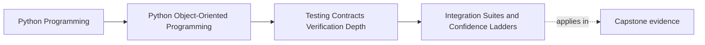

# Integration Suites and Confidence Ladders

<!-- page-maps:start -->
## Page Maps

<!-- page-maps:end -->

This lesson is about keeping a test suite explainable.

Confidence does not come from "having many tests."
It comes from knowing:

- which claim belongs to which proof layer
- which layer should fail first
- what extra risk a more expensive layer adds

That structure is the confidence ladder.
Without it, teams usually either over-trust narrow proof or over-pay for broad proof.

## Keep two claims on the table

Use these capstone claims:

- `WorkshopEnrollment` must preserve seat truth under real lifecycle histories
- `CertificateIssuanceService` must not create duplicate visible work under retry

These two claims are useful because they force different first-failing layers.

If the same proof answer appears for both, the ladder is probably being applied by habit
rather than by risk.

## A confidence ladder is a costed proof map

The ladder is not about prestige.
It is about cost and honesty.

For each important claim, ask:

1. what is the cheapest proof that can really catch the defect?
2. what risk remains after that proof passes?
3. what broader proof earns its cost by catching that remaining risk?

That is what keeps the suite from turning into either:

- a pile of fast tests that cannot see workflow truth
- a pile of slow tests that hide where the truth actually lives

## Example ladder for this course

The course has been building these layers on purpose:

- behavior-first tests for local semantic rules
- stateful tests for lifecycle histories
- contract suites for replaceable boundaries
- integration suites for composed workflow risk
- approval or outward-representation checks for stable visible contracts

The names matter less than the proof ownership:

- local rule
- history
- substitute compatibility
- workflow composition
- public representation

If two layers are proving the same thing with no new signal, the ladder is wasting time.

## Integration suites should earn their cost

An integration suite is justified when the bug lives between boundaries.

Good candidates:

- load, mutate, save, and publish through real workflow boundaries
- retry behavior that depends on durable progress
- domain object plus repository plus side-effect boundary working together
- translation drift between application and adapter layers

Bad candidates:

- local semantic rules the aggregate can already prove directly
- tiny helper-call choreography
- copied lower-layer proof with no extra composition risk

Integration tests are strongest when they prove something lower layers cannot honestly
see.

## First-failing layers for the running claims

For the seat-limit claim:

- first failing layers are behavior-first and stateful proofs

Why:

- aggregate truth and lifecycle are the core risk
- integration proof can add repository or conflict pressure later, but not first

For the retry-no-duplication claim:

- first failing layer is a workflow-level integration test with meaningful durable and
  side-effect boundaries

Why:

- the risk lives in composition across retry, persistence, and visible work
- narrow local tests can miss the exact failure that users would actually see

This contrast is the module's point: different claims deserve different first failures.

## A ladder should make failure interpretation faster

When the ladder is healthy, a failing test already narrows the investigation:

- a local behavior failure suggests semantic drift inside one object
- a contract failure suggests substitute incompatibility
- an integration failure suggests composition or workflow drift

That is operationally valuable.
Without the ladder, every failure sends maintainers searching everywhere.

## Do not let the slowest layer carry the whole suite

When a team trusts only the top of the ladder:

- feedback slows down
- diagnosis becomes vague
- lower-layer ownership becomes blurry

The opposite mistake also matters:

- if everything stays at the fastest layer, composed workflow risk stays under-proved

The ladder matters because both extremes are weak.

## Build one confidence packet per major workflow

For one important workflow, keep a short packet that answers:

- first failing proof
- next broader proof
- heaviest proof reserved for operational pressure
- what each added layer catches that the previous one could miss

This packet makes the ladder teachable to another maintainer instead of living only in
your head.

## Worked capstone ladder

A strong capstone ladder might look like this:

1. behavior-first tests prove `WorkshopEnrollment` local rules
2. stateful tests prove confirm, release, and follow-on histories
3. repository contract suites prove substitute compatibility
4. one workflow integration suite proves load, mutate, save, and visible publish without
   duplicate work under retry
5. one approval or outward-representation check protects the stable user-facing result

Now each major regression has a likely first-failing layer.

That is much stronger than one giant suite that tries to prove everything at once.

## Common failure modes

- treating the whole test suite as one undifferentiated pile
- forcing workflow risk into narrow unit tests that cannot see it honestly
- pushing local semantic proof up into slow integration suites
- duplicating the same proof at several layers without extra signal
- building a ladder nobody can explain in plain language

## Confidence review card

Use this short card when reviewing a test architecture change:

| Question | What you want to see |
| --- | --- |
| does each layer own a distinct proof question? | yes |
| is each claim proved first at the cheapest honest layer? | yes |
| do integration tests target composition risk instead of local rules? | yes |
| can another maintainer explain what each layer would fail first? | yes |

## Capstone connection

Use this page to ask:

- which current integration test is proving real cross-boundary risk
- which test is carrying a claim that belongs in a cheaper lower layer
- which workflow is still under-proved because no composed suite yet covers the real
  boundaries

That is how a test collection becomes a confidence architecture.

## Exit check

Leave this lesson only when you can do all of these:

- explain what a confidence ladder is in terms of proof cost and failure ownership
- identify one capstone claim that belongs in an integration suite
- identify one capstone test that should move downward, narrow, or disappear
