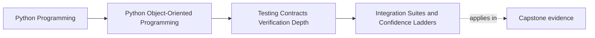

# Integration Suites and Confidence Ladders

<!-- page-maps:start -->
## Page Maps

<!-- page-maps:end -->

Read the first diagram as a placement map: this page is one concept inside its parent
module, not a detached essay, and the capstone is the pressure test for whether the
idea holds. Read the second diagram as the working rhythm for the page: name the
problem, study the example, identify the boundary, then carry one review question
forward.

## Why this lesson matters

Students often talk about "the test suite" as though it were one thing.

In practice, confidence comes from several layers that answer different questions at
different costs.

When those layers are not deliberate, teams usually end up with one of two bad shapes:

- everything is pushed into the fastest layer, leaving boundary risk under-proved
- everything important is pushed into slow integration tests, leaving feedback expensive and vague

A confidence ladder exists to keep the proof route explainable.

## A ladder is not about prestige, it is about proof cost

Higher-level tests are not automatically better. They are just more expensive and often
prove different things.

A healthy ladder usually asks:

- what is the cheapest layer that can honestly prove this claim?
- what risk remains that only a broader layer can catch?

This keeps the suite from becoming either underpowered or needlessly heavy.

## Different layers should answer different questions

For an object-oriented Python system, a simple ladder might include:

- behavior-first tests for local domain rules
- stateful tests for lifecycle histories
- contract tests for replaceable repositories and adapters
- integration tests for multi-layer workflows
- approval or end-to-end checks for public-facing outputs

The important part is not the names. It is that each layer owns a distinct proof
question.

## Integration tests should target boundary composition risk

Integration tests earn their cost when the risk lives between layers.

Good candidates include:

- repository plus aggregate round-trip behavior
- application service plus unit-of-work coordination
- adapter plus domain object translation
- runtime flow that involves retries, publication, and persistence together

These tests are strongest when unit tests cannot honestly prove the same claim because
the bug appears only in composition.

## A ladder should make failure interpretation easier

One underrated benefit of layered suites is diagnostic clarity.

If you know:

- unit tests defend local semantics
- contract tests defend substitute compatibility
- integration tests defend composed workflows

then a failure already tells you something about where the promise broke.

Without that structure, every failure demands a full investigation from scratch.

## Do not let the slowest layer carry the whole burden

When a team trusts only the top of the ladder, two problems follow:

- feedback slows down
- the reason a workflow failed becomes harder to isolate

High-level suites should confirm broad promises, not compensate for missing precise
lower-level proof.

The opposite problem also exists: too many narrow tests can still leave workflow risk
uncovered. The ladder matters because both extremes are weak.

## A worked example

Suppose the capstone includes:

- domain rules for incident transitions
- repository-backed persistence
- event publication
- a public command or runtime workflow

An honest confidence ladder might look like:

1. behavior-first tests prove local incident rules
2. stateful tests prove lifecycle histories
3. repository contract tests prove substitute compatibility
4. one integration suite proves that a command loads, mutates, saves, and publishes through real boundaries
5. one approval or CLI-level suite proves the user-facing representation stays stable

Now each major risk has a first-failing layer.

That is far more useful than one giant suite that tries to prove everything at once.

## Keep the ladder explainable to humans

If a new contributor cannot answer:

- what does this suite prove?
- why does it exist at this layer?
- what kind of regression should fail here first?

then the ladder is probably not clean enough yet.

A test architecture is part of the system design. It should be readable as such.

## Common mistakes

- treating all tests as one undifferentiated pile
- pushing workflow risk down into unit tests that cannot see it honestly
- pushing local semantic checks up into expensive integration suites
- duplicating the same proof across many layers with little extra signal
- building a ladder nobody can explain in plain language

## Review checklist

| Question | Good sign |
| --- | --- |
| does each test layer own a distinct proof question? | yes |
| is each claim proved at the cheapest honest layer first? | yes |
| do integration tests focus on composition risk rather than local rules? | yes |
| can a reviewer explain what should fail first for each major regression? | yes |

## Capstone connection

Use the capstone suite to ask:

- which current integration tests are proving true cross-layer risk?
- which ones are carrying checks that belong in cheaper lower layers?
- where is one critical workflow still under-proved because no higher-level suite composes the real boundaries?

This is how a test collection becomes a confidence architecture.

## Exit check

Leave this lesson only when you can do all of these:

- explain what a confidence ladder is and why it is not just a test pyramid slogan
- identify one capstone claim that belongs in an integration suite
- identify one capstone test that should move to a cheaper layer or be deleted
