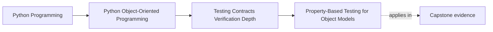

# Property-Based Testing for Object Models

<!-- page-maps:start -->
## Page Maps

<!-- page-maps:end -->

This lesson is about proving claims that are too wide for a few narrated examples.

Property-based testing is useful when the real promise sounds like:

- this should hold across many valid shapes
- this should survive many legal histories
- this representation should round-trip without losing meaning

It is not "stronger testing because randomness feels advanced."
It is breadth-oriented proof for design claims that are too broad for a few examples.

## Keep one broad claim visible

Use a capstone-style claim such as:

- a schedule window or reporting value object round-trips without losing meaning
- generated lifecycle sequences never leave an impossible state behind
- normalized output preserves a stable ordering or equality rule

Now compare that with a narrow claim like:

- a retired object rejects one specific command

The broad claim is where properties usually earn their cost.
The narrow claim is often better taught by one direct example.

## A property is an always-true design claim

The heart of property-based testing is not the generator.
It is the claim.

Strong property statements sound like:

- serialize then deserialize preserves semantic equality
- after any valid generated transition sequence, invariants still hold
- normalized representations compare equal when their meaning is equal
- derived duration never becomes negative for any valid generated window

These are design truths.
The generator exists to pressure-test them, not replace them.

## Use properties when breadth matters more than narration

Example-based tests remain better when the main job is teaching one concrete rule.

For example:

- a closed incident cannot be acknowledged
- a full workshop cannot confirm another seat

Those rules are usually clearer with direct behavior tests.

Use property-based testing when the hard part is not one rule explanation but one of
these:

- many legal input combinations
- many boundary sizes and lengths
- many histories
- algebraic or structural laws

This is the difference between explicit examples and breadth pressure.

## Strategy design is part of the domain work

Weak property tests often fail because the generation strategy is careless.

If the strategy produces mostly meaningless primitive noise, you learn little about the
object model.

A strong strategy should reflect:

- valid domain shapes
- boundary sizes and counts
- meaningful combinations of values
- intentionally invalid or edge inputs only when those are part of the claim

In other words, strategy design is not plumbing.
It is a second place where you must understand the domain clearly.

## Round-trip properties are often the best starting point

Many learners succeed first with properties that defend round-trip meaning:

- value object to wire form and back
- snapshot to storage form and back
- parsed command to normalized representation and back

These properties are useful because they catch:

- loss of meaning
- accidental normalization drift
- missing fields
- silent asymmetry between write and read forms

They also teach the difference between exact representation equality and semantic
equality.

## Shrinking turns breadth into a teachable counterexample

One reason property-based testing is worth the effort is shrinking.

When the property fails, the tool tries to reduce the failing case or sequence to the
smallest understandable counterexample.

That matters because the real output of a good property failure is:

- not "something random broke"
- but "here is the smallest case that contradicts your design claim"

That is exactly the kind of artifact a learner or reviewer can reason from.

## Stateful properties are natural for lifecycle-heavy objects

When histories matter, generated sequences can be more valuable than generated single
inputs.

Useful examples:

- generate legal and illegal command sequences for one stateful object
- generate repeated save/load cycles for a repository-backed value
- generate combinations of retries and repeated attempts around one idempotency rule

This is especially valuable when hand-written paths are becoming repetitive and you no
longer trust yourself to enumerate the important histories manually.

## Worked capstone example

Suppose a schedule window or reporting value object claims:

- normalization preserves represented meaning
- serialization round-trips preserve semantic equality
- derived duration is never negative for valid shapes

Useful properties might check:

1. serialize then deserialize yields an equivalent value
2. normalized values compare equal to equivalent source inputs
3. derived duration remains valid for all generated valid windows

Those are not "more random tests."
They are executable versions of the type's semantic laws.

## Build a property packet before you generate data

Before writing a property, keep a small packet:

- claim stated in plain design language
- why hand-written examples are not enough
- what counts as a meaningful generated input
- what a shrunk failure should ideally teach

If that packet is weak, the property is likely to become noise instead of evidence.

## Common failure modes

- treating random generation as the goal instead of the property
- generating mostly invalid or meaningless inputs
- writing properties so broad that failures become hard to interpret
- replacing clear example tests with properties when one narrated example teaches the
  rule better
- ignoring shrunk counterexamples instead of reading them as design feedback

## Property review card

Use this short card when reviewing a property:

| Question | What you want to see |
| --- | --- |
| is the property a real design claim rather than a generic computation check? | yes |
| do generators reflect meaningful domain structure? | yes |
| would a shrunk failure teach something concrete? | yes |
| is the property used where breadth matters more than one narrated example? | yes |

## Capstone connection

Use this page to ask:

- which value objects or snapshots have round-trip promises worth proving broadly
- which lifecycle or policy invariants now span too many cases for example tests alone
- where a generated counterexample would teach more than five more hand-written cases

That is where property-based testing becomes design instrumentation instead of testing
fashion.

## Exit check

Leave this lesson only when you can do all of these:

- explain when a property is a better proof route than a hand-written example
- design one generator that reflects domain meaning rather than primitive noise
- state one capstone invariant as an always-true property
