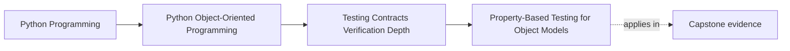

# Property-Based Testing for Object Models

<!-- page-maps:start -->
## Page Maps

<!-- page-maps:end -->

Read the first diagram as a placement map: this page is one concept inside its parent
module, not a detached essay, and the capstone is the pressure test for whether the
idea holds. Read the second diagram as the working rhythm for the page: name the
problem, study the example, identify the boundary, then carry one review question
forward.

## Why this lesson matters

Some design claims are too wide for a few hand-written examples.

If you want to prove that:

- equality behaves consistently
- serialization round-trips preserve meaning
- a lifecycle never leaves an impossible state behind
- a set of ordering rules always holds

then three or four carefully chosen examples may still miss the one input shape or
history that breaks the claim.

Property-based testing helps when the real promise is "this should hold across many
valid cases," not just "this worked for these examples."

## A property is an always-true design claim

The heart of property-based testing is not random data. It is a clearly stated
invariant.

Good property questions sound like:

- if I serialize then deserialize this value object, is the meaning preserved?
- if two objects are equal, do they remain interchangeable where equality matters?
- after any valid transition sequence, do lifecycle invariants still hold?
- does sorting according to this comparison rule behave consistently?

These are design truths. The generator exists to pressure-test them.

## Do not use properties when one example says everything

Property-based testing is not automatically stronger than example-based testing.

If one business rule is:

- a retired incident cannot be acknowledged

then one explicit behavior-first test may teach that rule better than a generator.

Use properties when the burden is breadth:

- many legal inputs
- many combinations
- many sequences
- algebraic or structural laws

Use examples when the burden is explanation of one specific rule.

## Strategy design is part of the model

Weak property tests often fail because the input generation is careless.

If your strategy produces mostly meaningless junk, you learn very little about the real
object model.

A good strategy should reflect:

- valid domain shapes
- intentionally invalid edge cases when those matter
- boundary sizes and lengths
- meaningful combinations of states and values

In other words, generator design is not test plumbing. It is a second place where you
must understand the domain.

## Round-trips are often the easiest honest starting point

Many students first succeed with properties by starting from round-trip claims:

- value object to wire form and back
- aggregate snapshot to storage form and back
- command representation to parsed form and back

These properties are useful because they defend:

- loss of meaning
- accidental normalization drift
- missing fields
- surprising representation asymmetry

They also teach the difference between representation equality and semantic equality.

## Shrinking turns a wide failure into a teachable example

One reason property-based testing is worth the effort is shrinking.

When a property fails, the tool tries to reduce the failing input or sequence to a
smaller example.

That matters because the real output of a good property failure is not:

- "the generator found something weird"

It is:

- "here is the smallest understandable counterexample to your design claim"

That is exactly the kind of artifact a learner can reason from.

## Stateful properties are a natural partner for lifecycles

For objects with histories, generated sequences can be more valuable than generated
single inputs.

Examples:

- generating command sequences for a state machine
- generating repeated save and load cycles
- generating combinations of valid and invalid transition attempts

This is especially useful when handwritten transition tests are becoming repetitive and
you no longer trust yourself to enumerate the important histories manually.

## A worked example

Suppose a schedule window value object claims:

- normalization preserves the represented interval
- serialization round-trips retain meaning
- equality ignores irrelevant representation detail

You might build properties that check:

1. serializing then deserializing yields an equal window
2. normalized windows still compare equal to equivalent source inputs
3. derived duration remains non-negative for all valid generated windows

Those are not "more random tests." They are executable statements of the semantic rules
the type is supposed to keep forever.

## Common mistakes

- treating random input generation as the goal instead of the property
- generating mostly invalid data that never reaches meaningful behavior
- writing properties so broad that failures are hard to interpret
- replacing clear example tests with properties when the rule is better taught explicitly
- ignoring shrunk counterexamples instead of reading them as design feedback

## Review checklist

| Question | Good sign |
| --- | --- |
| is the property a real design claim rather than a generic computation check? | yes |
| do generators reflect meaningful domain structure? | yes |
| would a failing shrunk example teach something concrete? | yes |
| is the property used where breadth matters more than one narrated example? | yes |

## Capstone connection

Use the capstone to ask:

- which value objects or snapshots have round-trip promises worth proving broadly?
- which lifecycle or policy invariants now span too many cases for example tests alone?
- where would a generated counterexample teach more than adding five more hand-written cases?

This is the point where generated testing becomes design instrumentation instead of
testing fashion.

## Exit check

Leave this lesson only when you can do all of these:

- explain when a property is a better proof route than a hand-written example
- design one generator that reflects domain meaning instead of primitive noise
- state one capstone invariant as an always-true property
