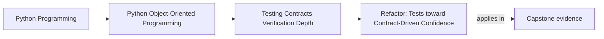

# Refactor: Tests toward Contract-Driven Confidence

<!-- page-maps:start -->
## Page Maps

<!-- page-maps:end -->

This page is about repairing a weak test suite in an order that preserves learning and
real confidence.

The suite we are refactoring has a familiar smell:

- many green unit tests
- heavy mocks
- little lifecycle coverage
- broad integration checks
- no shared contract suites

The goal is not "more tests." The goal is a suite where each layer proves one clear
claim.

## The claim route for this refactor

Use these two capstone promises as the forcing function:

1. `WorkshopEnrollment` never confirms more attendees than the seat limit
2. `CertificateIssuanceService` never creates duplicate visible issuance when a workflow
   is retried

The first promise is local and lifecycle-heavy.
The second is cross-boundary and side-effect-heavy.

If one refactor route can make both claims easier to prove, the suite is improving for
the right reason.

## The brittle starting point

Imagine the current suite looks like this:

- unit tests assert private helper choreography
- enrollment history is tested one call at a time
- in-memory and durable repositories each have separate ad hoc examples
- retry behavior is "covered" only by one large end-to-end test
- builders hide the important values that actually explain the invariant

This kind of suite stays busy without telling you what failed first.

## Refactor step 1: remove implementation surveillance

Start with the tests that break every time internals move.

Replace tests such as:

- "helper method `calculate_remaining_seats` was called once"
- "service called repository before formatter"
- "mock sink received exactly these internal intermediate objects"

with behavior questions such as:

- did enrollment confirm or waitlist correctly?
- did the visible certificate workflow publish one stable outcome?
- did the domain reject an invalid transition clearly?

This step shrinks the surface of meaningless brittleness.

## Refactor step 2: prove histories, not only isolated calls

Once the local tests speak behavior, ask where one-call examples still miss the real
risk.

For `WorkshopEnrollment`, isolated tests are not enough. The real claim sits in the
history:

1. confirm attendees until the last seat is taken
2. attempt one more enrollment
3. confirm the new result is waitlisted rather than silently overbooked
4. cancel or release a seat
5. confirm the next transition follows the owned lifecycle rules

This is the point where the suite stops pretending that aggregates live one method call
at a time.

## Refactor step 3: extract one shared repository contract

Now look at substitutes.

If both an in-memory repository and a durable repository claim to support enrollment or
certificate workflows, write one contract suite and run it against both.

That shared suite should answer questions such as:

- does save-and-load preserve the same visible state?
- do missing records fail in the same semantic way?
- does version or conflict behavior surface through the same contract?

If the substitutes cannot pass the same semantic suite, they are not honestly
interchangeable.

## Refactor step 4: expose important setup values

Before adding broader proof, repair the setup language.

Weak builders often hide the thing the test is supposed to teach.

Bad setup:

- a magical `build_valid_workshop()` helper with invisible defaults
- a fixture that silently creates five seats and three attendees
- a certificate object whose retry token or issued state is hidden

Better setup:

- explicit seat count
- explicit attendee history
- explicit retry token or issued marker

The rule is simple: if the reader cannot see the important pressure on the page, the
test is teaching the wrong thing.

## Refactor step 5: place workflow proof where composition risk begins

Only after local behavior, lifecycle proof, and repository contracts are clearer should
you tighten the workflow tests.

For `CertificateIssuanceService`, the integration proof should show:

1. confirmed state is loaded
2. issuance is attempted
3. persistence and side-effect boundaries cooperate correctly
4. a retry does not create duplicate visible results

That is a composed workflow claim.
It belongs above unit tests and below broad end-to-end theater.

## Refactor step 6: use broader generation only where breadth matters

Some claims deserve more than a few named examples.

Good candidates include:

- ordering laws for exposed collections
- round-trip guarantees for serialized public value objects
- semantic equality rules that should hold across many inputs

Do not reach for property-based testing just to look advanced.
Use it when the claim truly spans a wide space and a shrunk counterexample would teach
more than another hand-written example.

## Refactor step 7: review snapshots and approvals as contracts

If the suite includes snapshots, ask what public promise they protect.

Keep a snapshot only when it guards something like:

- a stable public representation
- a documented report shape
- a reviewer-facing artifact that another consumer depends on

Delete or narrow snapshots that only freeze internal formatting noise.

The aim is approval evidence, not artifact hoarding.

## One ordered repair plan

For this capstone, an honest repair plan could be:

1. rewrite brittle mock-driven unit tests into behavior-first domain proofs
2. add lifecycle tests for seat exhaustion and recovery paths
3. extract one shared repository contract suite for in-memory and durable substitutes
4. simplify builders so the pressure values remain visible
5. add one composed retry workflow proof for certificate issuance
6. add broad generated proof only where the input space really demands it
7. keep only approval artifacts that defend a public promise

This order matters because each later step depends on the earlier proof language being
clean.

## What this refactor should change in your review habit

After reading this page, you should stop asking:

- how many tests do we have?
- why is the integration suite so large?
- should we add property-based testing somewhere?

and start asking:

- which claim should fail first?
- which proof layer is still missing?
- which current tests are noisy enough that they hide the real gap?

That is the shift from testing activity to testing judgment.

## Capstone connection

Use this page when the capstone suite feels noisy but unconvincing.

Walk one claim through the repair route and decide:

- which brittle tests should be rewritten first
- which lifecycle history is still unproved
- which repository substitutes need one shared contract next
- which workflow deserves a composed retry proof before the suite grows wider

## Exit check

Leave this refactor page only when you can do all of these:

- describe an ordered path from brittle surveillance tests to contract-driven evidence
- explain why lifecycle and workflow claims need different proof layers
- identify one current test habit that creates noise without increasing confidence
