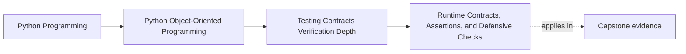

# Runtime Contracts, Assertions, and Defensive Checks

<!-- page-maps:start -->
## Page Maps

<!-- page-maps:end -->

Read the first diagram as a placement map: this page is one concept inside its parent
module, not a detached essay, and the capstone is the pressure test for whether the
idea holds. Read the second diagram as the working rhythm for the page: name the
problem, study the example, identify the boundary, then carry one review question
forward.

## Why this lesson matters

Tests are not the only place a system can defend its design claims.

At runtime, some boundaries still need explicit checks so the system can fail:

- early
- clearly
- near the source of the violation

But runtime checks are easy to misuse. Teams often blur together:

- caller-facing validation
- internal assertions
- defensive parsing
- panic-style last resorts

When these are mixed carelessly, the code stops explaining what kind of failure
happened and who is supposed to respond to it.

## A runtime check should answer one clear failure question

Before adding a check, ask:

- is this guarding against a caller mistake?
- is this guarding against malformed or hostile boundary data?
- is this guarding an internal invariant that should be impossible if surrounding code is correct?

Those are different situations, and they deserve different responses.

## Domain errors and assertions are not interchangeable

Use a domain or application-facing error when the caller can legitimately do something
invalid or unsupported.

Examples:

- acknowledging an already closed incident
- registering an unsupported plugin capability
- submitting malformed input through a public command surface

Use an assertion when the condition represents a programmer error, corrupted control
flow, or a supposedly impossible internal state.

Examples:

- an aggregate claims to be active but lacks the data required for active use
- a transition table reaches a branch the surrounding code should have ruled out
- an internal coordinator observes a state combination that violates a preserved invariant

This distinction matters because the error message communicates who owns the next move.

## Defensive checks belong at data-entry boundaries

Many important checks are not deep in the domain. They sit at the edges where the system
accepts data or commands from the outside.

Examples:

- codec parsing
- repository hydration
- adapter responses
- plugin loading
- file or network payload decoding

The purpose of these checks is not to prove the entire system correct. It is to reject
bad or unsupported input before it contaminates deeper layers.

## Assertions should clarify the invariant, not narrate confusion

An assertion such as:

- `assert x`

usually teaches very little.

A stronger assertion names the preserved truth:

- the incident version must advance monotonically after persistence
- an acknowledged incident must record the acknowledging actor
- a scheduler callback must not run after the coordinator is closed

The message should help a future reader understand what the system thought was
impossible and why the failure is serious.

## Checks still need proof

One common failure mode is decorative runtime safety:

- a vague assertion nobody tests
- a defensive branch nobody exercises
- a malformed-input path nobody reviews

These checks look reassuring but become stale quickly.

If a runtime guard matters to correctness, recovery, or diagnosis, it should have:

- a direct test
- or a documented and intentionally reviewed failure route

Otherwise the check is easy to break without anyone noticing.

## A worked example

Suppose a repository loads incident snapshots from durable storage.

Useful runtime checks might include:

- required fields are present before hydration
- version numbers are non-negative
- persisted state names map to supported lifecycle states

If a snapshot is malformed, that is not a domain disagreement between healthy callers.
It is a boundary integrity problem. The repository should reject it explicitly.

Now suppose the aggregate's `close()` method internally reaches a branch where the
incident is supposedly already closed yet still emits a new closure event. That is more
likely an internal invariant break than a caller error. An assertion or equivalent
invariant failure route is the better fit there.

## Checks should strengthen, not duplicate, the model

Do not add runtime checks everywhere just because a boundary feels risky.

A good check should either:

- stop bad data before it enters the model
- expose an impossible internal condition as soon as it appears

If a check simply repeats clear domain validation without clarifying responsibility, it
may be noise rather than protection.

## Common mistakes

- using assertions for caller mistakes that deserve explicit errors
- using vague errors for invariant breaks that should be treated as internal faults
- adding defensive branches with no test or review path
- placing boundary checks too deep, after corrupted data already spread
- writing assertion messages that do not explain the preserved truth

## Review checklist

| Question | Good sign |
| --- | --- |
| is it clear whether the failure is a caller problem, boundary problem, or invariant break? | yes |
| do important entry boundaries reject malformed input early? | yes |
| do assertion messages name the invariant rather than just the symptom? | yes |
| do the important checks have direct verification? | yes |

## Capstone connection

Use the capstone boundaries to ask:

- where should malformed repository or adapter data be rejected before hydration or dispatch?
- which current assertions are too vague to help diagnose an invariant failure?
- which caller-facing errors are incorrectly being treated as internal crashes, or vice versa?

That review makes runtime checks part of the proof architecture instead of a pile of
scattered guard clauses.

## Exit check

Leave this lesson only when you can do all of these:

- explain the difference between caller-facing validation and internal invariant assertions
- name one capstone boundary that deserves a defensive check
- rewrite one weak assertion message so it states the preserved truth directly
