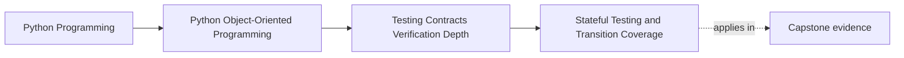

# Stateful Testing and Transition Coverage

<!-- page-maps:start -->
## Page Maps

<!-- page-maps:end -->

Read the first diagram as a placement map: this page is one concept inside its parent
module, not a detached essay, and the capstone is the pressure test for whether the
idea holds. Read the second diagram as the working rhythm for the page: name the
problem, study the example, identify the boundary, then carry one review question
forward.

## Why this lesson matters

Many design bugs do not appear after one call. They appear after a history.

An object can look correct when tested in isolation and still fail when:

- one valid transition is repeated
- two valid transitions happen in the wrong order
- one derived value is recalculated after several mutations
- one event stream accumulates across state changes

Stateful testing exists because object models often carry memory. If your tests ignore
that memory, they miss the exact class of failures that makes aggregates and lifecycles
hard to trust.

## Think in paths, not just methods

When a type has lifecycle meaning, the first testing question should not be:

- which methods exist?

It should be:

- which paths through the state space are allowed?
- which paths are forbidden?
- which invariants must survive every valid path?

This shift matters because lifecycle bugs are usually path bugs, not API-list bugs.

## Build a transition map before writing the suite

For a lifecycle-heavy object, write down:

- starting states
- valid commands from each state
- invalid commands from each state
- required postconditions
- emitted events or side effects per transition

That transition map becomes both a design artifact and a testing plan.

If you cannot write the map clearly, the object may still be underspecified.

## Cover legal and illegal history

Students often cover only the happy path:

1. create
2. activate
3. retire

That is not enough.

You also need the uncomfortable paths:

- activate twice
- retire before activation
- evaluate after closure
- replay a command after the object already emitted the relevant event

Illegal-path tests are often the place where ownership and typestate rules become truly
visible.

## Assert after each meaningful step

One common mistake is to run a full sequence and only inspect the final state.

That can hide the moment things went wrong.

A stronger sequence test usually checks:

- state after each transition
- preserved invariants after each step
- emitted events or counters at the point they should change
- absence of unintended drift after repeated operations

This makes stateful tests more diagnostic. When they fail, they tell you where the
lifecycle stopped being honest.

## A worked example

Imagine a rule aggregate with the lifecycle:

- draft
- active
- retired

Suppose the design claims:

- only drafts may be activated
- active rules may evaluate metrics
- retired rules reject future evaluation
- retirement emits one event and prevents future mutation

An honest stateful test suite would not stop at one `activate` test and one `retire`
test.

It would also verify:

- `activate` from `active` fails
- `retire` from `draft` fails if the model forbids it
- `evaluate` after retirement is blocked
- repeated retirement does not emit duplicate lifecycle events

These are not edge-case decorations. They are proof that the lifecycle boundary is real.

## When hand-written paths stop scaling

Some lifecycles remain small enough for explicit path tests. Others grow too wide.

When the number of histories becomes hard to reason about by hand, that is a sign to
consider:

- table-driven transition cases
- state-machine style tests
- property-based sequence generation

The goal is not novelty. The goal is coverage that still answers design questions
honestly after the path count grows.

## Common mistakes

- testing commands independently even though correctness depends on history
- covering only valid paths and ignoring invalid ordering
- asserting only the final state instead of checking meaningful intermediate points
- letting event duplication or derived-state drift go untested
- stopping at one hand-written path after the lifecycle is already too wide for it

## Review checklist

| Question | Good sign |
| --- | --- |
| is there an explicit transition map behind the tests? | yes |
| do tests cover both legal and forbidden histories? | yes |
| are invariants checked across the sequence, not only at the end? | yes |
| would a repeated or out-of-order command fail visibly? | yes |

## Capstone connection

Use the capstone lifecycles to ask:

- which aggregates depend most on history rather than one-call behavior?
- where could duplicate commands or replayed runtime work create invalid transitions?
- which event-emitting paths need explicit proof that they do not drift across repeated state changes?

This is where Module 03 typestate work and Module 05 retry work become executable proof.

## Exit check

Leave this lesson only when you can do all of these:

- explain why sequence coverage is different from method coverage
- write one transition map for a lifecycle-heavy capstone object
- identify one invariant that must be checked after several steps, not just at the end
