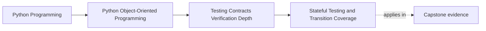

# Stateful Testing and Transition Coverage

<!-- page-maps:start -->
## Page Maps

<!-- page-maps:end -->

This lesson is about proving that correctness survives history, not just one call.

Many object-model failures do not appear after one method invocation.
They appear after:

- a valid transition is repeated
- two valid transitions happen in the wrong order
- one command is replayed after interruption
- one derived value drifts across several mutations

If your tests ignore history, they ignore the exact class of bugs that makes lifecycle
objects hard to trust.

## Keep one lifecycle visible

Use one capstone path:

- `WorkshopEnrollment` confirms attendees until capacity is reached
- a later confirmation must be rejected or waitlisted
- repeated or out-of-order commands must not corrupt the state

That is not a one-call rule.
It is a path rule.

This is why sequence coverage is different from method coverage.

## Think in paths, not API lists

For a lifecycle-heavy object, the first question should not be:

- which methods exist?

It should be:

- which states can the object inhabit?
- which commands are legal from each state?
- which commands must fail?
- which invariants must survive every legal path?

That shift matters because lifecycle bugs are path bugs, not method-list bugs.

## Write a transition map before the suite

Before you write many tests, create a small transition map:

- starting states
- legal commands from each state
- illegal commands from each state
- postconditions after each legal transition
- events or counters that should change along the way

If the map is hard to write, the lifecycle is probably still underspecified.

The transition map is not extra paperwork.
It is the design artifact your tests are meant to execute.

## Cover both legal and illegal histories

Students often stop after the happy path:

1. create
2. activate
3. retire

That is not enough.

You also need histories such as:

- confirm twice after the last seat
- retry a command after the state already advanced
- evaluate after closure
- repeat a lifecycle command that should be idempotent or rejected

Illegal histories are often where ownership rules become visible.

## Assert after meaningful steps, not only at the end

One common weakness in stateful tests is:

- run a long sequence
- inspect only the final state

That hides the moment things went wrong.

A stronger stateful test usually checks:

- state after each important transition
- preserved invariants after each step
- emitted events or counters at the point they should change
- absence of unintended drift after repeated operations

That makes failures more diagnostic.

## Worked capstone path

Suppose `WorkshopEnrollment` claims:

- confirmation succeeds until capacity is full
- later confirmation attempts do not silently overbook
- releasing or cancelling a seat reopens capacity honestly

A useful stateful proof sequence could:

1. create an enrollment with a visible seat limit
2. confirm attendees up to the final available seat
3. attempt one more confirmation and assert rejection or waitlisting
4. release capacity through the allowed path
5. confirm that a later legitimate transition now succeeds again
6. assert no duplicate lifecycle event or corrupted count drift appeared

This is much stronger than a few isolated command tests because it proves the history.

## Repeated commands are not edge cases

In real systems, retries and repeated commands happen:

- users click again
- jobs replay
- queues redeliver
- operators rerun a command path

That means repeated-command coverage is not optional polish.
It is core lifecycle proof, especially for objects that emit events or guard capacity.

If a command should be idempotent, prove it.
If it should be rejected, prove that too.

## When hand-written paths stop scaling

Some lifecycles are small enough for explicit sequences.
Others become too wide.

When paths multiply, consider:

- table-driven transition cases
- generated sequences
- state-machine style tests

The goal is not to sound advanced.
The goal is to keep coverage honest after the history space outgrows your ability to
enumerate it comfortably by hand.

## Build one lifecycle packet

For each lifecycle-heavy object, keep a short packet with:

- state names
- legal commands
- illegal commands
- invariants that must survive every path
- repeated-command behavior

That packet helps another maintainer understand what the stateful tests are actually
proving.

## Common failure modes

- testing commands independently even though correctness depends on history
- covering only valid paths and ignoring illegal ordering
- asserting only the final state instead of meaningful intermediate points
- leaving repeated commands, duplicate events, or derived-state drift under-proved
- continuing with hand-written paths after the lifecycle has already outgrown them

## Transition review card

Use this short card when reviewing one lifecycle suite:

| Question | What you want to see |
| --- | --- |
| is there an explicit transition map behind the tests? | yes |
| do tests cover both legal and illegal histories? | yes |
| are invariants checked across the sequence, not only at the end? | yes |
| would a repeated or out-of-order command fail visibly? | yes |

## Capstone connection

Use this page to ask:

- which capstone objects depend most on history rather than one-call behavior
- where duplicate commands or replayed work could create invalid transitions
- which event-emitting paths need proof that they do not drift across repeated state
  changes

That is where lifecycle design becomes executable evidence.

## Exit check

Leave this lesson only when you can do all of these:

- explain why sequence coverage is different from method coverage
- write one transition map for a lifecycle-heavy capstone object
- identify one invariant that must be checked after several steps, not just at the end
