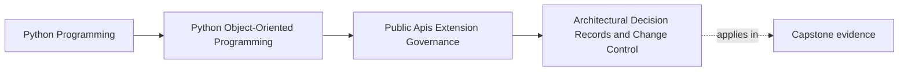
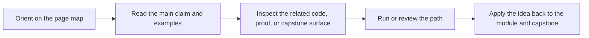

# Architectural Decision Records and Change Control

<!-- page-maps:start -->
## Page Maps

<!-- page-maps:end -->

This lesson is about keeping governance memory alive after the current conversation is
gone.

Public-surface and extension decisions age badly when their reasoning lives only in:

- one maintainer's memory
- old chat logs
- one merged commit nobody wants to reread

Without durable records, teams later ask:

- why is this facade public?
- why is this seam narrow?
- why does this import exception exist?
- why is the compatibility promise smaller than expected?

If the answers are not durable, later review becomes guesswork instead of stewardship.

## Keep one decision visible

Use one capstone decision:

- the package exposes one public facade and one `IncidentSink` capability

Now ask:

If a maintainer reviews this package on Monday, July 27, 2026 or six months later, what
would they need to know in order to judge whether a proposed widening is a real new need
or just convenience?

That is the purpose of an architectural decision record.

## Good records preserve reasoning, not only outcomes

A useful record captures:

- what was decided
- what alternatives were considered
- why the chosen option won
- what future conditions would justify reopening the decision

That is more useful than a bare conclusion because future maintainers need the tradeoffs,
not only the label.

Without tradeoffs, "public" and "private" quickly turn into folklore words.

## Not every code choice needs a record

The threshold is lower when the decision affects:

- public surface area
- compatibility commitments
- extension mechanisms
- import-boundary exceptions
- deprecation or removal policy

These are the decisions most likely to outlive:

- the current file layout
- the current team memory
- the current implementation details

That is why they deserve durable reasoning.

## Change control should match seam risk

One useful discipline is to scale review ceremony with public risk.

Higher-impact changes often deserve:

- a short decision record
- explicit compatibility review
- linked tests or executable examples
- a named deprecation or migration plan when relevant

Lower-impact internal changes may need only ordinary code review.

The point is not to make everything heavy.
The point is to stop high-impact public changes from being treated like local cleanup.

## Records should point to living evidence

A decision record is strongest when it links to:

- the facade or module it governs
- the compatibility suite or proof route that defends it
- the docs or examples that teach the supported path
- the import or extension rule it relies on

That way a reviewer can move from rationale to evidence without reconstructing the whole
history from scratch.

The record explains why.
The linked proof shows the seam still works.

## Worked capstone record

A useful record for `service_monitoring` could say:

- the facade exists so consumers do not depend on deep runtime imports
- `IncidentSink` is public because alternate sinks are a real supported use case
- direct plugin access to aggregates and repositories was rejected because it would steal
  authority across the ownership boundary
- the decision should be revisited only if a future use case cannot be served through
  the narrow capability seam

That record helps later maintainers judge whether a proposed expansion is:

- a genuine new need
- or a shortcut that breaks the existing boundary story

## Records are not a substitute for docs or tests

Decision records explain the rationale.
They do not prove:

- the seam still works
- examples still teach the right path
- compatibility promises are still honored

That is why strong change control links records to living evidence instead of treating
the record itself as proof.

## Build a decision packet

For each high-impact public or extension decision, keep a short packet:

- decision title
- supported surface or seam
- alternatives rejected
- main reason the chosen option won
- future condition that would reopen it
- linked docs, examples, or proof routes

That packet makes governance durable enough to survive team turnover and refactors.

## Common failure modes

- relying on oral tradition for high-impact public decisions
- writing records that state the conclusion but omit the rejected alternatives
- giving major public-surface changes the same review treatment as local refactors
- storing records where maintainers never see them during seam changes
- treating records as archive paperwork instead of live governance memory

## Decision review card

Use this short card when reviewing a public or extension change:

| Question | What you want to see |
| --- | --- |
| is the decision important enough to outlive current memory? | yes |
| can future reviewers see what alternatives were rejected and why? | yes |
| does change control scale with the compatibility risk of the seam? | yes |
| are records linked to code, docs, and proof surfaces? | yes |

## Capstone connection

Use this page to ask:

- which current public or plugin-facing decision would be hardest to justify a year from
  now without a record
- which proposed change should require explicit compatibility review instead of ordinary
  local review
- where decision records should live so maintainers will actually use them during seam
  changes

That is how governance keeps its memory while the codebase keeps changing.

## Exit check

Leave this lesson only when you can do all of these:

- explain why public-surface reasoning must be durable, not oral
- identify one capstone seam that deserves a decision record
- explain what makes change control heavier for one API change than for another
