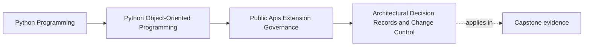

# Architectural Decision Records and Change Control

<!-- page-maps:start -->
## Page Maps

<!-- page-maps:end -->

Read the first diagram as a placement map: this page is one concept inside its parent
module, not a detached essay, and the capstone is the pressure test for whether the
idea holds. Read the second diagram as the working rhythm for the page: name the
problem, study the example, identify the boundary, then carry one review question
forward.

## Why this lesson matters

Public API and extension decisions age badly when their reasoning lives only in memory.

Without durable records, teams later ask:

- why is this facade public?
- why is this plugin seam allowed but that one rejected?
- why is this compatibility promise so narrow?
- why does this import exception exist?

If the answers live only in old chat threads or the memory of one maintainer, governance
becomes fragile. The next change is reviewed against guesswork instead of intent.

## Decision records preserve the reasoning, not just the outcome

An architectural decision record is useful when it captures:

- what was decided
- what alternatives were considered
- why the chosen option won
- what future conditions would reopen the decision

That is more valuable than a bare conclusion because future maintainers need the
tradeoffs, not only the final label.

## API and extension seams deserve records when the governance cost is real

Not every small code decision needs a record.

But the threshold is lower when a change affects:

- public surface area
- compatibility commitments
- extension mechanisms
- import-boundary exceptions
- deprecation and removal policy

These are the decisions most likely to outlive the current file layout or the current
team memory.

## Change control should match the risk of the seam

One useful discipline is to match review ceremony to impact.

Higher-impact surfaces often deserve:

- a written decision record
- explicit compatibility review
- linked tests or examples
- a named migration or deprecation plan

Lower-impact internal changes may only need ordinary code review.

The point is not to make everything heavy. The point is to stop high-impact public
changes from being treated like local cleanup.

## Records should connect to code and evidence

A decision record becomes much more useful when it points to:

- the relevant public module or facade
- the supporting compatibility suite
- the documentation or example that teaches the seam
- the import-boundary or extension-safety rule it relies on

That way, a reviewer on July 27, 2026 or later can move from rationale to evidence
without reconstructing the whole history from scratch.

## A worked example

Suppose the capstone decides to expose one public facade and one plugin-facing sink
capability.

A useful decision record might say:

- the public facade exists so consumers avoid deep imports into internal runtime modules
- the sink capability is supported because customization pressure is real there
- direct plugin access to aggregates was rejected because it would break ownership boundaries
- the decision should be revisited only if a later use case cannot be served through the narrow capability seam

That record helps later reviewers judge whether a proposed expansion is a genuine new
need or just a convenience shortcut.

## Records are not a replacement for tests or docs

Decision records explain why a seam exists.

They do not by themselves prove:

- the seam still works
- the docs still teach the right path
- the compatibility promise is still honored

That is why strong change control links records to living evidence rather than treating
the record as the evidence.

## Common mistakes

- relying on oral tradition for high-impact API and extension decisions
- writing records that state conclusions but omit alternatives and tradeoffs
- giving major public-surface changes the same review treatment as local refactors
- storing records where maintainers will never see them during review
- treating records as archival paperwork instead of live governance memory

## Review checklist

| Question | Good sign |
| --- | --- |
| are high-impact public and extension decisions recorded with rationale? | yes |
| can future reviewers see what alternatives were rejected and why? | yes |
| does change control scale with the compatibility risk of the change? | yes |
| are records linked to code, docs, or executable proof surfaces? | yes |

## Capstone connection

Use the capstone to ask:

- which current public or plugin-facing decision would be hardest to justify a year from now without a record?
- which proposed change should require explicit compatibility review instead of ordinary local review?
- where should decision records live so maintainers will actually use them during seam changes?

This is how governance keeps its memory when people and code structure both change.

## Exit check

Leave this lesson only when you can do all of these:

- explain why public-surface reasoning must be durable, not oral
- identify one capstone seam that deserves a decision record
- explain what makes change control heavier for one API change than for another
