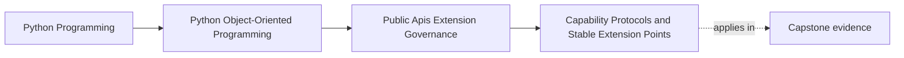

# Capability Protocols and Stable Extension Points

<!-- page-maps:start -->
## Page Maps

<!-- page-maps:end -->

Read the first diagram as a placement map: this page is one concept inside its parent
module, not a detached essay, and the capstone is the pressure test for whether the
idea holds. Read the second diagram as the working rhythm for the page: name the
problem, study the example, identify the boundary, then carry one review question
forward.

## Why this lesson matters

An extension point becomes unstable the moment it requires consumers to know too much
about the host's internals.

Students often create "extensible" seams that really mean:

- import this internal class
- subclass this concrete type
- reach into this stateful object
- mutate this hidden registry

That is not stable extension. It is privileged intimacy disguised as flexibility.

Capability protocols exist so the host can say:

- here is the exact behavior we need from an extension
- here is the narrow information we will provide
- here is what must stay stable for outside implementers

## A capability protocol should describe work, not structure

A strong extension seam is defined by what the extension can do.

Examples:

- evaluate a candidate rule
- provide metric samples
- publish a normalized incident record
- transform a stable result object

These are capability questions.

A weak seam is defined by what internal structure the extension is allowed to touch.

Examples:

- subclass this aggregate directly
- edit these internal collections
- reach into this repository cache

Those are ownership leaks, not durable contracts.

## Narrow seams are easier to version

Once a protocol is public, every new required method, argument contract, or result
meaning becomes part of compatibility management.

That is why extension seams should be:

- as small as they can honestly be
- explicit about input and output meaning
- decoupled from internal object wiring

The smaller the seam, the easier it is to evolve the host without destabilizing
extensions.

## Capability beats inheritance most of the time

Students often reach for inheritance because it feels object-oriented.

But for external extension, inheritance creates several risks:

- protected internals become accidental public dependencies
- lifecycle assumptions leak into third-party code
- refactoring base classes becomes breaking change territory

A capability protocol or abstract interface is usually safer because it asks for one
replaceable role without exposing how the host composes the rest of the system.

## Composition roots should own the wiring

An extension author should implement a capability.

The host's composition root should decide:

- when that capability is instantiated
- how it is configured
- which other services surround it
- what fallback or failure policy applies

If the extension has to wire itself deep into the object graph, the seam is too intimate
to govern cleanly.

## A worked example

Suppose the capstone wants to let users provide alternate metric sources.

A weak extension design might tell them to subclass an internal runtime coordinator and
override several helper methods.

A stronger design would define a narrow protocol such as:

- request samples for a stable target description
- return normalized sample data or a documented failure

Now the extension knows the capability it must supply, but it does not need access to:

- incident aggregates
- scheduling internals
- repository lifecycles

That keeps ownership where it belongs.

## Stable extension points still need policy

Even a good protocol needs governance around:

- versioning
- documented guarantees
- compatibility testing
- deprecation policy

The protocol is only the shape of the seam. Governance is what keeps the seam usable
over time.

## Common mistakes

- calling a seam "extensible" when it really requires deep internal imports
- exposing large interfaces because "future plugins might need them"
- using inheritance where a narrow capability contract would be clearer
- letting extensions mutate host state directly
- changing public capability requirements as though they were local refactors

## Review checklist

| Question | Good sign |
| --- | --- |
| does the seam describe a small external capability rather than internal structure? | yes |
| can the host evolve internally without forcing extension rewrites? | yes |
| does the extension avoid direct mutation of host internals? | yes |
| is the wiring owned by the composition root rather than the extension itself? | yes |

## Capstone connection

Use the capstone to ask:

- which customization needs can be expressed as narrow roles instead of deep subclassing?
- where are current extension ideas reaching past the intended ownership boundary?
- which stable inputs and outputs would make one capstone seam externally implementable without leaking internals?

This is the point where "extensibility" becomes a designed contract instead of wishful
public exposure.

## Exit check

Leave this lesson only when you can do all of these:

- explain why a capability protocol is safer than privileged internal access
- identify one capstone customization point that should become a narrow protocol
- identify one inheritance-based extension idea that should be replaced by a smaller capability seam
