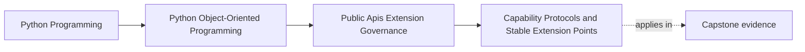

# Capability Protocols and Stable Extension Points

<!-- page-maps:start -->
## Page Maps

<!-- page-maps:end -->

This lesson is about making extension safe enough to support.

A stable extension point should let outside code do one bounded job without learning or
owning the host's internals.

That is what a capability protocol is for.
It answers:

- what work may the extension perform?
- what input will the host provide?
- what meaning must stay stable for outside implementers?

If the seam instead requires privileged intimacy, it is not yet stable enough to
publish.

## Keep one extension need visible

Use one capstone need:

- publish an incident through an alternate `IncidentSink`

The extension should be able to do one thing:

- accept already-shaped incident information and report a bounded outcome

It should not need to:

- inspect aggregate internals
- mutate repository state
- wire itself into runtime control flow

That contrast is the whole lesson.

## Capability protocols describe work, not host structure

A good extension seam is written around a role.

Examples:

- publish this normalized incident
- transform this stable result shape
- provide these metric samples

A weak extension seam is written around internal ownership leaks:

- subclass this concrete coordinator
- override these helper methods
- mutate this internal cache
- access this hidden registry

The first set describes capability.
The second set describes privileged access.

## Stable seams are usually narrow seams

Every public method, argument meaning, and result guarantee becomes governance work.

That is why a good capability protocol should be:

- small enough to explain in one sitting
- explicit about input and output meaning
- decoupled from internal object wiring
- narrow enough that host internals can still move

Small seams are easier to document, version, test, and deprecate honestly.

## Capability usually beats inheritance for outsiders

Inheritance feels natural in object-oriented code, but it is often the wrong default for
external extension.

Inheritance tends to leak:

- lifecycle assumptions
- protected internals
- constructor details
- method-overriding requirements that were never meant to be public

A capability protocol is usually safer because it asks for one replaceable role without
publishing the host's composition.

That keeps the public promise focused on work, not on internal hierarchy.

## The composition root should own the wiring

An extension author should implement the capability.
The host should decide:

- when the capability is instantiated
- how configuration is validated
- what fallback or disablement policy applies
- what surrounding services and retries are used

If the extension has to wire itself deep into the object graph, the seam is too intimate
to govern well.

The host owns orchestration.
The extension owns the bounded role.

## Example: `IncidentSink` as a stable seam

An honest `IncidentSink` seam could promise:

- the host will provide a normalized incident payload
- the sink may return a bounded success or failure meaning
- the host remains responsible for retry, disablement, and workflow truth

What stays outside the seam:

- aggregate mutation
- repository access
- private scheduler control
- host-owned policy decisions

This is exactly what makes the seam stable:

- the extension gets useful work
- the host keeps authority

## Stable extension points still need policy

The protocol shape is only one part of the story.

A real stable extension point also needs:

- documentation that teaches the intended role
- compatibility proof or review routes
- version and deprecation expectations
- registration or construction rules if several implementations will be supported

Without these, the seam may be elegant but still operationally weak.

## Honest capability gaps should change the design

If one proposed extension needs:

- repository access
- scheduling control
- deep lifecycle awareness

then one of two things is probably true:

- the seam is still too small for the real use case
- the use case should not be externalized yet

The wrong move is to keep widening a public protocol until it leaks half the host.

Stable extension points are strong because they resist that pressure.

## Common failure modes

- calling a seam stable even though it requires deep internal imports
- exposing large interfaces because future plugins "might need them"
- using inheritance where a narrow role contract would be clearer
- letting extensions mutate host state directly
- changing public capability requirements as though they were local refactors

## Capability review card

Use this card when reviewing an extension seam:

| Question | What you want to see |
| --- | --- |
| does the seam describe a bounded external role? | yes |
| can the host evolve internally without forcing extension rewrites? | yes |
| does the extension avoid direct mutation of host internals? | yes |
| is the wiring owned by the composition root rather than the extension? | yes |

## Capstone connection

Use this page to ask:

- which customization need is best expressed as one narrow capability
- where a current extension idea is still reaching past the ownership boundary
- which stable inputs and outcomes would make `IncidentSink` externally implementable
  without leaking internals

That is where extensibility becomes a governed contract instead of wishful public
exposure.

## Exit check

Leave this lesson only when you can do all of these:

- explain why a capability protocol is safer than privileged internal access
- identify one capstone customization point that should become a narrow protocol
- identify one inheritance-based idea that should be replaced by a smaller capability
  seam
