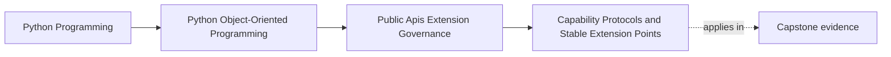

# Capability Protocols and Stable Extension Points

<!-- page-maps:start -->
## Page Maps

<!-- page-maps:end -->

This lesson is about making extension safe enough to support.

A stable extension point should let outside code do one bounded job without learning or
owning the host's internals.

That is what a capability protocol is for. It answers:

- what work may the extension perform?
- what shaped input will the host provide?
- what bounded outcome may the extension report?
- what meaning must remain stable for outside implementers?

If the seam instead requires privileged intimacy with the host, it is not yet stable
enough to publish.

## Keep one extension need visible

Use one capstone need:

- publish an incident through an alternate `IncidentSink`

The extension should be able to do one thing:

- accept already-shaped incident information and report a bounded result

It should not need to:

- inspect aggregate internals
- mutate repository state
- control runtime scheduling
- rewire host-owned policy decisions

That contrast is the whole lesson. A stable extension point gives useful work without
leaking ownership.

## Capability protocols describe roles, not host structure

A good extension seam is written around a role:

- publish this normalized incident
- transform this stable result shape
- provide these metric samples

A weak seam is written around internal structure:

- subclass this concrete coordinator
- override these helper methods
- mutate this cache
- access this registry and lifetime manager

The first group describes a capability.
The second group describes privileged access.

This distinction matters because only the first group is usually defensible as a public
promise.

## Stable seams are usually narrow seams

Every public method, parameter meaning, and result guarantee creates governance work.

That is why a stable capability protocol should be:

- small enough to explain in one sitting
- explicit about input and output meaning
- decoupled from internal object wiring
- narrow enough that host internals can still move

Small seams are easier to:

- document
- version
- test
- deprecate honestly

Large seams often start as convenience and end as maintenance debt.

## Capability usually beats inheritance for outsiders

Inheritance often feels natural in object-oriented code, but it is frequently the wrong
default for external extension.

Inheritance tends to leak:

- lifecycle assumptions
- constructor details
- protected internals
- method-overriding requirements that were never meant to be public

A capability protocol is usually safer because it asks for one replaceable role without
publishing the host's composition or hierarchy.

This keeps the public promise focused on work instead of exposing half the host design.

## The composition root should own the wiring

An extension author should implement the capability.
The host should decide:

- when the capability is instantiated
- how configuration is validated
- what fallback or disablement policy applies
- what retries and surrounding services exist

If the extension has to wire itself deep into the object graph, the seam is already too
intimate to govern well.

The rule is simple:

- the host owns orchestration
- the extension owns the bounded role

That split is what keeps authority from drifting outward.

## Worked capstone seam

An honest `IncidentSink` seam could promise:

- the host provides a normalized incident payload
- the sink may return a bounded success or failure meaning
- the host remains responsible for retries, disablement, and workflow truth

What stays outside the seam:

- aggregate mutation
- repository access
- scheduler control
- host-owned policy choices

Why this seam is stable:

- outsiders get useful work
- the host keeps authority
- the seam can evolve more slowly than the private orchestration beneath it

## Capability gaps should change the design, not widen the seam blindly

If one proposed extension needs:

- repository access
- scheduling control
- deep lifecycle awareness
- private retry state

then one of two things is probably true:

- the seam is too small for the real use case
- the use case should not be externalized yet

The wrong move is to keep widening the public protocol until it leaks half the host.

Stable extension points are strong because they resist that pressure and make the host
ask harder design questions first.

## Build a capability packet

For each extension seam, keep a short packet with:

- supported use case
- bounded role description
- stable input shape
- bounded result meaning
- what authority stays with the host
- what proof route keeps the seam honest

This packet helps another maintainer review the seam without rediscovering the same
boundary reasoning from scratch.

## Common failure modes

- calling a seam stable even though it requires deep internal imports
- exposing large interfaces because future plugins "might need them"
- using inheritance when a narrow role contract would be clearer
- letting extensions mutate host state directly
- changing public capability requirements as though they were local refactors

## Capability review card

Use this card when reviewing an extension seam:

| Question | What a strong answer sounds like |
| --- | --- |
| what bounded role does the seam publish? | "publish one normalized incident" |
| what input and result meanings are stable? | "shaped incident payload in, bounded outcome out" |
| what authority stays with the host? | "truth, retries, disablement, orchestration" |
| could the host evolve internally without forcing extension rewrites? | "yes, because the seam does not expose internals" |
| what proof keeps the seam honest? | "compatibility packet and facade example" |

## Capstone connection

Use this page to decide:

- which customization need is best expressed as one narrow capability
- where a current extension idea is still reaching past the ownership boundary
- which stable inputs and outcomes would let `IncidentSink` stay implementable without
  leaking internals
- which proposed extension should remain internal because it demands too much authority

That is where extensibility becomes a governed contract instead of wishful public
exposure.

## Exit check

Leave this lesson only when you can do all of these:

- explain why a capability protocol is safer than privileged internal access
- identify one capstone customization point that should become a narrow protocol
- identify one extension idea that should remain internal until the host design changes
