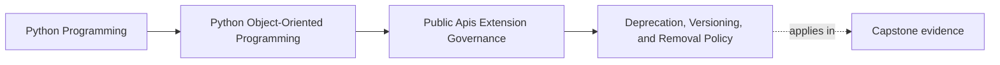

# Deprecation, Versioning, and Removal Policy

<!-- page-maps:start -->
## Page Maps

<!-- page-maps:end -->

Read the first diagram as a placement map: this page is one concept inside its parent
module, not a detached essay, and the capstone is the pressure test for whether the
idea holds. Read the second diagram as the working rhythm for the page: name the
problem, study the example, identify the boundary, then carry one review question
forward.

## Why this lesson matters

Once a surface is public, changing it stops being a local code decision.

Consumers build habits around:

- import paths
- parameter shapes
- return meaning
- error behavior
- ordering guarantees

If you remove or redefine those things without a clear policy, users learn that "public"
really means "supported until the next refactor." That destroys trust faster than a
smaller API ever would.

Deprecation policy exists so public change becomes predictable instead of surprising.

## Public APIs have lifecycles just like domain objects

A public surface can move through a lifecycle such as:

- introduced
- supported
- deprecated
- removed

That lifecycle should be explicit enough that another engineer can answer:

- what changed?
- what replaces it?
- when will the old surface stop working?

Without those answers, users are left to infer policy from commit history and breakage.

## A deprecation warning is not the policy

Warnings are only one delivery mechanism.

The real policy must answer:

- which version first marks the surface deprecated?
- what migration path is supported?
- after what removal window may the old surface disappear?
- what counts as a breaking behavior change even if the signature stays the same?

That is what makes deprecation teachable and governable instead of merely noisy.

## Behavioral compatibility matters as much as signatures

Students often think of breakage only in terms of renamed functions or missing
parameters.

But public behavior can also break when you change:

- ordering guarantees
- default values
- error types
- side-effect timing
- accepted input semantics

These are contract changes even when the function name is unchanged.

If the system treats them as "internal improvements," consumers experience them as
unannounced breakage.

## Migration guidance should be concrete

A useful deprecation message or note should help the user move.

That means including:

- the replacement surface
- the reason for the change when it affects usage
- the approximate removal horizon
- any changed semantics the consumer must account for

"Use the new API instead" is not real migration guidance if the new API behaves
differently in ways the caller must understand.

## Removal should be a coordinated event

Before removing a deprecated surface, review all of the durable promises that mention it:

- documentation
- executable examples
- compatibility suites
- approval artifacts
- release or migration notes

Removal is not complete when the code disappears. It is complete when the old promise is
no longer being taught, tested, or implied anywhere.

## A worked example

Suppose the capstone exposes a public helper that returns incident summaries in one
shape, and a better facade now exists.

An honest deprecation plan would define:

1. the currently supported replacement facade
2. the release in which the old helper becomes deprecated
3. the exact semantic differences the caller must adjust to
4. the version or time window after which removal may occur
5. the example and compatibility updates that must happen before removal

What it should not do is:

- leave the old surface undocumented but still importable
- emit a warning without a migration route
- remove it later and call the resulting breakage "cleanup"

## Versioning only helps when the meaning is real

Version numbers are useful only if they map to a believable policy.

For example, if you say a release is backward compatible, then public behavior should
not break quietly inside it.

That means versioning discipline must be backed by:

- documented compatibility rules
- review expectations
- tests that protect important public behavior

Without that, the version label is only ceremony.

## Common mistakes

- treating warnings as a substitute for an actual deprecation policy
- ignoring behavioral breakage because the function name stayed the same
- removing deprecated surfaces before docs and examples are updated
- leaving removal timing vague enough that consumers cannot plan
- claiming compatibility without executable checks on the public promise

## Review checklist

| Question | Good sign |
| --- | --- |
| can a user tell what changed, what replaces it, and when removal may happen? | yes |
| are behavioral changes reviewed as possible breaking changes? | yes |
| do docs, examples, and tests align with the deprecation plan? | yes |
| does versioning policy match actual compatibility behavior? | yes |

## Capstone connection

Use the capstone to ask:

- which surface would be hardest to replace today because it lacks a real migration path?
- where might behavior drift count as breakage even if imports remain stable?
- which examples and tests would have to change before one public seam could honestly be removed?

This is where API lifecycle management stops being release-note wording and becomes part
of the design contract.

## Exit check

Leave this lesson only when you can do all of these:

- explain why a warning is not the same thing as a deprecation policy
- identify one behavioral change that would count as breaking in the capstone
- write the three minimum facts a consumer needs in a real migration notice
