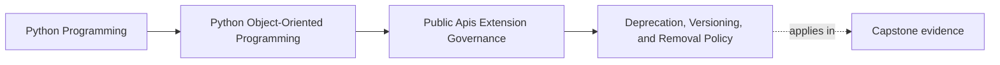

# Deprecation, Versioning, and Removal Policy

<!-- page-maps:start -->
## Page Maps

<!-- page-maps:end -->

This lesson is about making public change predictable.

Once a surface is public, changing it stops being a local refactor decision.
Consumers build habits around:

- import paths
- parameter meanings
- default behavior
- ordering guarantees
- failure shapes

If those things can disappear or drift without a policy, "public" becomes another word
for "until the next cleanup pass."

That destroys trust faster than a smaller API ever would.

## Keep one public surface visible

Use the capstone package facade and sink seam:

- `service_monitoring.run_monitoring(...)`
- `IncidentSink`

Now ask:

If one of these changed tomorrow, what would another maintainer or consumer need to know
before they could adapt safely?

The answer should not rely on reading commit history or guessing the maintainer's mood.

## A warning is not a deprecation policy

A warning is only one signal.

The real policy must answer:

- what changed
- what replaces it
- when the old path became deprecated
- how long the supported overlap lasts
- what behavior changed even if the name did not
- when removal becomes honest

Without those answers, deprecation is noise instead of guidance.

## Public surfaces have lifecycles

A public surface usually moves through:

- introduced
- supported
- deprecated
- removed

That lifecycle should be explicit enough that another maintainer can answer:

- which state is this surface in right now?
- what migration path exists?
- what future date or version boundary makes removal acceptable?

If those answers are vague, users are left to infer policy from breakage.

## Behavioral compatibility matters as much as signatures

Students often notice breakage only when a function disappears.

But public behavior also breaks when you change:

- default values
- ordering guarantees
- failure categories
- retry timing
- accepted input meaning

These are compatibility issues even when the function name stays the same.

If a maintainer calls such changes "internal improvement," users still experience them
as breakage.

## Migration guidance must be concrete

A real migration note should tell the user:

- what to call or import instead
- what semantic difference to expect
- what overlap window still exists
- what proof or example confirms the new path

"Use the new API instead" is not enough if the new surface behaves differently in ways
the caller must understand.

Migration guidance is part of the public contract, not release-note decoration.

## Removal is not complete until the old promise disappears everywhere

Before removing a surface, review all durable places that still teach or defend it:

- quickstarts
- reference docs
- executable examples
- compatibility suites
- approval artifacts
- migration notes

Removal is not done when the code is deleted.
It is done when the old promise is no longer being taught, tested, or implied.

## Worked capstone example

Suppose the package currently teaches:

- `run_monitoring(...)`

and later wants to expose:

- `run(...)`

An honest deprecation plan would include:

1. the replacement entrypoint
2. the first release or change note that marks `run_monitoring(...)` deprecated
3. the overlap window during which both are supported
4. any semantic differences in result or failure behavior
5. the quickstart, reference, and executable example updates required before removal

What it should not do:

- leave the old path working but undocumented and hope consumers move
- emit a warning without a migration route
- remove the old name later and call the resulting breakage "cleanup"

## Versioning is useful only when the meaning is real

Version labels matter only if they map to believable policy.

If a release is called backward compatible, then:

- public behavior should not drift quietly inside it
- migration notes should exist for real supported change
- examples and compatibility routes should still align with the promise

Without those things, the version number is ceremony rather than stewardship.

## Build a simple deprecation packet

For each public change, keep a short packet with:

- old surface
- replacement surface
- semantic difference
- first deprecated release or date
- earliest honest removal point
- doc and proof updates required

That packet makes the policy understandable to both maintainers and consumers.

It is especially valuable on Monday, July 27, 2026, because it anchors the present
state instead of leaving everyone to guess which promise is current.

## Common failure modes

- treating warnings as if they were the whole deprecation policy
- ignoring behavioral breakage because the signature still exists
- removing surfaces before docs and examples are updated
- leaving removal timing too vague for consumers to plan around
- claiming compatibility without a proof route for the public promise

## Deprecation review card

Use this short card when reviewing a public change:

| Question | What you want to see |
| --- | --- |
| can a user tell what changed, what replaces it, and when removal may happen? | yes |
| are behavioral changes reviewed as possible breaking changes? | yes |
| do docs, examples, and tests align with the migration story? | yes |
| does versioning language match actual compatibility behavior? | yes |

## Capstone connection

Use this page to ask:

- which capstone surface would be hardest to retire today because it lacks a migration
  story
- where behavior drift would count as breakage even if imports remained stable
- which examples and compatibility routes must change before one supported seam could be
  honestly removed

That is where API lifecycle management becomes part of the design contract.

## Exit check

Leave this lesson only when you can do all of these:

- explain why a warning is not the same thing as a deprecation policy
- identify one behavioral change that would count as breaking in the capstone
- write the three minimum facts a consumer needs in a real migration notice
