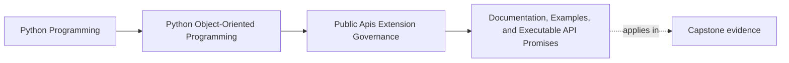

# Documentation, Examples, and Executable API Promises

<!-- page-maps:start -->
## Page Maps

<!-- page-maps:end -->

This lesson is about a simple but costly truth:

- for many users, the documentation is the API

They learn what is supported from:

- the first quickstart they copy
- the first import path they see
- the first configuration example they trust
- the first migration note they need under pressure

If those surfaces teach the wrong path, the wrong path is effectively public whether the
maintainers intended that or not.

## Keep one public story visible

Use the capstone package:

`service_monitoring`

Assume the supported story is:

- import the package facade
- configure one supported sink seam if needed
- run the workflow
- handle the documented outcome surface

Now ask:

- would a new learner who reads the docs today be taught exactly that story, or would
  they still learn internal shortcuts?

That is the real documentation-governance test.

## Examples are support promises in executable clothing

Examples do more than explain syntax. They silently answer:

- which import path is sanctioned
- which arguments matter
- which failures a caller should expect
- which extension seam is actually intended

That means a deep internal import in a quickstart is not a harmless shortcut. It is a
public promise with no governance around it.

This is why example review belongs in API governance, not only in copy editing.

## Different docs have different jobs

Keep the roles explicit:

- tutorials teach first use and narrative flow
- how-to guides solve one focused task
- reference pages define stable inputs, outputs, and guarantees
- explanation pages teach tradeoffs and reasoning

When those roles blur, readers cannot tell:

- what is the supported contract
- what is only narrative scaffolding
- what is safe to depend on long-term

Public-doc discipline starts with role discipline.

## The first copied example matters most

If the first example a learner copies imports:

- runtime workers
- repository wiring
- adapter helpers

then those internals have already become the accidental API.

That is why the highest-value examples should use:

- the supported facade
- the supported extension seam
- realistic configuration
- realistic failure handling

Examples are part of governance, not garnish.

## Important examples should be executable

Important public examples should fail when the supported surface drifts.

That may mean:

- a smoke-tested quickstart
- checked snippets
- a sample command path exercised in CI
- a compatibility packet that mirrors the docs

The goal is not to execute every paragraph. The goal is to keep the most important public
stories from fossilizing.

If the example is valuable enough to teach the API, it is valuable enough to protect.

## Failure-path docs belong in the contract too

Weak API documentation teaches only the success path.

A stronger public story also documents:

- what configuration errors look like
- what unsupported inputs are rejected early
- what deprecation or migration path callers should follow
- what extension limits the host enforces

Otherwise the docs teach the system only in its easiest mood and leave users to discover
the real boundary behavior by failure.

## Worked capstone document set

An honest public document set for this package could include:

- one quickstart using only `service_monitoring` facade imports
- one short extension example showing `IncidentSink` in the supported role
- one reference page defining stable inputs, outcomes, and failure meanings
- one migration note when public names or shapes change
- one executable route that keeps the main quickstart honest

What it should not include:

- deep runtime imports because they are shorter
- examples that bypass supported construction
- stale snippets teaching a deprecated path as though it were current on Monday, July 27,
  2026

## Docs and compatibility must move together

When a public surface changes, update all of these together:

- reference page
- quickstart
- executable examples
- migration guidance
- compatibility or review route

If code changes first and docs catch up later, users receive conflicting promises in the
meantime.

That is a governance failure, not only a documentation failure.

## Build a documentation packet

For each public story, keep a short packet with:

- target user task
- first example or quickstart path
- reference page that defines the stable contract
- failure or migration note that belongs beside it
- executable or review route that keeps the story aligned with code

This packet gives maintainers a concrete way to audit whether the docs are still
teaching the right public surface.

## Common failure modes

- showing deep internal imports in public examples
- mixing tutorial narrative and stable contract language in one unclear page
- leaving the highest-value examples unexecuted so they drift silently
- documenting only success paths and ignoring real failure behavior
- treating docs changes as lower priority than public API changes

## Documentation review card

Use this card when reviewing public docs:

| Question | What a strong answer sounds like |
| --- | --- |
| what supported task does this example teach first? | "run monitoring through the public facade" |
| does it avoid deep internal imports? | "yes, only supported public paths are shown" |
| what failure or migration behavior is documented nearby? | "configuration rejection and deprecation guidance" |
| what keeps the example honest? | "an executable smoke route or snippet check" |
| what role does this page play? | "tutorial, how-to, reference, or explanation" |

## Capstone connection

Use this page to ask:

- which current example still teaches a private import or internal shortcut
- which supported workflow should get an executable example first
- where the current docs fail to explain a real configuration, failure, or migration
  path
- which page is mixing tutorial and contract language badly enough to confuse learners

That is how documentation becomes part of API governance instead of trailing summary
text.

## Exit check

Leave this lesson only when you can do all of these:

- explain why examples publish API promises whether maintainers intend that or not
- identify one capstone example that should be executable
- identify one place where public docs need a failure-path or migration explanation, not
  just a happy-path snippet
