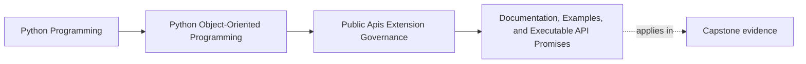

# Documentation, Examples, and Executable API Promises

<!-- page-maps:start -->
## Page Maps

<!-- page-maps:end -->

Read the first diagram as a placement map: this page is one concept inside its parent
module, not a detached essay, and the capstone is the pressure test for whether the
idea holds. Read the second diagram as the working rhythm for the page: name the
problem, study the example, identify the boundary, then carry one review question
forward.

## Why this lesson matters

For many users, the documentation is the API.

They learn what is supported by reading:

- quickstart examples
- package guides
- sample commands
- reference sections

If those surfaces show deep imports, outdated argument shapes, or impossible workflows,
the system has already published the wrong contract even if the code itself has a
cleaner intended public surface.

## Examples teach what you really support

Consumers often copy the first working-looking example they see.

That means examples should demonstrate:

- the sanctioned entrypoint
- the intended data flow
- the supported failure or configuration pattern

They should not quietly depend on:

- internal modules
- temporary helper functions
- setup shortcuts that bypass public contracts

Otherwise the docs create accidental API promises the maintainers never meant to keep.

## Documentation has distinct roles

Not every page should do the same job.

Keep these roles separate when possible:

- **tutorials** teach first use and narrative flow
- **how-to guides** solve a focused task
- **reference docs** define stable inputs, outputs, and guarantees
- **explanation pages** discuss tradeoffs and design choices

When all four are mixed together, readers often leave with fuzzy expectations about what
is merely illustrative and what is contractually supported.

## Public examples should be reviewable like code

If an example shows the supported path, then reviewing that example is part of reviewing
the public API.

Useful review questions include:

- does this example use only public entry surfaces?
- does it model a real supported workflow?
- does it hide important failure handling or migration constraints?
- if a user copied this today, would they be learning the right dependency path?

This turns examples into governance artifacts, not decorative prose.

## Executable examples catch documentation drift

When practical, important examples should be exercised through:

- doctest-style execution
- smoke tests around sample commands
- checked snippets
- integration paths that mirror the documented surface

The goal is not to execute every paragraph. The goal is to make the highest-value public
examples fail when the supported surface drifts.

Without that, documentation often becomes a fossil record of earlier APIs.

## Failure cases belong in public documentation too

Weak API docs often show only the happy path.

But public contracts also include:

- what errors callers should expect
- what unsupported inputs look like
- what migration path replaces a deprecated surface
- what extension limitations users must respect

Teaching only the success story leaves consumers unprepared for the real boundary
behavior they must handle.

## A worked example

Suppose the capstone wants to publish one supported monitoring workflow.

An honest documentation set might include:

- a quickstart that uses only the public facade
- a reference page that defines the command or service inputs and outputs
- one executable example that proves the documented path still works
- one failure-path example that shows how configuration or plugin registration errors are surfaced

What it should not do is:

- teach users to import deep runtime modules because that is shorter to type
- hide required setup behind internal fixtures
- treat old deprecated behavior as still normal in examples

## Docs should move with compatibility policy

When the public surface changes, the docs need the same governance attention as the
code:

- deprecations should update migration guidance
- removals should delete or replace obsolete examples
- new public seams should come with accurate reference and tutorial coverage

If code and docs evolve on different timelines, users receive conflicting promises.

## Common mistakes

- showing deep internal imports in public-facing examples
- mixing tutorial narrative and reference guarantees into one unclear page
- leaving critical examples unexecuted so they drift silently
- documenting only success flows and ignoring real error behavior
- treating docs changes as less important than public API changes

## Review checklist

| Question | Good sign |
| --- | --- |
| do examples demonstrate only supported public paths? | yes |
| are tutorial, reference, and explanation roles distinguishable? | yes |
| do important examples have executable backstops? | yes |
| do docs explain failure and migration behavior where it matters? | yes |

## Capstone connection

Use the capstone docs to ask:

- which current example still teaches a deep import or internal shortcut?
- which supported workflow deserves an executable example first?
- where does the current documentation fail to explain a public error or migration path the user will actually meet?

This is how documentation becomes part of API governance rather than a trailing summary.

## Exit check

Leave this lesson only when you can do all of these:

- explain why examples publish API promises whether maintainers intended that or not
- identify one capstone example that should be executable
- identify one place where public docs need a failure-path explanation, not just a happy-path snippet
