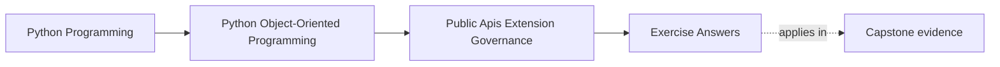
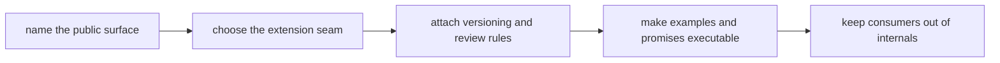

# Exercise Answers

<!-- page-maps:start -->
## Page Maps

<!-- page-maps:end -->

These answers are model explanations, not the only acceptable wording.

## How to use the answer page well

Do not read the model answers first and then reduce Module 09 to "use a facade and be
careful with plugins."

A better rhythm is:

1. finish the exercise with your own governance packet
2. name the supported consumer need, the public seam, and the private boundary behind it
3. compare your reasoning with the model answer
4. revise anywhere your answer still confuses convenience with durable support

What matters is whether the reasoning makes publication, extension, and change control
explicit and reviewable.

Strong Module 09 answers usually do five things:

- they define public surfaces by supported consumer need, not file accessibility
- they keep extension seams narrow enough to preserve ownership
- they treat plugins as governance obligations rather than as generic flexibility
- they make deprecation, compatibility, and examples part of the same promise
- they protect internal layout from becoming accidental public API

The strongest self-study packets also leave behind six concrete artifacts:

- one public-surface inventory
- one private-versus-public boundary note
- one extension-seam justification
- one deprecation and compatibility rule
- one executable-example review
- one change-control recommendation

If your answers rely mostly on "this seems reusable," the reasoning is still too thin.

## Answer 1: Name one true public surface

A strong answer identifies:

- the real consumer need
- the narrow public entrypoint that satisfies it
- the deeper internal path that should stay unsupported
- the ownership rule preserved by the public surface

The main lesson is:

- publication should follow stable intent, not current layout convenience

## Answer 2: Compare public and private seams

The important pieces are:

- what remains private
- what becomes public
- what user behavior each choice encourages
- what evidence would reveal misuse or drift

The weakness to avoid is:

- publishing internals simply because current consumers happen to want them

## Answer 3: Design one capability boundary

A strong answer explains:

- why the chosen seam is a facade, protocol, callback, or capability object
- what actions it allows
- what internals stay protected
- what bug or governance problem appears if the seam widens

Capability design is strongest when:

- outside code gains exactly enough ability without gaining hidden authority

## Answer 4: Review one plugin or registration story

Good answers usually show:

- whether plugin machinery is justified at all
- how discovery or registration stays reviewable
- what constraints keep plugins from reaching past the intended boundary
- what support burden the team accepts by publishing the seam

The main lesson is that:

- a plugin system creates supported outsiders and therefore needs explicit governance

## Answer 5: Write one deprecation rule honestly

A strong answer names:

- what behavior is changing
- how consumers are informed
- what overlap or transition window exists
- what compatibility proof route guards the promise

Deprecation is weak when:

- behavior disappears through informal cleanup without a defendable policy

## Answer 6: Review one executable documentation promise

A strong answer explains:

- what public behavior the example teaches
- how to keep it executable or continuously reviewed
- what drift would matter most
- what route should fail first if the example stops telling the truth

The key review question is:

- what wrong mental model would a stale example teach a new consumer

## Answer 7: Enforce one import boundary

A strong answer distinguishes:

- supported imports
- unsupported deep imports
- the review or automation rule enforcing the boundary
- the refactor freedom preserved by that discipline

Import discipline is strongest when:

- internal reorganization remains possible without breaking supported consumers

## Answer 8: Review one third-party integration contract

The important pieces are:

- the stable contract given to the integrator
- the compatibility check protecting it
- the implementation details that remain replaceable
- the gap that unit mocks alone would miss

The main lesson is that:

- integration promises need proof that survives backend and layout change

## Answer 9: Build one extension-safety review packet

A strong review names:

- the public entrypoint
- the protected internal boundary
- the change-control rule
- the documentation promise
- the compatibility proof route
- the remaining governance risk

The strongest final note points to one support cost that still needs explicit stewardship.

## Answer 10: Produce a governance decision packet

The packet is strong when another maintainer can answer:

- what is public
- what is deliberately private
- how one extension is allowed to participate
- how consumers are protected through change
- what proof route shows the surface is intentionally supported

If different readers infer different promises, the packet is still too ambiguous.

## Self-check

If your answers consistently explain:

- why one surface deserves publication
- how one seam stays narrow enough for safe extension
- what one deprecation or compatibility rule really protects
- how one example remains executable instead of aspirational
- where one import boundary keeps internal structure free to change

then you are using Module 09 correctly.
