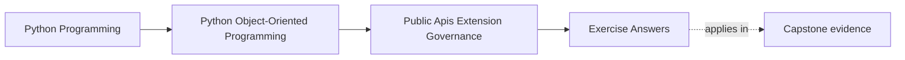
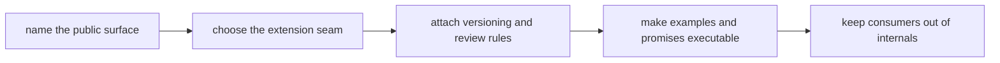

# Exercise Answers

<!-- page-maps:start -->
## Page Maps

<!-- page-maps:end -->

Use these answers as model stewardship notes, not as stock phrases.

The point of the answers is to show what a strong maintainer does when a package is
technically reachable from many places:

- narrow the support promise
- keep authority boundaries intact
- attach deprecation and compatibility burden early
- make examples and proof routes defend the story

These answers stay with one package:

`service_monitoring`

The assumed situation is the same as the exercise page:

- consumers need a stable workflow entrypoint
- extension authors may need one alternate incident sink
- runtime and adapter internals are close enough to be imported by mistake

Everything below is judged by one standard:

> Does this governance decision make the package easier to support without widening the
> public promise accidentally?

## Answer 1: Two supported user stories

A strong pair of user stories could be:

- a consumer wants to run monitoring and inspect stable results
- an extension author wants to supply one alternate sink for already-shaped incident
  information

What the consumer should not need:

- repository details
- runtime worker objects
- adapter construction helpers

What the extension author should not need:

- aggregate mutation power
- orchestration timing control
- private host state access

Why this is strong:

- the consumer story is about outcomes, not layout
- the extension story is about capability, not intimacy
- both stories define what should remain outside the support promise

Weak alternative:

- "users might want access to internals later, so keep things flexible"

That line widens the public surface without naming the support burden.

## Answer 2: One true public facade

A strong facade answer starts from the consumer story, not from export convenience.

Example:

- public entrypoint: `service_monitoring.run_monitoring(...)`
- stable companion surface: one documented result or status shape

What stays private:

- runtime orchestration modules
- repository construction details
- adapter helper imports

Why this matters:

- internal layout can change without becoming a breaking change
- learners get one obvious starting point
- support requests are less likely to depend on semi-public internal routes

If the beginner path still needs a deeper import, the facade is not narrow enough yet.

## Answer 3: Separate consumer surface from extension surface

A strong split looks like this:

- consumer surface: start monitoring and inspect outcomes
- extension surface: receive already-shaped incident information through one capability
  seam

What the extension may do:

- receive a bounded incident payload
- report success or a bounded failure meaning

What it must not do:

- mutate aggregate truth
- reach into repositories
- control private retry or scheduling behavior

Why:

- a capability seam should not become a second owner of the system
- shaped data keeps the host in charge of authority and workflow order

This is how extension support stays narrow and reviewable.

## Answer 4: Is a plugin host justified?

For the incident-sink need, the default answer is often:

- not yet

Why:

- one capability seam plus explicit registration is probably enough
- a full plugin host adds discovery, compatibility, failure-governance, and disablement
  burden

A plugin host becomes justified only when:

- several outsider implementations must be supported over time
- their lifecycle truly needs coordinated discovery and runtime governance
- the team is willing to carry the support cost publicly

If a host were ever justified, it would still need:

- explicit discovery rules
- registration validation
- runtime failure handling
- disablement policy

Support cost, not novelty, should decide the answer.

## Answer 5: Compatibility and deprecation rule set

Suppose the package later wants to rename `run_monitoring(...)` to `run(...)`.

A strong rule set would say:

- the current facade remains supported through a defined transition window
- the new name is introduced alongside it
- docs and examples teach the new name while still warning about the old one
- compatibility checks or executable examples cover both during the supported window
- removal happens only after the published migration window ends

Weak alternative:

- rename it in code and docs and let consumers discover the break

Deprecation is not a courtesy. It is the honest way to change a public promise.

## Answer 6: Executable documentation promise

Suppose the quickstart teaches:

- import the facade
- configure a sink
- run the workflow

A strong answer says:

- keep this example executable or close enough to one automated smoke path that drift is
  caught

Why:

- examples often define the real API more strongly than prose
- learners copy examples before they read policy notes
- if an example teaches a private import, the public API story collapses

The right review question is:

- what supported path does this example teach another maintainer to copy?

## Answer 7: Import boundary rule

Supported imports:

- package facade
- documented capability protocol or sink type

Unsupported imports:

- runtime worker modules
- private adapter wiring
- repository and orchestration helpers

Reasonable enforcement routes:

- code review rule
- import-boundary lint or packaging checks where practical
- examples and docs that consistently teach only the supported path

Why this matters:

- once deep imports spread, internal movement starts looking like public breakage

Import discipline is one of the cheapest governance controls with the highest payoff.

## Answer 8: Third-party contract packet

Take the outsider sink use case.

A strong third-party contract packet would name:

- supported workflow:
  - register one sink through the public route and receive already-shaped incident data
- stable expectations:
  - accepted registration metadata
  - bounded payload shape
  - documented success and failure meanings
- visible failure path:
  - incompatible registration or runtime sink refusal is rejected with the supported
    bounded outcome
- legacy support:
  - one older registration shape remains supported only if it is still inside an
    announced deprecation window
- proof route:
  - one compatibility packet or suite that covers registration, publication, and failure
    behavior

This packet is stronger than "plugins still work" because it states exactly what the
outsider depends on.

## Answer 9: Governance note

A strong short note might read:

> `service_monitoring.run_monitoring(...)` is the supported consumer entrypoint.
> Alternate incident sinks may participate only through a narrow published capability
> seam receiving already-shaped incident data. Runtime orchestration, repository wiring,
> and adapter helpers remain private and may move without public compatibility promises.
> Quickstart examples must teach only the supported facade and sink path. Any facade or
> sink-contract change requires explicit migration language and compatibility review. The
> current governance risk is that deep-import examples could still widen the public
> surface by accident.

Why this note works:

- it tells another maintainer what is public
- it names what remains private
- it identifies the proof and migration burden
- it records one remaining risk honestly

## Answer 10: Governance packet summary

A strong final packet would include:

- one surface table naming the facade and protected internals
- one change table naming allowed changes and policy-triggering changes
- one example table naming which imports should stop being taught
- one extension decision note
- one compatibility and deprecation rule set
- one third-party contract packet
- one short governance note for future review

Another maintainer should be able to answer all of these from the packet:

- what consumers are supposed to depend on
- what extension authors may customize
- what must go through deprecation instead of silent change
- what examples and proof routes keep the code and docs aligned

## Self-check

You are using Module 09 well when another maintainer can answer all of these from your
packet without oral background:

- why the facade is public instead of one layer deeper
- how the extension seam avoids private-state intimacy
- which changes require migration language
- which proof route would fail first if the support promise drifted
