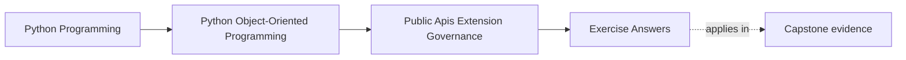
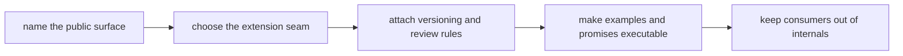

# Exercise Answers

<!-- page-maps:start -->
## Page Maps

<!-- page-maps:end -->

Use these answers as model stewardship notes, not as stock phrases.

The point of the answers is to show what a strong maintainer does with a package that is
technically importable in many places:

- narrow the support promise
- keep authority boundaries intact
- attach deprecation and compatibility burden early
- make examples and review routes prove the story

If your own packet was longer than these answers, that is good. These answers compress
the logic after the harder thinking has already happened.

## Running package

The model answers stay with the same package:

`service_monitoring`

Assumed pressure:

- consumers need a stable workflow entrypoint
- extension authors may need one alternate incident sink
- runtime and adapter internals are still close enough to be imported by mistake

The whole answer packet is organized around separating support promises from mere
reachability.

## Answer 1: Two supported user stories

A strong pair of user stories could be:

- a consumer wants to run the monitoring workflow and inspect stable results
- an extension author wants to supply one alternate sink for already-shaped incident
  information

What the consumer should not need:

- repository details
- runtime worker objects
- adapter wiring internals

What the extension author should not need:

- aggregate mutation power
- orchestration timing control
- private host state access

This distinction matters because it stops a support story from expanding around the
current file layout.

## Answer 2: One true public facade

A strong facade answer starts with the user story, not with export convenience.

Example:

- public entrypoint: `service_monitoring.run_monitoring(...)`
- stable companion surface: one documented result or status shape

What stays private:

- runtime orchestration modules
- repository construction details
- adapter helper imports

Why that matters:

- internal layout can change without becoming a breaking change
- learners get one start point instead of a maze of semi-public options

If the beginner path still needs a deeper import, the facade is not yet narrow enough.

## Answer 3: Consumer surface versus extension surface

A good split looks like this:

- consumer surface: start workflow, inspect outcomes
- extension surface: accept incident information through one capability seam

What the extension may do:

- receive already-shaped incident data
- return a bounded success or failure meaning

What it must not do:

- mutate aggregate truth
- reach into repositories
- control private retry or scheduling internals

If the extension can do those things, it stops being a capability and becomes a second
owner of the system.

## Answer 4: Is a plugin host justified?

For the incident-sink need, the default answer is often:

- not yet

Why:

- one capability seam plus explicit construction or registration is probably enough
- a full plugin host adds discovery, registration, compatibility, and failure-governance
  burden

A plugin host becomes justified only if:

- several outsider implementations must be supported
- their lifecycle and compatibility need to be governed over time
- the team is willing to carry that support cost

If it ever becomes justified, the host must still answer:

- discovery rule
- registration checks
- runtime failure handling
- disablement policy

Support cost, not novelty, should decide the answer.

## Answer 5: Compatibility and deprecation rule set

Suppose the package later wants to rename `run_monitoring(...)` to `run(...)`.

A strong rule set would say:

- current facade name remains supported through a defined transition window
- the new name is introduced alongside it
- docs and examples teach the new name while still warning about the old one
- compatibility checks or executable examples cover both during the supported window
- removal happens only after the published migration window ends

Weak alternative:

- rename the symbol in docs and hope consumers adapt

Deprecation is a supported change protocol, not a cleanup preference.

## Answer 6: Executable documentation promise

Suppose the quickstart teaches:

- import the facade
- configure a sink
- run the workflow

Strong answer:

- keep this example executable or close enough to an automated smoke route that drift is
  caught

Why:

- examples often define the real API more strongly than prose
- if the example teaches a private import, the public API story collapses

The right question is not "is the example nice?" It is "what supported path does this
teach another maintainer to copy?"

## Answer 7: Import boundary

Supported imports:

- package facade
- documented capability protocol or sink type

Unsupported imports:

- runtime worker modules
- private adapter wiring
- repository and orchestration helpers

Enforcement options:

- code review rule
- import-boundary lint or packaging checks where practical
- docs that consistently teach only the supported path

Why this matters:

- once deep imports spread, internal movement starts looking like public breakage

This is one of the highest-leverage governance controls in the module.

## Answer 8: Third-party contract

Take the outsider sink use case.

Stable contract:

- accepted sink input shape
- bounded result or failure meaning
- registration metadata expectations if registration exists

Must stay outside the promise:

- scheduler internals
- repository layout
- adapter construction details

Proof route:

- one compatibility packet or suite across supported sink implementations

What mock-only proof misses:

- whether a real substitute still behaves correctly under the supported contract

Compatibility exists to protect supported outsider behavior, not internal call shape.

## Answer 9: Extension-safety review note

A strong short note might read:

> `service_monitoring.run_monitoring(...)` is the supported consumer entrypoint.
> Alternate incident sinks may participate only through a narrow published capability
> seam. Runtime orchestration, repository wiring, and adapter helpers remain private and
> may move without public compatibility promises. Quickstart examples must teach only the
> supported facade and sink path. Any facade or sink-contract change requires explicit
> migration language and a compatibility review route. The current governance risk is
> that deep-import examples could still widen the public surface by accident.

That note is strong because it tells another maintainer:

- what is public
- what stays private
- what proof and examples keep the promise honest

## Answer 10: Governance packet summary

A strong packet would include:

- one surface table naming the facade and the protected internals
- one change table naming allowed changes and policy-triggering changes
- one example table naming which imports should stop being taught
- one extension decision note
- one compatibility and deprecation rule set
- one short governance note for future change review

Another maintainer should be able to answer all of these from the packet:

- what consumers are supposed to depend on
- what extension authors may customize
- what must go through deprecation instead of silent change
- what proof route keeps the docs, imports, and code aligned

## Self-check

You are using Module 09 well when another maintainer can answer these from your packet
without oral background:

- why the facade is public instead of a deeper import
- how the extension seam avoids private-state intimacy
- what makes a plugin host unjustified or justified
- what proof keeps the supported surface from drifting after July 27, 2026
