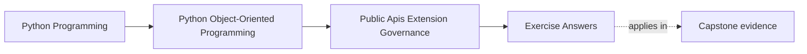
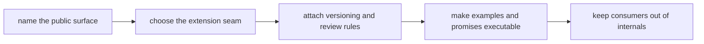

# Exercise Answers

<!-- page-maps:start -->
## Page Maps

<!-- page-maps:end -->

These are model answers for the `service_monitoring` governance scenario from the
exercise page. They are meant to show what a useful public-surface packet looks like when
the code is technically importable in many places but only a small part should be
defended as supported.

## Running scenario recap

Assume the capstone package has:

- internal application and runtime layers
- adapter modules
- a package-level user story for running monitoring workflows
- one likely extension need for alternate incident sinks

The design question is not "what can outsiders import?" The design question is "what are
we willing to document, version, prove, and support on purpose?"

## Answer 1: One true public surface

A strong answer starts with one consumer need:

- "run the monitoring workflow and collect results"

Public surface:

- one package-level facade such as `service_monitoring.run(...)`

Private deeper path:

- direct imports into runtime workers, repositories, or internal orchestration modules

Why keep the deeper path private:

- it preserves refactor freedom around internal ownership boundaries
- it avoids teaching consumers to couple to the current layout

The public surface should be as narrow as the supported use case allows.

## Answer 2: Public versus private seam

Good split:

- public: a facade plus one documented result type
- private: runtime coordination objects, internal policies, adapter wiring

Why:

- consumers need outcomes and stable entry behavior
- they do not need construction trivia or internal wiring seams

If you publish the deeper path, every internal refactor starts looking like a breaking
change. That is avoidable only if private remains meaningfully private.

## Answer 3: Capability boundary

Extension need:

- alternate incident sink

Better seam:

- a narrow protocol or capability object that receives already-shaped incident data

What it may do:

- accept published incident events
- return success, retryable failure, or bounded result semantics

What it must not do:

- mutate aggregate state directly
- reach into repositories or runtime internals
- control orchestration timing by private access

If the seam widens that far, the extension stops being a capability and becomes a second
owner of the system.

## Answer 4: Plugin or registration story

Plugin machinery is justified only if:

- there are several real outsider implementations to support
- registration needs durable compatibility rules
- the team is willing to own the review burden

If justified, registration should:

- happen at one explicit boundary
- validate plugin shape and configuration early
- refuse unsupported or malformed plugins clearly

If not justified, a simpler constructor or dependency-injection seam is better.

The key question is not "can we load plugins?" It is "do we want the support cost of
public outsiders?"

## Answer 5: Deprecation rule

Suppose the facade currently exposes `run_monitoring()` and later wants `run()`.

Honest rule:

- document the old name as deprecated
- keep both paths during a defined transition window
- add compatibility checks for both during that window
- remove the old name only after the published migration period ends

Weak rule:

- rename it in docs and hope consumers notice

Deprecation is a public promise about change, not cleanup by convenience.

## Answer 6: Executable documentation promise

Suppose the quickstart teaches:

- import facade
- configure one sink
- run one workflow

Strong rule:

- example should execute in tests or in a review route close enough to fail on drift

Why this matters:

- the first example teaches consumers which path is public
- a stale example teaches deep-import or unsupported behavior by accident

The example is part of the API contract, not a marketing paragraph.

## Answer 7: Import boundary

Supported imports:

- package facade
- documented protocols or extension types

Unsupported imports:

- deep runtime worker modules
- internal adapter helpers
- private package paths used only for wiring

Enforcement:

- review rule
- lint or import-boundary check where practical
- docs that consistently teach only the supported path

If deep imports spread, internal layout becomes a hidden public API.

## Answer 8: Third-party integration contract

For one outsider integration:

- stable promise: accepted incident payload shape and callback/result contract
- proof route: compatibility suite shared across supported implementations

What must stay outside:

- private runtime scheduling
- adapter internals
- repository layout

What mock-only validation misses:

- whether a real substitute still behaves correctly under the same compatibility suite

That is why third-party contracts need proof beyond internal call choreography.

## Answer 9: Extension-safety review packet

A strong short review might say:

> `service_monitoring.run(...)` is the supported facade. Alternate incident sinks may
> participate only through a narrow published capability protocol. Runtime orchestration,
> repositories, and adapter wiring remain private. Quickstart examples must execute
> against the supported facade. Breaking changes to the facade or sink protocol require a
> deprecation path and compatibility suite. The main remaining governance risk is that
> deep-import examples or internal helper exposure could widen the public surface by
> accident.

That note is strong because it tells the next maintainer:

- what is public
- what is not
- what proof keeps that promise honest

## Answer 10: Governance packet

A useful packet includes:

- one surface table naming the facade and protected internals
- one compatibility table naming allowed and forbidden change
- one extension review paragraph
- one deprecation rule
- one import-boundary enforcement note

Another maintainer should be able to answer all of these:

- what is public and why
- what stays private and why
- what one extension is allowed to do
- how the next change avoids breaking supported consumers casually

## Self-check

You are using Module 09 correctly when another maintainer can answer these from your
packet without extra oral context:

- why the facade is public instead of the deeper import
- how the extension seam avoids private-state intimacy
- what documentation and compatibility proof support the public promise
- what change must go through deprecation instead of silent renaming
