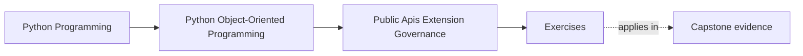
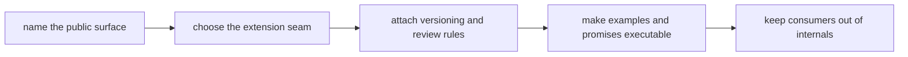

# Exercises

<!-- page-maps:start -->
## Page Maps

<!-- page-maps:end -->

Use this page as a full governance lab for public-surface design.

The goal is not to repeat vocabulary such as facade, seam, compatibility, or deprecation.
The goal is to produce a governance packet that another maintainer could use to defend a
public package honestly after the original author is gone.

By the end, the packet should answer all of these:

- what is truly public
- what remains private and movable
- what one extension is allowed to customize
- what support burden comes with that promise
- how examples, imports, and compatibility checks keep the promise honest

## Working governance scenario

Use one package all day:

`service_monitoring`

Assume this package already has:

- a useful application-level workflow
- runtime and adapter internals that are still easy to import directly
- examples that may accidentally teach private paths
- one real extension need for an alternate incident sink

Your job is to turn that situation into an intentional support story.

## What you are building

Create one governance packet with these sections:

- public-surface inventory
- consumer story
- extension story
- private-boundary note
- supported capability seam note
- compatibility and deprecation rule set
- executable-example review
- import-discipline rule
- third-party contract packet
- closing governance note

Each exercise fills one part of the packet.

## Working tables to prepare first

Start by drafting these three tables before Exercise 1.

| Consumer or extension need | Best public surface candidate | Why this is narrow enough | What stays private | Governance burden created |
| --- | --- | --- | --- | --- |

| Surface or seam | Allowed change | Change that requires policy | Proof or review route | Risk if misgoverned |
| --- | --- | --- | --- | --- |

| Example or import path | What it teaches today | Should it stay or be replaced | Supported path it should teach |
| --- | --- | --- | --- |

You will refine these tables as the packet grows. If they stay empty until the end,
governance reasoning usually stays vague.

## Exercise 1: Write the two supported user stories

Write:

- one consumer story
- one extension story

Example starting points:

- a consumer wants to run monitoring and inspect stable results
- an extension author wants to provide one alternate incident sink

For each story, answer:

- what the user genuinely needs
- what they should never need
- what accidental dependency would appear if you published too much

This exercise keeps the packet centered on support promises instead of file layout.

## Exercise 2: Name one true public facade

Choose the narrowest stable entrypoint for the consumer story.

Write:

- the import path a learner should copy first
- the main call or object that belongs there
- the stable outcome shape it protects
- one deeper path that must remain private even if technically importable

End with one sentence explaining what refactor freedom is preserved by keeping that
deeper path private.

## Exercise 3: Separate consumer surface from extension surface

Choose the extension seam and write:

- what capability it grants
- what authority it intentionally does not grant
- what would go wrong if the seam could reach repository, runtime, or aggregate internals
- what shaped data should cross the seam instead of raw host state

If the extension story still sounds like "give plugins whatever they need," the seam is
too wide.

## Exercise 4: Decide whether a plugin host is justified

Take the incident-sink customization need and answer:

- is one capability seam enough?
- is explicit registration enough?
- is a full plugin host really justified?

If you answer yes to a plugin host, add:

- the discovery rule
- the registration checks
- the failure or disablement rule
- the support burden this creates

If you answer no, write which simpler seam should exist instead and why.

## Exercise 5: Write one compatibility and deprecation rule set

Choose one future change, such as:

- renaming the facade call
- changing the sink protocol shape
- retiring an older registration path

Then write:

- what counts as a supported change
- what requires deprecation instead of silent replacement
- what migration path consumers receive
- what proof route should fail first if the promise is broken

This is where public support becomes release safety.

## Exercise 6: Review one executable documentation promise

Choose one quickstart or example and answer:

- what supported path does it teach?
- does it reinforce the right facade and seam?
- what drift would make it dangerous?
- what automated or review route should fail first if it goes stale?

If the example still teaches a private import, the public API story is not real yet.

## Exercise 7: Enforce one import boundary

Pick one private zone, such as:

- runtime workers
- repository wiring
- adapter construction helpers

Then write:

- which imports should remain supported
- which deep imports should be off-limits
- what lint, packaging, review, or documentation rule would enforce that
- what internal change becomes painful if deep imports spread

This is one of the highest-leverage governance exercises in the module.

## Exercise 8: Define one third-party contract packet

Take one outsider use case and specify:

- the supported external workflow
- the stable payload or metadata expectations
- one documented failure path that must remain understandable
- one legacy behavior that is still supported, if any
- the compatibility suite or packet that should protect this contract

The point is to define what the outsider depends on beyond "it imports."

## Exercise 9: Draft one governance note

Write one short note that names:

- the public facade
- the extension seam
- the protected private boundary
- the compatibility or deprecation promise
- the example or import path that must be corrected
- one remaining governance risk

Keep it short enough to resemble a real review comment or change note.

## Exercise 10: Assemble the packet

Before opening the answer page, assemble:

- the three working tables
- the two user stories
- one facade decision
- one extension decision
- one compatibility and deprecation rule set
- one executable-example review
- one import-boundary rule
- one third-party contract packet
- one short governance note

Another maintainer should be able to answer all of these from your packet:

- where should consumers start and why?
- what exactly may an extension customize?
- what still stays private and movable?
- what change requires deprecation instead of a silent refactor?
- what proof keeps the supported surface honest?

## Done means the surface is defendable

You are done only when the packet is strong enough that a maintainer who missed class
could defend the package without relying on oral history.

That means the packet must be:

- specific about users and seams
- explicit about private boundaries
- concrete about compatibility and proof
- aligned with the examples learners will copy
- honest about the remaining governance risk
