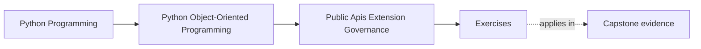
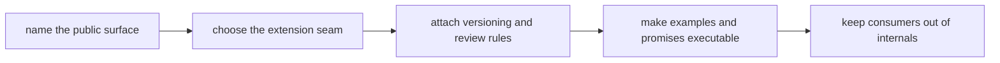
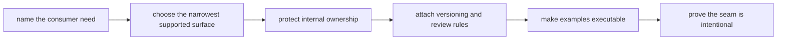

# Exercises


<!-- page-maps:start -->
## Page Maps




<!-- page-maps:end -->

Use these exercises to turn extensibility into a governed contract instead of a vague
invitation for consumers to import whatever currently works.

The day is not about listing packaging features. It is about deciding what deserves to be
public, what must remain private, how plugins and integrations are constrained, and what
evidence proves the surface is intentionally supported.

## How to work through this set

Treat the ten exercises as one full lab day on public surface design and extension
governance.

Before each answer:

1. name the consumer or extension use case under review
2. name the narrowest surface that could support it safely
3. state which internal boundary must remain protected

Do the exercises in order. The day is one progression:

- Exercises 1-3 define public facades, private seams, and capability boundaries
- Exercises 4-6 review plugin governance, deprecation policy, and executable docs
- Exercises 7-8 enforce import discipline and third-party contracts
- Exercises 9-10 assemble a full extension-governance packet for one meaningful surface

Keep one governance packet as you go. By the end of the day it should contain:

- one public-surface inventory
- one private-versus-public boundary note
- one extension-seam justification
- one deprecation and compatibility rule
- one executable-example review
- one change-control recommendation

If those six artifacts are missing, you are probably still talking about convenience
instead of governance.

## Recommended working layout

If you want one lab tree that can support the whole day, use something like:

```text
module09-lab/
├── artifacts/
├── notes/
├── scratch/
└── tests/
```

Keep one surface table while you work:

| Consumer need | Public surface candidate | Why it is narrow enough | Internal boundary still protected | Governance burden introduced |
| --- | --- | --- | --- | --- |

Keep one compatibility table:

| Surface or seam | Change allowed | Change forbidden without policy | Proof or review route | Consumer risk if misgoverned |
| --- | --- | --- | --- | --- |



Use that route on purpose. It keeps the day centered on durable support costs instead of
on accidental import paths.

## Exercise 1: Name one true public surface

Take one consumer use case and explain:

- what public entrypoint or facade should support it
- why a deeper internal import should stay private
- what ownership boundary the public surface preserves
- what future maintenance cost appears if the deeper path becomes public

Study note:
A public API is a promise you are willing to defend repeatedly.

## Exercise 2: Compare public and private seams

Choose one seam and explain:

- what part should remain private
- what part could be published safely
- which consumer behavior each choice encourages
- what evidence would show the seam is still being used as intended

Study note:
Private is not a failure to share. It is often the price of keeping the model coherent.

## Exercise 3: Design one capability boundary

Pick one extension need and explain:

- whether a facade, protocol, callback, or narrow capability object is the right seam
- what the capability is allowed to do
- what it must never mutate or observe directly
- what bug appears if the seam becomes too wide

Study note:
Extension seams are strongest when they expose ability without surrendering ownership.

## Exercise 4: Review one plugin or registration story

Take one plugin-style extension and explain:

- whether it deserves plugin machinery at all
- how discovery or registration should work
- what sandbox or review rule must constrain it
- what governance cost makes the plugin model acceptable or not

Study note:
Plugin support is expensive because it creates supported outsiders, not because loading
code is technically hard.

## Exercise 5: Write one deprecation rule honestly

Choose one public behavior that may need change and explain:

- what the supported deprecation path looks like
- what consumers must be told
- what compatibility suite or check should guard the promise
- what informal removal habit would make the surface untrustworthy

Study note:
Deprecation is a contract transition, not a note in release text.

## Exercise 6: Review one executable documentation promise

Take one example, walkthrough, or README-style promise and explain:

- what public behavior it demonstrates
- how to keep it executable or reviewable
- what drift risk matters if the example becomes stale
- what route should fail first if the promise no longer matches reality

Study note:
Examples teach consumers what is safe. Stale examples teach them the wrong system.

## Midday self-check

Before moving into import discipline and third-party contracts, make sure your packet
already answers these questions clearly:

- what one consumer truly needs from the public surface
- what one seam must remain private
- how one capability boundary stays narrow
- what one deprecation or documentation promise really commits you to

If you cannot answer those four questions in plain language, return to Exercises 1-6 and
make the packet more explicit before continuing.

## Exercise 7: Enforce one import boundary

Take one package area and explain:

- which imports should be supported
- which deep imports should be considered off-limits
- what layer rule or lint/review practice should enforce that
- what internal drift becomes impossible to fix if deep imports spread

Study note:
Import discipline is one of the cheapest ways to keep governance real.

## Exercise 8: Review one third-party integration contract

Choose one outside consumer or integration and explain:

- what stable contract it receives
- what compatibility test or suite should protect it
- what implementation detail must stay out of the contract
- what breakage risk appears if the integration is validated only by unit mocks

Study note:
Third-party contracts need proof that survives implementation change.

## Exercise 9: Build one extension-safety review packet

Take one seam and write a short review that names:

- the public entrypoint
- the private boundary behind it
- the versioning or deprecation rule
- the executable documentation promise
- the compatibility proof route
- one governance risk that still needs attention

Study note:
This review should sound like durable stewardship, not like a feature pitch.

## Exercise 10: Produce a governance decision packet

Assemble:

- one surface table
- one compatibility table
- one extension review paragraph
- one deprecation rule
- one import-boundary enforcement note

The packet is strong when another maintainer can answer:

- what is public and why
- what is private and why
- how one extension is allowed to interact
- how consumers are protected during change
- what proof shows the surface is intentionally supported

## Done means more than finishing the page

You are done with the exercise day when your packet can survive three kinds of review:

- a design review asking whether the surface is narrower than the internal architecture
- a consumer review asking what promise is actually supported
- a governance review asking how versioning, docs, and compatibility checks hold the line

If the packet cannot survive those reviews, keep tightening the support language.
