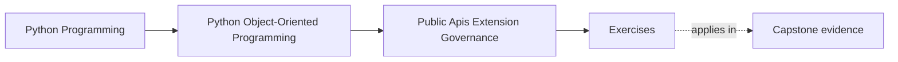
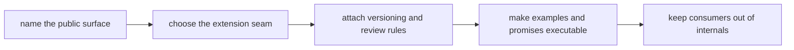

# Exercises

<!-- page-maps:start -->
## Page Maps

<!-- page-maps:end -->

Use this page as one full governance lab for public-surface design.

The goal is not to repeat API vocabulary.
The goal is to leave with one defendable packet that answers:

- what is public
- what is private
- what one extension is allowed to do
- what compatibility and deprecation burden comes with that choice

If another maintainer could not pick up your packet and govern the surface safely, the
lab is not done.

## Running governance scenario

Use one package all day:

`service_monitoring`

Assume the package currently has:

- a useful application layer
- runtime and adapter modules that are still easy to import directly
- examples that may teach deeper imports than they should
- one plausible extension need for an alternate incident sink

Your job is to turn that situation into an intentional support story.

## What you are building by the end

Create one governance packet with these sections:

- public-surface inventory
- consumer and extension user stories
- private-boundary note
- supported capability seam note
- compatibility and deprecation rule set
- executable-example review
- import-discipline rule
- change-control recommendation

The packet should explain not only what is exposed, but why the rest stays movable.

## Tables to prepare first

Start with these working tables.

| Consumer or extension need | Best public surface candidate | Why this is narrow enough | What stays private | Governance burden created |
| --- | --- | --- | --- | --- |

| Surface or seam | Allowed change | Change that requires policy | Proof or review route | Risk if misgoverned |
| --- | --- | --- | --- | --- |

| Example or import path | What it teaches today | Should it stay or be replaced | Supported path it should teach |
| --- | --- | --- | --- |

## Exercise 1: Write the two supported user stories

Write one consumer story and one extension story.

For example:

- a consumer wants to run the monitoring workflow and inspect stable results
- an extension author wants to provide one alternate incident sink

Then answer:

- what each user actually needs
- what each user should never need
- what accidental internal dependency would appear if you published too much

The point is to start from support promises, not from file layout.

## Exercise 2: Name one true public facade

Choose the narrowest stable entrypoint for the consumer story.

Write:

- the import path a learner should copy first
- the main call or object that belongs there
- the stable result or outcome shape it should protect
- one deeper path that must remain private even if it is technically importable

Then explain what refactor freedom is preserved by keeping the deeper path private.

## Exercise 3: Separate consumer surface from extension surface

Choose the extension seam and describe:

- what capability is being granted
- what authority is intentionally not being granted
- what would go wrong if the extension could reach into repositories, runtime workers,
  or aggregate state

If your answer still sounds like "let plugins access whatever they need," the seam is
too wide.

## Exercise 4: Decide whether a plugin host is justified

Take the incident-sink customization need and answer:

- is one capability seam enough?
- is explicit registration enough?
- is a full plugin host really justified?

If you decide a plugin host is justified, add:

- the discovery rule
- the registration checks
- the failure or disablement rule

If you decide it is not justified, say what simpler seam should exist instead.

## Exercise 5: Write one compatibility and deprecation rule set

Pick one future change, such as:

- renaming the facade call
- changing the sink protocol shape
- retiring one old registration path

Then write:

- what counts as a supported change
- what requires deprecation rather than silent replacement
- what migration path consumers receive
- what proof route should keep the promise honest

This is where the module stops being about naming and becomes about release safety.

## Exercise 6: Review one executable documentation promise

Choose one quickstart or example and explain:

- what supported path it teaches
- whether it currently reinforces the right public surface
- what drift would make it dangerous
- what review or automated route should fail first if it goes stale

If the example still teaches a private import, your public API story is not yet real.

## Exercise 7: Enforce one import boundary

Pick one private zone, such as:

- runtime worker modules
- repository wiring
- adapter construction helpers

Then explain:

- which imports should remain supported
- which deep imports should be off-limits
- what lint, review, packaging, or documentation rule would enforce that
- what internal change becomes painful if deep imports spread

This is one of the cheapest and highest-value governance exercises in the course.

## Exercise 8: Review one third-party contract

Take one outsider use case and write:

- the stable contract the outsider receives
- the implementation detail that must stay outside the promise
- the compatibility suite or packet that should protect the contract
- the kind of breakage a mock-only or doc-only proof would miss

This is where external support becomes more than good intentions.

## Exercise 9: Draft one extension-safety review note

Write a short governance note that names:

- the public facade
- the extension seam
- the protected private boundary
- the compatibility or deprecation promise
- the example or import path that must be corrected
- one remaining governance risk

Keep it short enough to resemble a real review comment or change note.

## Exercise 10: Assemble the governance packet

Before opening the answer page, assemble:

- the three tables from the start
- the two user stories
- one facade decision
- one extension decision
- one compatibility and deprecation rule set
- one executable-example review
- one import-boundary rule
- one short governance note

Another maintainer should be able to answer all of these from your packet:

- what is public and why
- what is private and why
- what the extension may do without stealing authority
- what proof keeps the supported surface honest

## Done means the surface is defendable

You are done only when your packet survives these questions:

- "Why should consumers start here and not one layer deeper?"
- "What exactly is the extension allowed to customize?"
- "How would a breaking change be introduced honestly instead of silently?"
- "Which proof or review route keeps the docs and code aligned?"

If those answers still sound generic, tighten the packet before you move to the answer
page.
