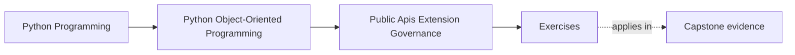
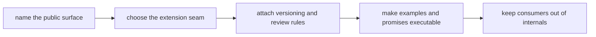

# Exercises

<!-- page-maps:start -->
## Page Maps

<!-- page-maps:end -->

Use these exercises as one governance lab on public surface design. The goal is not to
list packaging or plugin ideas. The goal is to prove that a learner studying alone can
take one capstone package, decide what deserves to be public, narrow the extension seam,
and attach the review and compatibility burden that comes with publishing it.

## Running lab scenario

Use one capstone-facing surface all day:

`service_monitoring`

Assume the capstone currently has:

- an internal application layer
- runtime and adapter modules
- some deep imports used in examples
- one potential extension need for alternate incident sinks or metrics sinks

Your job is to decide:

- what the supported package-level entrypoint should be
- what customization seam outsiders may use
- what must remain private even if it is technically importable

If you choose a different surface, keep the same pressure: one package that could become
public, one plausible extension need, and one risk of accidental deep-import dependence.

## What to keep open while you work

Build one governance packet as you go. By the end it should contain:

- one public-surface inventory
- one private-versus-public boundary note
- one extension-seam justification
- one deprecation and compatibility rule
- one executable-example review
- one change-control recommendation

Useful tables:

| Consumer need | Public surface candidate | Why it is narrow enough | Internal boundary still protected | Governance burden introduced |
| --- | --- | --- | --- | --- |

| Surface or seam | Change allowed | Change forbidden without policy | Proof or review route | Consumer risk if misgoverned |
| --- | --- | --- | --- | --- |

## Exercise 1: Name one true public surface

For `service_monitoring`, decide:

- what one package-level entrypoint or facade should support
- which deeper import path should stay private
- what ownership boundary the public surface preserves
- what maintenance cost appears if the deeper import becomes public instead

Start with consumer need, not with file visibility.

## Exercise 2: Compare public and private seams

Pick one seam and explain:

- what part becomes publicly supported
- what part remains intentionally private
- what user behavior each choice encourages
- what refactor freedom is preserved by keeping the private part private

This is where "technically reachable" must stop pretending to mean "supported."

## Exercise 3: Design one capability boundary

Choose one extension need such as an alternate incident sink or metrics exporter.

Decide whether the seam should be:

- a facade method
- a protocol
- a callback
- a registration object

Then explain:

- what capability the extension gets
- what it must never mutate or inspect directly
- what bug appears if the seam is widened

## Exercise 4: Review one plugin or registration story

Assume someone asks for plugin-style registration.

Explain:

- whether plugin machinery is justified at all
- how discovery or registration should work if it is justified
- what review or sandbox rule must constrain it
- what support cost makes the plugin model acceptable or not

Do not answer from novelty. Answer from governance burden.

## Exercise 5: Write one deprecation rule honestly

Pick one public behavior that may need to change later.

Explain:

- what the supported migration path looks like
- what consumers must be told
- what overlap window is promised
- what compatibility suite or review route enforces the promise

Deprecation is a contract transition, not release-note theater.

## Exercise 6: Review one executable documentation promise

Choose one example or quickstart path and explain:

- what public behavior it teaches
- how to keep it executable or continuously reviewed
- what wrong mental model a stale example would create
- what route should fail first if the example drifts

This is where documentation becomes part of API governance.

## Exercise 7: Enforce one import boundary

Choose one package area and explain:

- which imports should be supported
- which deep imports should be considered off-limits
- what lint, review, or packaging rule should enforce that
- what internal change becomes difficult if deep imports spread

Import discipline is one of the cheapest governance tools in the whole course.

## Exercise 8: Review one third-party integration contract

Take one outsider use case and explain:

- what stable contract the integrator receives
- what compatibility test should protect it
- what implementation detail must stay outside the promise
- what breakage a mock-only proof route would miss

This exercise is about proving that the seam survives implementation change.

## Exercise 9: Build one extension-safety review packet

Write a short review that names:

- the public entrypoint
- the protected private boundary
- the extension seam
- the deprecation or compatibility rule
- the example or docs promise
- one governance risk still not solved

This should read like stewardship, not like a feature pitch.

## Exercise 10: Produce the governance packet

Finish the lab by assembling:

- one surface table
- one compatibility table
- one extension review paragraph
- one deprecation rule
- one import-boundary enforcement note

The packet is done only when another maintainer can answer:

- what is public and why
- what is private and why
- how the extension is allowed to participate
- what proof shows the surface is intentionally supported

## Done means the surface is defendable

You are done with the exercise day when your packet can survive these review questions:

- "Why is this surface public instead of that deeper one?"
- "What can an extension do without crossing ownership boundaries?"
- "How will consumers survive the next change safely?"

If those answers are still fuzzy, keep tightening the support language before you open
the answer page.
