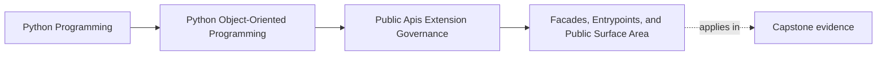

# Facades, Entrypoints, and Public Surface Area

<!-- page-maps:start -->
## Page Maps

<!-- page-maps:end -->

Read the first diagram as a placement map: this page is one concept inside its parent
module, not a detached essay, and the capstone is the pressure test for whether the
idea holds. Read the second diagram as the working rhythm for the page: name the
problem, study the example, identify the boundary, then carry one review question
forward.

## Why this lesson matters

In Python, almost any import path can become somebody's dependency.

That creates a dangerous illusion:

- if users can reach it, it must be public

But reachability is not the same thing as support. A codebase becomes harder to evolve
when consumers learn to depend on:

- deep package paths
- private helper types
- current constructor details
- accidental file layout

Facades and deliberate entrypoints exist so the program can say, clearly, "this is the
surface we are prepared to explain, support, version, and review."

## Public surface is a governance promise

The real question is not:

- what can another module import today?

It is:

- what surface are we willing to keep understandable and stable over time?

Once you call something public, you take on obligations around:

- documentation
- examples
- compatibility review
- deprecation policy
- test coverage for that surface

That is why a small public surface is not aesthetic minimalism. It is governance
discipline.

## A facade narrows the consumer's dependency

A facade gives consumers one clear place to enter the system.

It may expose:

- supported commands
- stable service objects
- documented data shapes
- sanctioned extension hooks

The facade should not simply re-export everything. Its job is to translate internal
structure into a smaller consumer-facing promise.

That keeps internal refactoring freedom alive because the rest of the package no longer
needs to be treated as public by default.

## Entrypoints should match real use cases

A useful entrypoint is organized around what consumers actually need to do.

Examples:

- run a monitoring workflow
- register a plugin capability
- submit a public command
- inspect stable output or result objects

That is stronger than exporting classes merely because they exist. A class that makes
sense inside the package may be the wrong public story for an external caller.

## Narrower is usually safer than cleverer

Students sometimes try to design a highly flexible public surface too early.

That usually leads to:

- too many public types
- too many optional parameters
- too much exposure of lifecycle detail
- too much reliance on internal object wiring

A narrower facade with fewer supported paths is often the more durable design because it
lets you change internal composition later without breaking consumers.

## A worked example

Suppose the capstone contains:

- domain aggregates
- repository implementations
- application services
- CLI or runtime orchestration

A weak public surface might let users import deep modules directly:

- one aggregate from one internal file
- one repository from another
- one utility from a third

That makes the current directory structure part of the consumer contract.

A stronger public surface might instead expose:

- one package-level service entrypoint
- one stable command layer
- one documented result shape
- one small set of extension interfaces

Now the package tells consumers how to use it without asking them to know how it is
built internally.

## Internal modules should stay internal on purpose

Not everything needs a public route.

Keep modules private when they exist mainly to support:

- local composition
- internal algorithms
- intermediate translation
- temporary or replaceable implementation structure

If a consumer needs deep imports to do real work, that is often a sign the facade is
missing a supported use case or the system is publishing too little at the wrong level.

## Common mistakes

- treating every importable path as a supported API
- exporting internal classes because they are convenient to reach today
- designing facades around file layout instead of consumer workflows
- widening the public surface before documentation and compatibility rules exist
- assuming a re-export list is enough without a clear public-use story

## Review checklist

| Question | Good sign |
| --- | --- |
| can consumers do the main supported work through a narrow entry surface? | yes |
| are deep internal imports unnecessary for normal supported use? | yes |
| does the public surface expose workflows and contracts rather than file layout? | yes |
| would internal restructuring stay mostly invisible to consumers? | yes |

## Capstone connection

Use the capstone package to ask:

- which imports should remain private implementation details?
- what is the narrowest package-level surface that would support real users or integrations?
- where is the current file layout at risk of becoming the accidental API?

This is the first governance decision in the module: choose the surface you are willing
to support, and let the rest stay movable.

## Exit check

Leave this lesson only when you can do all of these:

- explain why import reachability is not the same thing as public support
- identify one capstone surface that should become a facade entrypoint
- identify one deep import path that should stay private or be replaced by a supported entry surface
