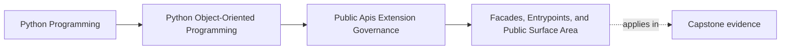

# Facades, Entrypoints, and Public Surface Area

<!-- page-maps:start -->
## Page Maps




<!-- page-maps:end -->

This lesson is about one governance promise:

If another maintainer or consumer starts here, what exact surface are we prepared to
support over time?

In Python, reachability is cheap.
Support is expensive.

That is why a facade and a deliberate entrypoint matter. They let the package say:

- start here
- depend on this
- leave the rest free to move

## Keep one package visible

Use the capstone package:

`service_monitoring`

Assume a newcomer wants to do one normal thing:

- run the supported monitoring workflow and inspect the stable result

The lesson question is:

What is the narrowest public surface that lets them do that without teaching runtime,
repository, or adapter internals as the public story?

## Public surface is a support burden, not an export convenience

A surface becomes public when maintainers are willing to:

- document it
- keep examples aligned with it
- review compatibility around it
- deprecate it honestly
- prove it through executable or reviewable routes

That means the real question is not:

- what can be imported today?

It is:

- what are we willing to explain, defend, and keep coherent next month or next year?

This is why a small public surface is not minimalism for its own sake. It is stewardship.

## A facade should speak in user tasks, not file layout

A strong facade is shaped by what users need to do.

For this capstone, that might mean:

- one package-level workflow entrypoint
- one stable result shape
- one documented extension seam type

It should not mean:

- exporting every useful-looking internal class
- forcing users to understand package layering before they can start
- treating the current directory structure as the API design

The consumer story should survive even if the internals are reorganized.

## One start point is a teaching decision

If the first example a learner copies imports:

- runtime workers
- repository wiring
- adapter helpers

then those internals have already become the accidental API.

That is why entrypoints are not only code organization.
They are also teaching surfaces.

The first copied import path should reinforce the intended contract, not the current
layout accident.

## Facades are valuable because they protect refactor freedom

When consumers depend on a narrow facade:

- constructors can change internally
- file layout can move
- policies can be recomposed
- helpers can disappear

without every internal shift becoming a public event.

When consumers depend on deep imports, each of those changes risks becoming visible
breakage.

This is why facades are part of governance, not just packaging style.

## A worked capstone surface

A strong public shape for this package might look like:

```python
from service_monitoring import run_monitoring, IncidentSink
```

What that teaches:

- `run_monitoring` is the supported consumer path
- `IncidentSink` is the narrow extension seam
- deeper layers are intentionally not the first story

What it avoids teaching:

- repository implementations as public dependency points
- runtime coordinators as extension entrypoints
- file layout as architectural knowledge every caller must learn

The exact names may vary. The design discipline should not.

## Not every useful internal object deserves a public route

Keep a module private when it mainly exists for:

- internal composition
- translation between boundaries
- helper logic
- runtime orchestration
- replaceable implementation structure

If a real consumer use case still needs one of those surfaces, the answer is usually:

- add a better supported facade

not:

- make the deep internal import public by default

## A good facade comes with two companion rules

Once you pick a public entrypoint, add two companion rules immediately:

1. examples and docs must teach that path first
2. deep internal imports should be treated as unsupported unless explicitly promoted

Without those rules, the package will slowly publish more than intended even if the code
shape itself looks clean.

## Common failure modes

- treating every importable path as public because Python allows it
- exporting internal classes because they are convenient today
- designing the facade around file layout instead of a user task
- widening the public surface before compatibility and docs work exists
- calling a re-export list a facade without defining the supported use story

## Facade review card

Use this short card when reviewing a public-surface change:

| Question | What you want to see |
| --- | --- |
| can the main supported work happen through one narrow entrypoint? | yes |
| are deep imports unnecessary for normal supported use? | yes |
| does the surface teach a workflow rather than a directory layout? | yes |
| would internal restructuring stay mostly invisible to consumers? | yes |

## Capstone connection

Use this page to ask:

- which import path should become the only beginner-facing start point
- which deep path should remain private even if it is currently convenient
- what stable result or command surface would let consumers ignore internal layering

That is the first real governance choice in the module.

## Exit check

Leave this lesson only when you can do all of these:

- explain why import reachability is not the same as public support
- identify one capstone surface that should become the facade entrypoint
- identify one deep import that should stay private or be replaced by a supported path
