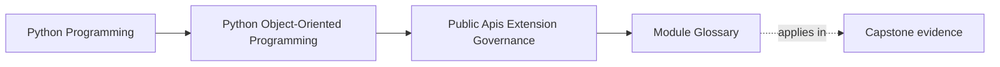

# Module Glossary

<!-- page-maps:start -->
## Page Maps

<!-- page-maps:end -->

This glossary belongs to **Module 09: Public APIs, Extension Seams, and Governance** in
**Python Object-Oriented Programming**. Use it to keep the module's governance language
stable while moving between lesson pages, exercises, and capstone review.

## How to use this glossary

Return here when two API-governance ideas start sounding similar even though they should
lead to different design decisions.

Examples:

- public surface versus import reachability
- capability seam versus plugin system
- deprecation warning versus deprecation policy
- compatibility suite versus ordinary integration test

If those distinctions blur, the package usually starts publishing more than it meant to.

## Terms in this module

| Term | Meaning in this module | Why it matters |
| --- | --- | --- |
| architectural decision record | a short durable record of why a public or extension-facing seam exists, what alternatives were rejected, and what would justify revisiting it | keeps governance memory from turning into folklore |
| capability protocol | a narrow public contract that asks an extension for one stable role or behavior without exposing private host state | makes customization safer than deep subclassing or internal imports |
| compatibility suite | a set of executable checks that proves a supported external or plugin-facing contract still behaves as promised across versions and drift | turns compatibility claims into evidence |
| consumer workflow | the real supported path an outside caller follows through the public surface | should shape facades, docs, and examples more than file layout does |
| deprecation policy | the explicit lifecycle rule for how a public surface moves from supported to deprecated to removed, including migration guidance and timing | makes API change predictable instead of surprising |
| executable example | a public-facing example that is actually run or smoke-checked so documentation drift breaks visibly | keeps examples honest as part of the contract |
| extension seam | the deliberately published place where outside code may customize behavior | should stay narrow and reviewable |
| facade | the small supported package-level entry surface that shields consumers from internal structure | preserves internal refactoring freedom |
| import-boundary rule | an explicit rule about which layers or consumers may import which modules | prevents deep internal modules from becoming accidental contracts |
| plugin discovery | the rule by which candidate extensions become visible to the host | should be explicit and reviewable, not magical |
| plugin registration | the validation step where the host checks identity, capability, compatibility, and configuration before activating an extension | prevents runtime surprises from weak extension governance |
| private module | an internal package surface that may be importable in Python but is not part of the supported contract | should remain movable without public compatibility promises |
| public surface | the narrow set of modules, commands, types, and seams the maintainers are willing to document, version, and support | defines the real API boundary |
| review checklist | a short repeatable set of risk questions used to review public and extension-seam changes consistently | reduces blind spots across maintainers |
| sandboxing | real isolation of untrusted or risky extension code, usually requiring a stronger boundary than an in-process interface alone | prevents interface design from being mistaken for security |
| stable entrypoint | the documented import or command path a consumer should start from | keeps users off deep accidental dependencies |
| substitute compatibility | the claim that different adapters, plugins, or public versions can stand in under one supported contract | needs suites and policy, not just naming |

## Fast contrasts

| Do not confuse | With | Better distinction |
| --- | --- | --- |
| public surface | import reachability | import reachability is what Python permits; public surface is what maintainers are prepared to support |
| capability protocol | plugin system | a capability protocol defines one seam; a plugin system adds discovery, registration, trust, and lifecycle governance around seams |
| deprecation warning | deprecation policy | a warning is one signal; the policy includes migration path, timing, and removal rules |
| compatibility suite | generic integration test | a compatibility suite protects a supported external promise, not just one composed success path |
| facade | re-export list | a facade is a governed entry surface tied to supported use cases, not merely a bundle of imports |

## Review prompts

- Which capstone import paths are reachable today but should never be treated as public?
- Which proposed customization need only requires a capability seam, not a full plugin system?
- Which current compatibility claim would be hard to prove if you had to write the suite today?

## Exit check

Leave this glossary only when you can do all of these:

- explain the difference between a public surface and a merely importable module
- explain why plugin support is a larger governance choice than publishing one capability seam
- name one capstone contract that deserves compatibility evidence and one internal module that should stay private
