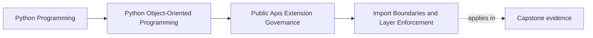

# Import Boundaries and Layer Enforcement

<!-- page-maps:start -->
## Page Maps

<!-- page-maps:end -->

Read the first diagram as a placement map: this page is one concept inside its parent
module, not a detached essay, and the capstone is the pressure test for whether the
idea holds. Read the second diagram as the working rhythm for the page: name the
problem, study the example, identify the boundary, then carry one review question
forward.

## Why this lesson matters

Python makes importing easy. Architecture does not.

Without explicit import discipline, systems drift toward:

- domain code importing infrastructure details
- plugins importing private host modules
- application entrypoints bypassing published facades
- deep helpers becoming accidental dependencies

This is one of the fastest ways to undermine a public API design. Even if the docs say
one surface is public, uncontrolled imports teach the codebase to depend on something
else.

## Layer rules need named boundaries

A useful architecture rule sounds like:

- domain does not import infrastructure
- plugins depend on public capabilities, not aggregate internals
- application services use published seams instead of private adapters

That is much stronger than:

- try not to create tight coupling

If a rule cannot be stated clearly, it is hard to review, hard to teach, and almost
impossible to enforce consistently.

## Package structure should support the rules

Good boundaries are easier to maintain when the package layout helps people do the right
thing by default.

Examples:

- keeping public facades in obvious package locations
- grouping internal modules behind stable higher-level entry surfaces
- separating plugin-facing protocols from host implementation details

Structure alone will not solve everything, but a flat or ambiguous tree makes the wrong
imports feel normal.

## Deep imports are often architecture signals

Not every deep import is wrong, but each one is worth asking about.

A deep import may mean:

- the public facade is missing a supported use case
- the code is bypassing an intended boundary
- one layer knows too much about another
- an internal utility is becoming an accidental contract

This is why deep-import review matters even when the code still works.

## Tooling should reinforce review, not replace it

Named rules become much more durable when they are supported by:

- import-linting tools
- layer-specific checks
- package-level conventions
- tests or build checks that reject forbidden edges

Tooling cannot invent good boundaries, but it can stop the same violations from being
rediscovered in every review.

## Exceptions should be rare and recorded

Some systems do need carefully scoped exceptions.

When that happens:

- name the exception
- explain why the normal rule is insufficient
- keep the scope narrow
- record the intended future state if the exception is temporary

Unrecorded exceptions are how architecture rules become folklore instead of policy.

## A worked example

Suppose the capstone wants plugins to publish incidents through a stable sink protocol.

A healthy import pattern might be:

- plugin code imports the public sink capability
- the host composition root wires the concrete implementation
- aggregate internals stay invisible to plugin modules

A weak pattern would let plugin code import:

- internal aggregate modules
- repository implementations
- runtime schedulers

At that point the plugin is no longer extending the public seam. It is depending on
private host structure, which means the import graph has already broken the governance
story.

## Boundary enforcement protects refactoring freedom

Import boundaries are not busywork. They preserve the ability to:

- reorganize internal packages
- replace implementation details
- evolve facades without supporting every historic import path
- keep extension points small and reviewable

If every layer can import every other layer, the package loses that freedom even before
any external user complains.

## Common mistakes

- leaving layer rules implicit and hoping reviewers remember them
- accepting deep imports because they are convenient in the current file layout
- treating tool-based enforcement as optional even after the rules are known
- letting plugins or consumers import private internals directly
- allowing undocumented exceptions to accumulate until the rule no longer means anything

## Review checklist

| Question | Good sign |
| --- | --- |
| are layer and public/private import rules stated explicitly? | yes |
| does the package layout support the intended boundaries? | yes |
| are deep imports reviewed as architecture signals rather than harmless shortcuts? | yes |
| are important rules reinforced by tooling or automated checks? | yes |

## Capstone connection

Use the capstone package to ask:

- which current deep imports are signs that the published facade is too weak or the layering is leaking?
- where should plugin-facing code depend on a public protocol instead of a private module?
- which import rule deserves tooling support first because reviewers should not have to catch it manually every time?

This is where public API governance reaches into day-to-day package structure.

## Exit check

Leave this lesson only when you can do all of these:

- state one import rule for the capstone in clear enforceable language
- identify one deep import that would count as a boundary violation
- explain why boundary tooling reinforces architecture instead of replacing architectural judgment
