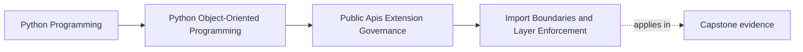
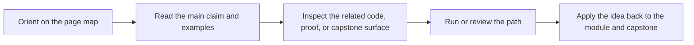

# Import Boundaries and Layer Enforcement

<!-- page-maps:start -->
## Page Maps

<!-- page-maps:end -->

This lesson is about keeping the codebase honest about which layers are allowed to know
about which other layers.

Python makes importing easy.
Architecture does not.

Without import discipline, systems drift toward:

- domain code importing infrastructure details
- plugins importing private host modules
- application entrypoints bypassing supported facades
- deep helpers becoming accidental public dependencies

That is one of the fastest ways to undermine everything else in this module.

## Keep one layering story visible

Use the capstone package:

`service_monitoring`

Assume the intended story is:

- consumers start from the supported facade
- extension authors depend on published capability seams
- runtime, repository, and adapter internals stay private

Now ask:

Which imports reinforce that story, and which imports quietly teach a different one?

That is the real import-boundary question.

## Layer rules need to be stated plainly

A useful rule sounds like:

- domain does not import infrastructure
- plugins depend on public capabilities, not private host internals
- application services use supported seams instead of deep adapter modules

That is much stronger than:

- try to avoid tight coupling

If the rule cannot be said clearly, it is hard to review, hard to teach, and nearly
impossible to enforce consistently.

## Package structure should help the rules

A good package tree does not solve architecture by itself, but it can make the intended
imports feel natural.

Helpful structure often includes:

- obvious facade modules for public entry
- protocol or capability modules separated from host implementation details
- runtime and adapter internals grouped behind higher-level seams

An ambiguous or flat tree makes the wrong imports feel normal even when the written
policy says otherwise.

## Deep imports are architecture signals

Not every deep import is automatically wrong.
Each one is still worth asking about.

A deep import may signal:

- the public facade is missing a supported use case
- one layer is bypassing an intended boundary
- a helper is becoming an accidental contract
- an extension seam is too weak, so callers are reaching inward instead

This is why deep-import review matters even when the code still works.

## Tooling should reinforce the rule, not invent it

Once the layer rules are clear, strengthen them with:

- import-linting tools
- layer-specific checks
- package-level conventions
- CI or test rules that reject forbidden edges

Tooling cannot design good boundaries for you.
It can stop the same mistakes from being rediscovered in every review.

That is still valuable because reviewers should not have to catch identical violations
manually forever.

## Exceptions should be rare, named, and recorded

Some systems do need narrowly scoped exceptions.

When that happens:

- name the exception
- explain why the normal rule is insufficient
- keep the scope explicit and small
- record the intended future state if it is temporary

Unrecorded exceptions are how layer rules become folklore instead of policy.

## Worked capstone example

Suppose the capstone publishes one `IncidentSink` capability.

Healthy import pattern:

- plugin code imports the public sink capability
- the composition root wires the concrete implementation
- aggregate and repository internals stay invisible to plugin modules

Weak import pattern:

- plugin code imports aggregate modules directly
- plugin code depends on repository implementations
- plugin code reaches into runtime schedulers or adapter helpers

At that point the plugin is no longer extending the public seam.
It is depending on private host structure, which means the import graph has already
broken the governance story.

## Boundary enforcement preserves refactor freedom

Import discipline is not busywork.
It preserves the ability to:

- reorganize internal packages
- replace implementation details
- evolve facades without supporting every historic deep path
- keep extension points small and reviewable

If every layer can import every other layer, the package loses that freedom before any
external user even complains.

## Build an import-boundary packet

For each important boundary, keep a short packet with:

- rule statement
- allowed import direction
- forbidden import direction
- known exception, if any
- tool or review route that reinforces the rule

That packet gives maintainers something concrete to review on Monday, July 27, 2026 and
after, instead of relying on oral memory.

## Common failure modes

- leaving layer rules implicit and hoping reviewers remember them
- accepting deep imports because they are convenient in the current file layout
- treating automated enforcement as optional after the rules are already known
- letting plugins or consumers import private internals directly
- allowing undocumented exceptions to accumulate until the rule no longer means much

## Import review card

Use this short card when reviewing one boundary:

| Question | What you want to see |
| --- | --- |
| are layer and public/private import rules stated explicitly? | yes |
| does the package layout support the intended boundaries? | yes |
| are deep imports reviewed as architecture signals rather than harmless shortcuts? | yes |
| are important rules reinforced by tooling or automated checks? | yes |

## Capstone connection

Use this page to ask:

- which current deep imports show that the published facade is still too weak
- where plugin-facing code should depend on a public protocol instead of a private module
- which import rule deserves tooling support first because reviewers should not have to
  catch it manually every time

That is where public API governance reaches into day-to-day package structure.

## Exit check

Leave this lesson only when you can do all of these:

- state one capstone import rule in clear enforceable language
- identify one deep import that would count as a boundary violation
- explain why tooling reinforces architecture instead of replacing architectural
  judgment
