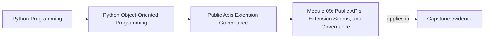

# Module 09: Public APIs, Extension Seams, and Governance

<!-- page-maps:start -->
## Page Maps

<!-- page-maps:end -->

This module is about deciding what other people may safely depend on.

That sounds administrative until you name the real risk:

> A codebase becomes harder to evolve the moment consumers learn to rely on the wrong
> layer.

Module 09 teaches how to stop that from happening before "helpful reuse" turns into an
accidental permanent contract.

## The public-surface question for this module

Keep one capstone pressure route visible while you read:

1. an external caller wants to create or review workshop enrollment outcomes
2. another team wants to add a custom incident sink or notification integration
3. documentation examples begin teaching import paths to those consumers

The core question is:

Which surface should become public, which seam should become replaceable, and which
internal module must stay free to move?

If you cannot answer that, you do not yet have API governance. You only have imports.

## What this module is really trying to prevent

Late in a course, students often assume public API work means adding flexibility.

More often it means refusing the wrong flexibility:

- refusing deep-import convenience
- refusing to publish helper modules as though they were stable
- refusing to call an ungoverned callback hook a plugin architecture
- refusing to promise compatibility without executable proof

Governance begins with narrowing, not widening.

## Running capstone seam

Use `service_monitoring.application` as the main review target.

Ask of that surface:

- what should a consumer start from?
- what should an extension author receive as a capability seam?
- what should remain private even if Python technically allows import?

If you keep that one surface in view, the rest of the module stops sounding abstract.

## Preflight

Before going further, you should already be able to:

- explain which objects own domain truth
- distinguish internal coordination from a public contract
- describe one workflow without relying on file-layout accidents

If those are still fuzzy, Module 09 will feel like vocabulary instead of design.

## What you should be able to do by the end

By the end of this module, you should be able to:

- define a narrow public facade without leaking internal layout
- choose a capability seam without accidentally inventing a full plugin ecosystem
- govern deprecation and compatibility with executable evidence
- review examples and docs as part of the public contract rather than as optional prose
- keep extension enthusiasm from weakening ownership boundaries

## Read this module as one governance review day

Use the pages in this order:

1. public facades and entrypoints
2. capability seams
3. plugin registration and sandboxing
4. deprecation and executable documentation
5. import-boundary review
6. compatibility suites
7. architectural decision records and change control
8. the refactor page
9. the exercises and answer packet

That order matters because you should not debate plugins or versioning before the
public surface itself is clear.

## Lesson map

- [Facades, Entrypoints, and Public Surface Area](facades-entrypoints-and-public-surface-area.md)
- [Capability Protocols and Stable Extension Points](capability-protocols-and-stable-extension-points.md)
- [Plugin Discovery, Registration, and Sandboxing](plugin-discovery-registration-and-sandboxing.md)
- [Deprecation, Versioning, and Removal Policy](deprecation-versioning-and-removal-policy.md)
- [Documentation, Examples, and Executable API Promises](documentation-examples-and-executable-api-promises.md)
- [Import Boundaries and Layer Enforcement](import-boundaries-and-layer-enforcement.md)
- [Review Checklists for Extension Safety](review-checklists-for-extension-safety.md)
- [Third-Party Integration Contracts and Compatibility Suites](third-party-integration-contracts-and-compatibility-suites.md)
- [Architectural Decision Records and Change Control](architectural-decision-records-and-change-control.md)
- [Refactor: Public API for Safe Customization](refactor-public-api-for-safe-customization.md)
- [Exercises](exercises.md)
- [Exercise Answers](exercise-answers.md)
- [Glossary](glossary.md)

## Keep these support surfaces open

- `../guides/proof-matrix.md` when you want a public promise tied to executable proof
- `../guides/pressure-routes.md` when a proposed extension seam feels larger than the
  actual customization need
- `../reference/self-review-prompts.md` when you need a short governance question
  before widening a supported surface

## One study route through the capstone

Take this route if the module starts feeling too broad:

1. open the current facade or application entry surface
2. mark what a consumer would reasonably expect to stay stable
3. mark what an extension author would need to customize safely
4. mark what only exists because of current internal layout
5. compare those decisions with the lesson pages and exercise packet

That route forces you to separate support promises from implementation reachability.

## Questions to keep explicit

- Which import path is merely possible, and which one are we actually prepared to
  document, version, and review?
- Which customization request needs one narrow capability seam rather than a full plugin
  host?
- Which compatibility claim would fail immediately if we had to prove it this week?
- Which example is teaching consumers the wrong dependency path?

## Common failure modes

- calling a reachable module "public" because people already import it
- publishing extension hooks before authority boundaries are stable
- discussing deprecation without a migration route or executable examples
- claiming plugin support when the real need is one replaceable adapter
- promising compatibility without a suite that would catch drift first

## Honest completion signal

You are ready to move on when you can take one capstone seam and explain:

- whether it should stay private, become public, or become replaceable
- which governance cost comes with that choice
- which proof route should fail first if another team starts depending on the wrong
  layer

## Closing criteria

You should finish this module able to publish the narrowest honest surface for an
object-oriented Python system and to defend that surface against accidental widening.

## Directory glossary

Use [Glossary](glossary.md) when you want the module's governance language kept stable
while you move between the lessons, refactor page, exercises, and capstone review.
