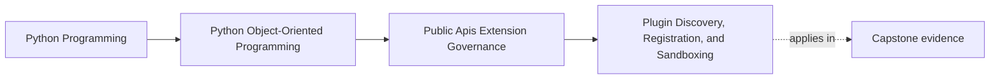

# Plugin Discovery, Registration, and Sandboxing

<!-- page-maps:start -->
## Page Maps

<!-- page-maps:end -->

Read the first diagram as a placement map: this page is one concept inside its parent
module, not a detached essay, and the capstone is the pressure test for whether the
idea holds. Read the second diagram as the working rhythm for the page: name the
problem, study the example, identify the boundary, then carry one review question
forward.

## Why this lesson matters

Plugin support is one of the easiest ways to make a system feel advanced while quietly
raising its governance cost.

The moment you allow outside code to participate, you inherit questions about:

- discovery
- registration
- capability validation
- compatibility
- failure isolation
- trust and security

If those questions are not answered, the "plugin system" is usually just dynamic import
with extra optimism.

## Do not add plugins before naming the real customization need

Many systems do not need plugins at all.

Sometimes they only need:

- one replaceable adapter
- one configuration-driven strategy choice
- one documented capability protocol

That is much cheaper to govern than a general plugin model.

Add plugins only when the customization pressure is real enough to justify the ongoing
cost of operating an extension ecosystem.

## Discovery should be deliberate, not magical

A plugin host needs a clear answer to:

- how does code become eligible for loading?

Common options include:

- explicit configuration
- a trusted package namespace
- declared entry points

The best choice is usually the simplest one that matches deployment reality.

Unbounded module scanning often looks flexible but creates unclear loading rules and weak
reviewability.

## Registration is where the host proves the seam is real

Discovery only finds candidates. Registration decides whether they are acceptable.

A useful registration step should validate:

- required capability support
- stable plugin identity
- compatibility version or contract declaration
- required configuration shape
- duplicate-name or duplicate-role conflicts

If registration is too permissive, the system learns incompatibility only after the
plugin is already entangled with live behavior.

## Lifecycle matters as much as interface shape

Plugins often need rules for:

- startup
- shutdown
- error handling
- retry or disable behavior
- configuration reload

The extension point is incomplete if the host knows how to call a plugin but not how to
own it over time.

This is especially important in long-running systems where plugin failures can leave
partial state, hanging resources, or confusing runtime drift.

## Sandboxing is rarely solved by an interface alone

One of the most common misunderstandings is:

- "we defined a plugin protocol, so plugins are sandboxed"

They are not.

In-process plugins still share:

- memory
- crash surface
- dependency space
- trust assumptions

If the plugin is not trusted, real isolation usually requires a stronger boundary such
as a process, service, or other operating-system-level containment strategy.

A Python interface can constrain how cooperative code is called. It cannot make hostile
or broken code safe by itself.

## A worked example

Suppose the capstone wants to let outside developers provide alternate incident sinks.

An honest plugin design might require:

- a narrow sink capability protocol
- explicit registration through configuration or entry points
- validation of supported protocol version
- unique plugin name and configuration schema
- a host-owned policy for sink startup failure and disablement

What it should not assume is:

- importing the module is enough
- any object with the right method name is safe to load
- in-process loading counts as sandboxing

This keeps plugin support tied to host governance rather than import luck.

## Common mistakes

- introducing plugins when a simpler replaceable seam would do
- discovering code through unclear or overly broad scanning rules
- registering plugins without validating capability, identity, and compatibility
- ignoring lifecycle management after successful load
- calling in-process trust "sandboxing" without a real isolation boundary

## Review checklist

| Question | Good sign |
| --- | --- |
| is plugin support justified by a real customization need? | yes |
| are discovery and registration rules explicit and reviewable? | yes |
| are capability, identity, and compatibility checked before activation? | yes |
| is trust separated from interface shape when discussing sandboxing? | yes |

## Capstone connection

Use the capstone to ask:

- which customization requests truly need a plugin model instead of one replaceable capability?
- where should registration reject incompatible or duplicate extensions before runtime work begins?
- which proposed plugins would be trusted in-process, and which would require a stronger boundary to be safe?

This is where extension enthusiasm meets operational honesty.

## Exit check

Leave this lesson only when you can do all of these:

- explain why plugin support carries governance cost beyond interface design
- name one explicit registration check a capstone plugin system would need
- explain why in-process loading is not real sandboxing
