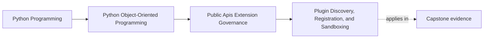

# Plugin Discovery, Registration, and Sandboxing

<!-- page-maps:start -->
## Page Maps

<!-- page-maps:end -->

This lesson is about one hard truth:

- publishing a plugin seam is not the same as publishing a capability protocol

The moment outside code may be discovered and activated, the host now owns:

- how candidates become visible
- how they prove compatibility
- how they are named and configured
- how failures are isolated or disabled
- how much trust the host is really extending

That is governance work, not just interface design.

## Start with the seam, not the plugin story

Use one capstone extension need:

`IncidentSink` lets the system publish an operational event to a downstream sink.

Before inventing plugins, ask:

- do we only need one replaceable adapter?
- do we need several trusted implementations selected by configuration?
- do we need third parties to add new implementations without host-code changes?

Only the third case truly pushes you into a plugin host.

If the pressure is smaller than that, stop early and keep the seam cheaper.

## Discovery decides who may even apply

Discovery is the rule that says which code counts as a candidate.

Good discovery rules are:

- explicit configuration
- a trusted package namespace
- declared entry points

Weak discovery rules sound flexible but age badly:

- "scan installed modules and see what looks right"
- "import everything under this prefix"
- "accept anything with a method called `publish`"

If discovery is vague, governance has already slipped. The host cannot defend what it
does not define clearly.

## Registration is the real contract gate

Discovery only finds candidates. Registration decides whether a candidate is allowed to
participate.

For an `IncidentSink` plugin, registration should validate at least:

- stable plugin identity
- supported contract or protocol version
- required configuration shape
- declared capabilities or limits
- duplicate-role or duplicate-name conflicts

The host should reject a bad plugin before live traffic depends on it.

## Activation must include lifecycle ownership

A plugin host is incomplete if it knows how to call a plugin but not how to own it over
time.

Ask:

- when is the plugin started?
- what happens if startup fails?
- can the host disable it cleanly?
- what signal shows a plugin is degraded?
- what retry or backoff policy belongs to the host rather than the plugin?

These are not operational extras. They are part of the seam.

## Sandboxing is not solved by a protocol

One of the most expensive mistakes in extension design is treating interface shape as
security.

An in-process plugin still shares:

- memory
- process lifetime
- crash surface
- dependency space
- secrets reachable through the host

A Python protocol can constrain cooperative code. It cannot turn untrusted code into
safe code.

If the plugin is not trusted, you need a stronger boundary than a method call:

- a subprocess
- a service boundary
- another operating-system-level containment strategy

Anything weaker should be described honestly as cooperation, not sandboxing.

## Worked capstone host design

An honest capstone host might work like this:

1. the facade loads configured sink identifiers
2. discovery resolves those identifiers through one explicit registry
3. registration checks protocol version, plugin name, and configuration schema
4. activation creates a host-owned wrapper with logging, failure policy, and disablement
5. runtime publication sends one narrow incident payload through the seam

That design keeps authority in the host:

- the host owns discovery rules
- the host owns failure policy
- the host owns disablement
- the plugin owns only its bounded sink behavior

This is the right direction because extension does not get to steal governance.

## When not to build a plugin system

Do not build plugins when the real need is:

- one built-in strategy switch
- one replaceable repository or sink adapter
- one configuration-selected implementation owned by the same team

In those cases, a capability seam plus clear construction rules is usually enough.

Plugins become honest only when outsider addition pressure is real and ongoing.

## Build a plugin-host packet

If you really need a plugin host, keep a short packet with:

- discovery rule
- registration checks
- activation lifecycle
- disablement and degraded-mode policy
- trust level of loaded code
- proof route for registration and runtime behavior

This packet lets another maintainer review the host as a trust boundary, not as a
fashionable extensibility feature.

## Common failure modes

- inventing plugins to avoid naming one narrow seam explicitly
- accepting vague discovery because explicit registration feels inconvenient
- validating method names but not semantic compatibility
- calling in-process cooperation "sandboxing"
- letting plugins mutate host internals because the public facade is too thin

## Plugin-host review card

Use this card before blessing a new plugin story:

| Question | What a strong answer sounds like |
| --- | --- |
| do we need a real plugin host at all? | "yes, because outsider implementations must be added over time" or a clear no |
| how are candidates discovered? | "through one explicit registry or configured entrypoint" |
| what does registration reject? | "bad version, bad schema, duplicate identity, unsupported capability" |
| who owns runtime failure and disablement? | "the host, not the plugin" |
| is the code trusted enough for in-process loading? | "yes, and we say so honestly" or "no, stronger isolation needed" |

## Capstone connection

Use this page to review the incident sink seam and answer:

- should it stay a capability seam or become a real plugin host?
- which registration checks would reject a bad sink before runtime work begins?
- which proposed sink would be too risky to trust in-process?
- what host-owned failure policy would still preserve workflow truth?

That review turns extension enthusiasm into a governed architectural choice.

## Exit check

Leave this lesson only when you can do all of these:

- explain the difference between a replaceable capability seam and a true plugin system
- name the registration checks your capstone host would need before activation
- explain why in-process loading is not sandboxing for untrusted code
