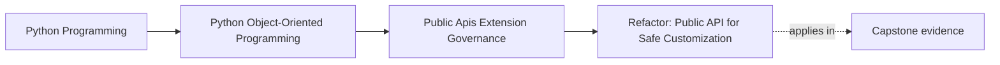

# Refactor: Public API for Safe Customization

<!-- page-maps:start -->
## Page Maps




<!-- page-maps:end -->

## Why this refactor matters

Many systems do not choose a public API. They drift into one.

That drift usually looks like this:

- examples use deep imports because they are easy
- internal helpers become consumer dependencies
- extension code subclasses whatever is nearby
- nobody can tell which breakage is "internal refactor" versus "consumer-facing change"

This refactor page turns that accidental situation into a governed one.

## Running refactor target

Use the course capstone as the target:

- package name: `service_monitoring`
- current state: useful internals, incomplete public surface discipline
- desired state: one small supported entry surface plus one narrow extension seam

Assume consumers want to do two things:

1. run one supported monitoring workflow
2. provide one supported incident sink customization

That is enough need to justify a public surface. It is not enough need to publish the
entire internal layout.

## Step 1: write the supported consumer story first

Before moving code, write down what an outsider is actually meant to do.

For this capstone, a strong public story might be:

- import one package-level facade
- provide configuration
- run the workflow
- optionally supply one incident sink capability
- receive one stable result or status surface

If a candidate public symbol does not support that story, it probably does not belong in
the first public layer.

## Step 2: choose the facade before choosing the modules

Do not start with "which file should be public?"

Start with:

- what one import should a learner copy first
- what one call should a consumer trust
- what one result type should remain stable enough to document

For example, the first public layer might become:

```python
from service_monitoring import run_monitoring, IncidentSink
```

That is narrow enough to teach and broad enough to support the main use case.

## Step 3: move customization to a capability seam

The extension question is not "where can plugins reach in?"

It is:

- what capability can outsiders provide without taking ownership away from the host

For the capstone, a good seam is:

- one `IncidentSink` protocol or callback boundary

Bad seam:

- direct access to repositories
- direct mutation of aggregate state
- deep imports into runtime worker internals

If customization still requires private-state intimacy, the seam is not ready to publish.

## Step 4: stop teaching deep imports immediately

Once the public surface is chosen, fix the teaching path before more consumers copy the
wrong thing.

Change:

- quickstart examples
- walkthrough snippets
- reference imports
- integration examples

So they all reinforce the same supported facade.

This step matters because the first example most learners copy becomes the accidental API
if you leave it unchanged.

## Step 5: attach one compatibility rule now, not later

Before the public surface grows, decide what counts as breaking.

For the first version of this capstone surface, a useful rule might be:

- facade names and documented sink protocol are supported
- internal module layout is not supported
- deep imports may change without deprecation
- facade or protocol changes require an explicit migration path

This is much easier to defend while the surface is still small.

## Step 6: add one proof route for the seam

A public surface is not real just because it is documented.

It becomes real when one proof route protects it, such as:

- one executable quickstart
- one compatibility suite for the sink protocol
- one import-boundary rule preventing examples from drifting back into internals

Without that proof, the governance story is still aspirational.

## Step 7: record why the boundary is shaped this way

Leave durable change memory for the next maintainer.

Record:

- why the facade is small
- why the incident sink seam is public
- why runtime internals remain private
- what would justify broadening the surface later

That keeps future changes tied to consumer need instead of convenience in the moment.

## Worked refactor route

If the capstone currently teaches:

- deep imports into runtime modules
- ad hoc subclassing for customization
- no stable compatibility proof

An ordered refactor could be:

1. introduce one package-level monitoring facade
2. replace example deep imports with the facade
3. define one documented incident sink protocol
4. validate sink registration at one explicit boundary
5. add one compatibility suite for supported sink behavior
6. mark runtime and adapter internals as private in docs and review rules
7. record the public-surface decision in one governance note

Each step is small, reviewable, and tied to one governance gain.

## What not to do

- do not publish a wider API "just in case"
- do not keep teaching deep imports while claiming they are private
- do not expose extension seams that still require knowledge of private host state
- do not add deprecation language without a proof route
- do not let documentation and code disagree about what is public

## Review checklist

| Question | Good sign |
| --- | --- |
| can the main consumer story be completed through one narrow facade? | yes |
| does the extension seam expose capability rather than private authority? | yes |
| do examples reinforce the supported import path? | yes |
| does at least one compatibility or executable-proof route defend the seam? | yes |

## Capstone connection

Use this page to audit the capstone today.

Ask:

- which current deep import should be replaced first by a package-level facade
- which one customization need is worth publishing before anything else
- which existing example would mislead a new consumer if left unchanged

That turns Module 09 into a real redesign path rather than a generic API warning.

## Exit check

Leave this refactor page only when you can do all of these:

- describe one ordered route from accidental imports to a governed public surface
- identify one capstone extension seam that is narrow enough to publish now
- explain why docs, compatibility proof, and import discipline all belong to the same refactor
