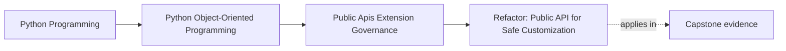

# Refactor: Public API for Safe Customization

<!-- page-maps:start -->
## Page Maps

<!-- page-maps:end -->

Read the first diagram as a placement map: this page is one concept inside its parent
module, not a detached essay, and the capstone is the pressure test for whether the
idea holds. Read the second diagram as the working rhythm for the page: name the
problem, study the example, identify the boundary, then carry one review question
forward.

## Why this refactor matters

Many systems become "public" by accident.

Consumers start depending on:

- deep imports
- internal runtime objects
- ad hoc helper functions
- undocumented extension hooks

Once that happens, the codebase loses refactoring freedom before anyone ever wrote down
an API strategy.

This refactor route shows how to reverse that pattern: define a narrow supported public
surface, give customization a safe seam, and attach governance so the package can evolve
without teaching consumers to depend on the wrong layers.

## Start by identifying what users actually need

Before publishing anything, write down the real supported use cases.

For the capstone, those might include:

- running one monitoring workflow
- supplying one supported customization such as a sink or metric source
- reading one stable result or report surface

If a surface is not tied to a real use case, it probably should not become public just
because it is easy to import.

## Step 1: define the narrow facade first

Choose the smallest public package surface that can support the intended use cases.

That facade might expose:

- one application service or command layer
- one stable result type
- one or two documented extension protocols

It should not expose the whole internal object graph by default.

This is the most important structural move because every later governance decision
depends on knowing what is and is not public.

## Step 2: move customization to capability seams

After the facade exists, identify where supported customization should happen.

Replace deep extension intimacy with:

- one narrow protocol
- one stable callback role
- one documented registration contract

The seam should ask extensions for a capability, not for access to private host state.

If an extension still needs to mutate aggregates or reach into repositories directly,
the seam is not ready to publish.

## Step 3: make import rules enforce the boundary

Once the public surface and extension seams exist, align imports with that decision.

That usually means:

- consumers use the facade instead of deep modules
- plugins depend on published protocols instead of internals
- internal layers stop importing one another casually across boundaries

If the import graph still treats internal modules as normal dependencies, the public API
story remains mostly rhetorical.

## Step 4: attach documentation and examples to the supported path

The public surface is incomplete until the docs teach it.

Add or revise:

- one quickstart path
- one reference description of the supported entry surface
- one executable example where practical
- one explanation of extension limits or error behavior

This ensures that the first thing a learner copies is the right surface rather than a
private shortcut.

## Step 5: define compatibility and deprecation rules before growth

Before more users depend on the facade, decide:

- how compatibility claims are expressed
- what counts as breaking behavior
- how deprecations are announced and migrated
- which suites prove the external contract

This is much easier to do while the public surface is still narrow than after the
package has already grown around undocumented expectations.

## Step 6: add change-control memory for the seam

Public and plugin-facing decisions should leave durable review memory.

Record:

- why this facade is public
- why one extension seam exists and another stays private
- what compatibility promise is being made
- what conditions would justify broadening or narrowing the surface later

That keeps later changes tied to the original reasoning rather than to convenience in
the moment.

## A worked refactor route

Imagine the capstone currently exposes:

- deep imports into runtime modules
- one informal customization path through subclassing
- examples that bypass the intended facade
- no explicit compatibility suite

An ordered refactor route could be:

1. create one package-level facade for the supported workflow
2. stop teaching deep imports in examples
3. replace subclass-heavy customization with one documented capability protocol
4. add registration validation for that extension seam
5. define import rules so consumers and plugins depend on the published surface only
6. add one compatibility suite for the external workflow or extension contract
7. write one decision record that explains why the seam is public and what remains private

That turns a codebase with accidental public reachability into one with explicit
governance.

## Common mistakes

- publishing many surfaces before identifying the real supported use cases
- calling deep imports "temporary" while continuing to teach them in docs
- exposing extension seams that still require private-state knowledge
- adding version labels without compatibility proof
- broadening the public surface without recording why the extra governance cost is worth it

## Review checklist

| Question | Good sign |
| --- | --- |
| can supported work be done through a narrow documented facade? | yes |
| do extension seams ask for capabilities rather than private access? | yes |
| do imports, docs, and examples all reinforce the same public path? | yes |
| are compatibility and change-control rules attached before the surface grows further? | yes |

## Capstone connection

Use this refactor route to inspect the capstone today.

Ask:

- which deep imports should be replaced by one package-level entry surface?
- which customization need deserves one narrow public seam next?
- which docs and tests would need to change before you could honestly call the capstone reusable by outsiders?

These questions turn Module 09 into a concrete API-governance redesign plan.

## Exit check

Leave this refactor page only when you can do all of these:

- describe an ordered plan for shrinking an accidental public surface into a governed one
- identify one capstone extension need that should become a documented capability seam
- explain why docs, imports, compatibility checks, and decision records all belong to the same public-API refactor
