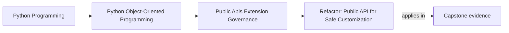

# Refactor: Public API for Safe Customization

<!-- page-maps:start -->
## Page Maps




<!-- page-maps:end -->

This page is about taking a package that is merely usable and turning it into one that
is supportable.

The capstone already has working internals.
The refactor question is different:

Which imports, calls, and seams are we prepared to document, version, prove, and keep
stable for other people?

If you cannot answer that clearly, you do not yet have a public API. You have
accidental reachability.

## Running refactor target

Use the capstone package as it stands:

- package: `service_monitoring`
- consumer need: run a monitoring workflow and receive stable outcomes
- extension need: provide one alternate incident sink
- current risk: examples, internals, and runtime surfaces are still close enough that a
  new learner could depend on the wrong thing

The goal is not a large API.
The goal is one small defended surface plus one narrow extension seam.

## Step 1: write the supported user stories first

Do not begin by asking which files are easy to export.

Begin by writing the smallest supported user stories:

1. a consumer can run the main workflow from one stable entrypoint
2. an extension author can provide one supported incident sink capability

Everything else should be treated as suspect until it proves it belongs.

This prevents a common failure:

- re-exporting internal helpers because they happen to be convenient today

## Step 2: choose the public facade by behavior, not by file layout

For the first user story, define:

- one import path
- one main call or object
- one stable result or outcome shape

For example, the public surface may end up shaped like:

```python
from service_monitoring import run_monitoring, IncidentSink
```

That is useful not because the names are short, but because they teach:

- where consumers should begin
- what they are allowed to ignore
- which deeper layers are not the contract

If the public story still needs runtime-worker or repository imports, the refactor is
not done.

## Step 3: separate consumer surface from extension surface

Consumers and extension authors rarely need the same intimacy.

Consumer surface:

- start the workflow
- inspect stable results

Extension surface:

- accept already-shaped incident information
- return a bounded success or failure meaning

Neither surface should gain:

- aggregate mutation privileges
- repository access
- private runtime timing control

This is the central discipline of the refactor: capability without stolen authority.

## Step 4: replace deep-import examples immediately

Once the facade is chosen, update the teaching path before anything else expands.

Change:

- quickstarts
- walkthrough snippets
- integration examples
- code blocks that still import private orchestration pieces

Why this step comes early:

- the first copied example becomes the real API for many learners
- if the docs keep teaching deep imports, the refactor has not really happened

Public API work is partly code movement and partly teaching-path correction.

## Step 5: shape one narrow capability seam

For the extension story, publish the smallest seam that solves the real need.

For the capstone, that seam is an `IncidentSink` capability, not a general plugin host.

The sink should receive:

- already-owned incident information
- one bounded call context

The sink should not receive:

- repository handles
- direct aggregate objects with mutation authority
- runtime scheduler internals

If outsiders need that much power, the host boundary is still wrongly shaped.

## Step 6: attach compatibility and deprecation rules while the surface is small

Do not postpone governance until "version two."

While the surface is still narrow, state:

- which facade names are supported
- which sink protocol or callback shape is supported
- that deep internal imports remain unsupported
- that supported-name changes require deprecation and migration guidance

Small surfaces are much easier to govern honestly than large accidental ones.

## Step 7: attach proof to the public story

A public surface is real only when something executable defends it.

For this capstone, attach at least:

- one executable quickstart or smoke route through the facade
- one compatibility check or review route for the sink capability
- one import-discipline rule or review note keeping examples out of private modules

If code and docs disagree about what is public, consumers will follow the docs first.

## Step 8: leave one durable governance note

Record:

- why the facade is kept small
- why the sink seam is public
- why deeper runtime and repository layers remain private
- what future pressure would justify widening the public contract

Without that note, maintainers in a later month or year may widen the surface from
convenience instead of need.

## Worked refactor route

An honest ordered route for the capstone could be:

1. write the two supported user stories
2. define one package-level workflow facade
3. replace examples that teach runtime or adapter deep imports
4. publish one `IncidentSink` capability and nothing broader
5. add registration or construction checks at the host boundary
6. define compatibility and deprecation rules for the facade and sink seam
7. add executable proof and import-discipline review
8. record the public-surface decision in a governance note

This order matters because later steps defend the surface chosen by the earlier ones.

## What not to do

- do not publish extra helpers "just in case"
- do not call a deep-import path private while still teaching it everywhere
- do not widen the extension seam until the host can still own failure and authority
- do not promise compatibility without a proof route
- do not let documentation drift behind the refactor

These are the habits that turn a small clean surface into a maintenance trap.

## Capstone connection

Use this page to audit the capstone right now.

Ask:

- which import path should become the only beginner-facing start point
- which current example would accidentally teach a private dependency
- which extension request is solved by `IncidentSink` without widening the host further

If you can answer those three cleanly, the public-surface redesign is becoming
governable.

## Exit check

Leave this page only when you can do all of these:

- describe one ordered route from accidental imports to a governed facade
- explain how the extension seam gives capability without private-state intimacy
- identify what proof and documentation work must ship with the public surface
