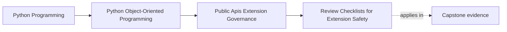

# Review Checklists for Extension Safety

<!-- page-maps:start -->
## Page Maps

<!-- page-maps:end -->

## Why this lesson matters

Extension review often fails in a predictable way: everyone notices a different risk, so
no one knows whether the seam was actually reviewed well.

One reviewer looks for:

- type shape

Another looks for:

- version drift

Another worries about:

- startup failure or blocking behavior

Without a stable checklist, those risks appear randomly. That makes extension safety
depend too much on reviewer memory instead of on repeatable governance.

## Use one real seam while reading

Keep one concrete seam in view:

- the `IncidentSink` capability from the capstone governance exercises

This keeps the checklist grounded. You are not building a checklist for all future
software. You are building one for a seam that could become public in this course
material today.

## A checklist is a consistency tool, not a substitute for judgment

The checklist does not answer the design for you.

It does something more practical:

- it forces the same hard questions to appear every time a public or plugin-facing seam
  changes

That is what makes review reliable across different maintainers and across time.

## Review more than the protocol shape

A narrow-looking seam can still be dangerous.

The checklist must cover more than:

- names
- methods
- argument types

It must also cover:

- ownership boundaries
- failure semantics
- startup and registration behavior
- blocking or async expectations
- compatibility burden
- documentation and proof routes

Those often become public obligations even when the signature looks clean.

## A six-question checklist that is small enough to use

For the `IncidentSink` seam, a practical checklist is:

1. Should this seam be public at all, or should the use case stay inside the facade?
2. Does the seam expose capability only, not aggregate, repository, or runtime intimacy?
3. What happens if registration data is malformed, missing, or incompatible?
4. What happens if the sink fails, blocks too long, or returns unsupported data at runtime?
5. What deprecation or compatibility promise is created by publishing this seam?
6. Which docs, examples, import rules, and tests prove the supported behavior?

That checklist is short enough to use and strong enough to catch most of the real risk.

## What good answers look like

Good review answers point to evidence:

- one compatibility suite
- one executable quickstart or sink example
- one import-boundary rule
- one registration-validation path
- one change-control or governance note

If the seam cannot answer the checklist with evidence, the governance story is still too
weak to trust.

## Failure review belongs inside the checklist

Many extension reviews stay trapped in the happy path. That is a mistake.

For the capstone seam, ask:

- what if the sink is missing at startup?
- what if configuration is present but malformed?
- what if the sink raises during publishing?
- what if the sink blocks longer than the host expects?
- what if the sink returns data the host cannot safely use?

If these answers are still hand-wavy, the seam is not operationally ready even if the
protocol looks elegant.

## A worked review pass

Suppose the capstone now exposes a public sink protocol.

A useful review pass might conclude:

- yes, the seam is justified because alternate sinks are a real supported need
- no, plugins may not reach into repositories or runtime worker state
- registration must validate plugin shape and configuration before the system starts work
- runtime sink failures must not corrupt aggregate truth
- quickstart and compatibility tests must demonstrate the supported sink path

That is a real governance decision, not a vague statement that the design "looks clean."

## Common mistakes

- making the checklist so long nobody uses it
- reviewing only type shape and ignoring failure behavior
- asking questions with no linked evidence route
- treating private-state access as acceptable because the extension is "trusted"
- forgetting that examples and docs teach consumers what the seam means

## Review checklist

| Question | Good sign |
| --- | --- |
| does the checklist ask whether the seam should be public at all? | yes |
| does it cover ownership and failure, not only type shape? | yes |
| is it short enough for repeated real use? | yes |
| can each question point to docs, tests, or policy evidence? | yes |

## Capstone connection

Use this page against the capstone now.

Ask:

- which current or proposed extension seam needs a checklist immediately
- which risk question is currently living only in reviewer memory
- which proof route is still missing for the seam to pass review honestly

This is how governance becomes repeatable instead of personality-driven.

## Exit check

Leave this lesson only when you can do all of these:

- explain why extension review must ask repeated questions beyond type review
- draft a short six-question checklist for one concrete capstone seam
- identify one failure-mode question that current capstone review would likely miss
