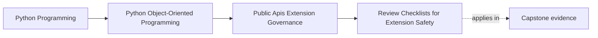

# Review Checklists for Extension Safety

<!-- page-maps:start -->
## Page Maps

<!-- page-maps:end -->

Read the first diagram as a placement map: this page is one concept inside its parent
module, not a detached essay, and the capstone is the pressure test for whether the
idea holds. Read the second diagram as the working rhythm for the page: name the
problem, study the example, identify the boundary, then carry one review question
forward.

## Why this lesson matters

Extension seams often go wrong in review not because nobody cared, but because nobody
asked the same hard questions consistently.

One reviewer notices:

- private-state access

Another notices:

- versioning drift

Another notices:

- failure semantics or startup risk

Without a repeatable checklist, those questions appear randomly. That makes public and
plugin-facing changes depend too heavily on which reviewer happened to be present.

## A checklist is a memory aid, not a substitute for judgment

The purpose of a checklist is not to replace design thinking.

It is to make sure high-impact questions are asked every time a public or extensible
surface changes.

A useful checklist helps reviewers ask:

- should this seam be public at all?
- what ownership boundary does it preserve or break?
- what compatibility promise is being created?
- what failure behavior becomes part of the contract?
- what docs and tests prove the promise?

That is how review becomes consistent without becoming mechanical.

## Extension safety is broader than type shape

A seam can look small in code and still be dangerous in behavior.

Review should cover more than:

- method names
- argument lists
- protocol definitions

It should also cover:

- lifecycle rules
- ordering or timing assumptions
- concurrency or blocking behavior
- error propagation
- configuration and startup behavior

These often become public obligations even if they are not obvious from the type
signature alone.

## Safety includes failure semantics

Many extension reviews stay focused on the successful path and miss the harder question:

- what happens when the extension fails?

Useful review questions include:

- what if registration data is malformed?
- what if the extension raises during execution?
- what if it blocks too long?
- what if it returns unsupported data?
- what if it is missing at startup?

If those answers are unclear, the seam is not operationally ready no matter how clean
the protocol looks.

## Checklists should stay small enough to be used

A checklist that nobody uses has no value.

The best ones are short, sharp, and directly tied to public-risk decisions.

For example, a compact extension-safety checklist might ask:

1. Is this surface truly public or plugin-facing, or should it stay private?
2. Does the seam expose capability only, not internal state or lifecycle ownership?
3. What versioning or deprecation promise is created by this change?
4. What happens on registration failure, runtime failure, or incompatible configuration?
5. Which docs and tests prove the intended behavior?
6. Which import or layering rules prevent consumers from bypassing this seam?

That is enough to shape a serious review without turning it into paperwork theater.

## The checklist should point to evidence

A review question is stronger when it leads to something concrete:

- one compatibility suite
- one executable example
- one import-boundary rule
- one ADR or change note

This keeps the checklist connected to proof rather than discussion alone.

If a seam cannot answer the checklist with evidence, the governance story is still weak.

## A worked example

Suppose the capstone introduces a public plugin seam for alternate incident sinks.

A useful review checklist would ask:

- does the sink protocol stay narrow enough to avoid aggregate intimacy?
- how is plugin identity and compatibility checked at registration?
- what happens if a sink fails during startup or publishing?
- which imports prevent plugin authors from depending on private runtime modules?
- where are the docs and compatibility tests that prove the supported behavior?

That checklist does not decide the design for the reviewer. It forces the real risks
into view before the seam hardens.

## Common mistakes

- treating checklists as bureaucracy rather than as consistent risk review
- focusing on signatures while ignoring failure, timing, or lifecycle semantics
- building checklists so long that nobody uses them
- asking review questions with no linked evidence route
- relying on individual reviewer memory instead of a shared review frame

## Review checklist

| Question | Good sign |
| --- | --- |
| does the review process ask the same core extension-risk questions every time? | yes |
| do checklist items cover behavior and failure, not only types? | yes |
| is the checklist short enough to be used consistently? | yes |
| can each major question point to docs, tests, or policy evidence? | yes |

## Capstone connection

Use the capstone to ask:

- which existing public seam would benefit most from a stable review checklist?
- which risk questions are currently being missed because they live only in reviewer memory?
- which docs or tests would need to exist before one extension surface could pass review honestly?

This is how governance becomes repeatable instead of personality-driven.

## Exit check

Leave this lesson only when you can do all of these:

- explain why extension review needs repeated questions beyond type review
- draft a short six-question checklist for one capstone seam
- identify one failure-mode question that current capstone review would likely miss
