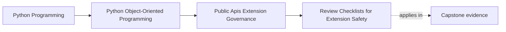

# Review Checklists for Extension Safety

<!-- page-maps:start -->
## Page Maps

<!-- page-maps:end -->

This lesson exists because extension review often fails in a predictable way:

- one reviewer checks type shape
- another checks version drift
- another worries about startup failure
- nobody can tell whether the seam was actually reviewed well

Without a stable checklist, extension safety depends too much on memory and personality.

The point of this page is not to replace judgment.
It is to make the same hard questions appear every time a seam changes.

## Keep one seam visible

Use one concrete seam while reading:

`IncidentSink`

That seam is narrow enough to be teachable and risky enough to make the checklist real.

If your checklist cannot help you review a seam this small, it will not save you on a
larger one.

## What a useful checklist must cover

A weak checklist reviews only the signature:

- names
- methods
- argument types

That is not enough.

An extension checklist must also cover:

- whether the seam should be public at all
- what authority boundaries it preserves
- what registration or construction checks exist
- what runtime failure behavior is expected
- what compatibility promise is created
- what examples, docs, and proof routes defend the story

Those are the real support obligations created by a seam.

## A seven-question checklist that is small enough to use

For `IncidentSink`, a strong short checklist is:

1. Is this seam public because of a real supported use case, or only because the host
   layout makes it easy to expose?
2. Does the seam grant capability only, rather than aggregate, repository, or runtime
   intimacy?
3. What explicit registration or construction checks reject malformed or incompatible
   implementations?
4. What happens if the sink is missing, slow, blocking, or raises at runtime?
5. What compatibility or deprecation promise is created by publishing this seam?
6. Which docs, examples, and import rules teach the supported usage path?
7. Which executable proof or review route would fail first if the seam drifted?

That checklist is short enough for repeated use and broad enough to catch the real
governance risks.

## What strong answers look like

Good answers point to evidence, not just reassurance.

Examples:

- one compatibility suite for sink behavior
- one executable or smoke-tested facade example
- one import-discipline review rule
- one registration-validation path
- one governance note recording why the seam is public

If a seam cannot answer the checklist with evidence, the support story is still thin.

## Failure review belongs inside the checklist

Do not leave operational risk outside the review.

For the capstone seam, ask:

- what happens if configuration is present but malformed?
- what happens if a sink blocks longer than the host expects?
- what happens if a sink raises after partial publication work?
- what happens if a sink returns data the host should not trust?
- what happens if the seam is still documented but no longer truly supported?

These are extension-safety questions, not later operations work.

## Build one reusable review packet

A good checklist becomes stronger when paired with a tiny reusable packet:

- seam description
- supported use case
- authority boundary note
- failure-behavior note
- compatibility promise
- proof route

That packet makes the checklist reusable across maintainers and review cycles.

## Worked review pass

A short review of `IncidentSink` might conclude:

- the seam is justified because alternate sinks are a real supported need
- the seam must receive already-shaped incident data and nothing with private authority
- registration must reject malformed configuration before the workflow starts
- runtime sink failure must not corrupt aggregate truth or duplicate visible work
- facade examples and compatibility proof must teach the supported path consistently

That is a real governance result, not just a statement that the interface "looks clean."

## Common failure modes

- making the checklist so long that nobody reuses it
- reviewing only type shape and missing ownership or failure behavior
- asking questions with no evidence route attached
- calling private-state access acceptable because the extension is "trusted"
- forgetting that examples and docs define how consumers will actually use the seam

## Review card

Use this compact review card during real changes:

| Question | What you want to see |
| --- | --- |
| should this seam be public at all? | one concrete supported use case |
| does it preserve authority boundaries? | capability without private-state intimacy |
| what rejects bad implementations early? | explicit registration or construction checks |
| what happens under runtime trouble? | failure behavior that preserves host truth |
| what support promise is created? | named compatibility and deprecation rule |
| what teaches the supported path? | facade docs and examples, not deep imports |
| what proof keeps it honest? | one executable or reviewable route |

## Capstone connection

Use this page against the capstone immediately.

Ask:

- which seam needs this checklist first
- which risk question is currently living only in reviewer memory
- which proof route is still missing for the seam to pass review honestly

That is how governance becomes repeatable instead of personality-driven.

## Exit check

Leave this lesson only when you can do all of these:

- explain why extension review must ask repeatable questions beyond protocol shape
- draft a short checklist for one concrete capstone seam
- identify one missing failure-mode question and one missing proof route in the current
  capstone review story
