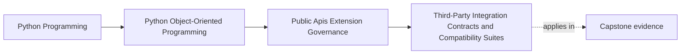

# Third-Party Integration Contracts and Compatibility Suites

<!-- page-maps:start -->
## Page Maps

<!-- page-maps:end -->

This lesson is about proving a public promise from the outside.

Compatibility suites matter because third-party consumers do not care that your code
still "basically works." They care that the supported contract they built against still
behaves as promised.

That means compatibility is broader than import success, type shape, or one happy-path
request.

## Use one supported seam

Keep one capstone seam in view:

the public workflow that lets a configured `IncidentSink` receive a published incident
through the supported facade.

If that seam is truly public, a compatibility suite must prove more than:

- the plugin imports
- registration succeeds once
- one publish call returns without crashing

Those checks are too weak to defend a real integration promise.

## What a third party actually depends on

An outside consumer or plugin author may be depending on all of these:

- how registration metadata is shaped
- what version markers mean
- what payload fields are present and stable
- how duplicate publication or retry is handled
- what failure shape is documented
- what deprecation window still permits older usage

If any of those are part of the support story, the compatibility suite must know it.

## Compatibility suites should mirror real usage

The best compatibility suite is not the most technically impressive one.

It is the one that mirrors the supported external path.

For the capstone sink seam, that likely means:

1. register a sink through the supported public route
2. publish one representative incident
3. observe the documented payload shape
4. observe the documented failure or rejection path
5. verify any supported legacy registration shape still behaves inside its deprecation
   window

This is what outsiders will experience.
That is what the suite should protect.

## Happy-path proof is not enough

A third party learns as much from stable failure behavior as from success behavior.

For example, the suite may need to prove:

- incompatible version declarations are rejected clearly
- malformed metadata fails registration with the documented shape
- duplicate or repeated workflow publication follows the supported idempotency story
- deprecated metadata still warns before removal while remaining functional inside the
  promised window

If those failure paths are part of the public promise, they are compatibility work, not
optional extras.

## Version labels need executable meaning

Saying "this public seam is stable across versions" is not useful unless the suite would
fail when behavior drifts.

A real compatibility suite should expose changes such as:

- a required field disappearing
- output ordering changing in a supported artifact
- a warning becoming an error too early
- a retry path now duplicating visible effects

Without executable proof, compatibility language is only optimism.

## One capstone compatibility packet

An honest compatibility packet for the sink seam could include:

- a valid registration case with current metadata
- a rejected registration case with an incompatible contract version
- one representative incident publication through the facade
- one stable failure path for sink rejection or runtime refusal
- one legacy registration case if an older shape is still intentionally supported

This packet is already enough to catch many false compatibility claims.

## Keep documentation and examples inside the contract

If the public seam is documented with examples, those examples belong inside the
compatibility story.

Why?

Because outside consumers often learn the contract from examples before they read any
formal prose.

If an example teaches:

- the wrong import path
- an outdated registration shape
- an old payload field

then the code and documentation are jointly drifting.

Executable examples are part of the suite's evidence, not a separate documentation chore.

## Review questions for a compatibility claim

Before calling a seam compatible, ask:

- Which exact external workflow are we promising to preserve?
- Which visible failure modes are part of that promise?
- Which fields, ordering rules, or metadata shapes must remain stable?
- Which older usage remains supported as of July 27, 2026, and how is that support
  proven?
- Which public example would fail first if the contract drifted?

These questions keep compatibility tied to a concrete promise instead of a vague label.

## Common failure modes

- calling one passing integration test a compatibility strategy
- proving imports and registration but not visible behavior
- covering success only while ignoring documented failure behavior
- claiming version support without a suite that would catch behavioral drift
- letting examples teach an obsolete contract while the tests still pass

## Capstone connection

Use this page to review the sink seam and decide:

- which current workflow is public enough to deserve a compatibility packet
- which failure path must be stabilized before calling the seam supported
- which legacy behavior should stay supported and which should be removed from the
  promise

That is where API governance becomes release safety.

## Exit check

Leave this lesson only when you can do all of these:

- explain why compatibility suites must cover real external workflows, not only imports
- identify one capstone seam that deserves explicit compatibility proof
- name one behavioral drift that could break consumers without changing a signature
