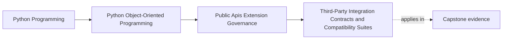

# Third-Party Integration Contracts and Compatibility Suites

<!-- page-maps:start -->
## Page Maps

<!-- page-maps:end -->

This lesson is about proving a public promise from the outside.

Third-party support becomes real only when the team can say:

- this is the workflow outsiders are allowed to depend on
- this is the payload or metadata shape they will receive
- this is the failure behavior they may reasonably expect
- this is the compatibility evidence that will fail if we drift

Without that level of precision, "supports integrations" usually means little more than
"works today in our own environment."

## Keep one public seam visible

Use one seam throughout this lesson:

- the public workflow that lets a configured `IncidentSink` receive a published incident
  through the supported facade

If that seam is truly public, a compatibility suite must defend more than these weak
checks:

- the plugin imports
- registration succeeds once
- one publish call returns without crashing

Those are useful smoke checks, but they are too weak to defend a real support promise.

## Start with the outsider workflow, not the host internals

The most important question is:

- what does the outsider actually experience?

For the sink seam, that likely means:

1. the outsider registers through the supported route
2. the host validates the registration shape
3. one representative incident is published
4. success, rejection, or failure is reported in the documented way
5. supported legacy behavior continues only inside its declared window

That workflow is what the compatibility suite should mirror.

If you instead test host helpers or internal adapter calls, you may prove the wrong
thing. Outsiders care about the supported route, not the implementation shortcuts behind
it.

## Compatibility is broader than signatures

A third party may depend on all of these:

- registration metadata shape
- version markers and how they are interpreted
- payload fields and ordering guarantees
- retry or duplicate-publication behavior
- documented rejection or failure meaning
- deprecation windows for older usage

This is why compatibility is broader than:

- an import path still existing
- a protocol having the same method name
- one happy-path test still passing

If the support story names any of those behaviors, the compatibility suite must know
about them.

## Happy-path proof is not enough

Strong suites cover success and failure.

For the sink seam, the suite may need to prove:

- compatible registration succeeds
- incompatible version metadata is rejected clearly
- malformed metadata fails with the documented shape
- representative publication delivers the expected payload contract
- duplicate or repeated publication follows the documented idempotency or retry story
- deprecated legacy metadata still works only within its supported window

Outsiders learn as much from stable failure behavior as from success behavior. If failure
paths are part of the promise, they are compatibility work, not optional extras.

## Version labels need executable meaning

It is easy to say:

- this seam is stable
- this metadata shape is supported
- this old form still works for now

Those claims matter only if the suite would fail when behavior drifts.

A real compatibility packet should expose changes such as:

- a required field disappearing
- ordering changing in a documented payload
- a warning becoming an error too early
- a repeated publish now duplicating visible effects

Without executable meaning, version language is only optimism.

## Keep examples inside the compatibility story

Examples and quickstarts are not separate from compatibility.

Why?

- outsiders often learn the contract from examples before they read formal prose
- examples define what import path and metadata shape people will copy
- stale examples can widen or distort the public story even when core tests still pass

That means one compatibility packet should also answer:

- which example teaches the public route
- which deprecated example should stop being taught
- what review or smoke path would fail if the example drifted

An example that teaches the wrong import path is a real compatibility problem.

## Worked sink compatibility packet

For the capstone sink seam, a strong packet might include:

- one valid registration case using the current metadata shape
- one rejected registration case using an incompatible version declaration
- one representative incident publication through the public facade
- one documented sink failure case showing the bounded runtime outcome
- one legacy registration case only if that shape is still intentionally supported

What this packet protects:

- that outsiders can register the supported way
- that the payload shape is still what the support story promised
- that failure behavior is legible and bounded
- that legacy support is real rather than assumed

This is already enough to catch many false claims of compatibility.

## Build a third-party contract packet

For each supported seam, keep a short packet with:

- public workflow name
- outsider consumer type
- stable payload or metadata expectations
- documented success path
- documented failure path
- legacy behavior still supported as of Monday, July 27, 2026, if any
- suite or proof route that defends each promise

This packet keeps release decisions tied to what outsiders actually depend on.

## Common failure modes

- calling one passing integration test a compatibility strategy
- proving registration but not visible behavior
- covering success only while ignoring documented failure behavior
- claiming version support without a suite that would catch drift
- letting examples teach an obsolete contract while technical tests still pass

## Compatibility review card

Use this card when reviewing a supported third-party seam:

| Question | What a strong answer sounds like |
| --- | --- |
| what outsider workflow are we promising? | "register one sink through the public route and receive shaped incidents" |
| what visible behavior must stay stable? | "metadata shape, payload fields, and bounded rejection behavior" |
| what legacy behavior still exists? | "older registration metadata remains supported only inside a named window" |
| what failure path is part of the contract? | "incompatible version declarations are rejected with the documented outcome" |
| what proof would fail first if the seam drifted? | "the compatibility packet covering registration, publish, and failure behavior" |

## Capstone connection

Use this page to decide:

- which one capstone seam is public enough to deserve an explicit compatibility packet
- which failure path must be stabilized before you can honestly call the seam supported
- which legacy behavior should remain in the promise and which should be removed from it
- which example belongs inside the compatibility story because outsiders will copy it

That is where API governance turns into release safety.

## Exit check

Leave this lesson only when you can do all of these:

- explain why compatibility suites must mirror real outsider workflows rather than host
  internals
- identify one public seam that deserves explicit compatibility proof
- name one behavioral drift that could break consumers even if the signature still looks
  the same
