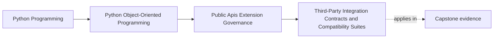

# Third-Party Integration Contracts and Compatibility Suites

<!-- page-maps:start -->
## Page Maps

<!-- page-maps:end -->

Read the first diagram as a placement map: this page is one concept inside its parent
module, not a detached essay, and the capstone is the pressure test for whether the
idea holds. Read the second diagram as the working rhythm for the page: name the
problem, study the example, identify the boundary, then carry one review question
forward.

## Why this lesson matters

External integrations drift even when your own code does not.

Consumers, providers, and plugin ecosystems change on their own timelines. That means a
public contract can break because:

- you changed behavior
- they changed expectations
- both sides kept the same names but changed semantics

Compatibility suites exist to make that drift visible before users discover it in
production.

## An integration contract is broader than one happy-path test

Students often confuse a third-party contract with:

- one request that succeeds
- one CLI example that still runs
- one plugin that still loads

That is too thin.

A real external contract may include:

- accepted shapes and required fields
- failure semantics
- timeout behavior
- ordering guarantees
- version markers and deprecation windows
- required public examples or workflow sequences

If those are part of the supported promise, the compatibility suite should know about
them.

## Compatibility suites should mirror how outsiders really use the seam

The best suite is not necessarily the most technical one. It is the one that reflects
the supported external usage pattern.

For example:

- if users mostly integrate through one documented facade workflow, keep that workflow in the suite
- if plugins depend on registration metadata and lifecycle callbacks, the suite should cover those entry conditions
- if external callers rely on stable output ordering, assert that explicitly

This keeps compatibility testing tied to real consumption rather than to internal
component boundaries alone.

## Version claims need executable proof

If you say a surface is compatible across versions, that claim should be backed by tests
that detect when:

- a required field disappeared
- a warning became a hard error too early
- a public result shape changed
- one workflow now times out or orders results differently

Version labels without compatibility evidence are weak governance.

## Non-happy paths matter here

External consumers learn a lot from failure behavior.

A compatibility suite may need to confirm:

- malformed input is rejected in a stable way
- unsupported plugin metadata fails registration clearly
- deprecated usage still warns before removal while still functioning inside the supported window
- transport or runtime failures surface through the documented contract rather than through leaked internals

Those are compatibility questions too, not just robustness extras.

## A worked example

Suppose the capstone publishes one supported integration seam for custom incident sinks.

An honest compatibility suite might cover:

- registration with valid metadata
- rejection of incompatible version declarations
- one representative publish workflow through the public facade
- one documented failure path for sink rejection or runtime error
- one deprecation path if an older registration shape remains temporarily supported

That suite proves much more than "the plugin imported successfully."

## Compatibility suites should evolve when the promise evolves

A suite can become misleading if the public contract changed but the tests still protect
the old story.

Whenever the supported external promise changes, review:

- examples
- compatibility cases
- deprecation coverage
- public docs

This keeps the compatibility layer aligned with what you actually claim to support as of
July 27, 2026, not what the system supported months earlier.

## Common mistakes

- calling one passing integration test a compatibility strategy
- covering success only while ignoring stable failure behavior
- testing internal mechanics instead of real external usage paths
- claiming version compatibility without tests for behavioral drift
- leaving the suite frozen around an outdated public promise

## Review checklist

| Question | Good sign |
| --- | --- |
| does the suite reflect real supported external usage? | yes |
| are failure and deprecation paths covered where they are part of the contract? | yes |
| do version-compatibility claims have executable proof? | yes |
| would public behavioral drift fail the suite before release? | yes |

## Capstone connection

Use the capstone to ask:

- which seam is most likely to be consumed by third parties or long-lived callers?
- which currently supported workflow deserves a compatibility suite before the next public expansion?
- where would a behavior drift slip through today because the suite proves only imports or happy paths?

This is where extension governance becomes release safety.

## Exit check

Leave this lesson only when you can do all of these:

- explain why compatibility suites must cover more than happy-path success
- identify one capstone seam that deserves explicit external-compatibility coverage
- identify one behavioral contract that could drift without a signature change
