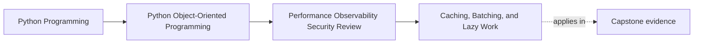

# Caching, Batching, and Lazy Work

<!-- page-maps:start -->
## Page Maps

<!-- page-maps:end -->

Read the first diagram as a placement map: this page is one concept inside its parent
module, not a detached essay, and the capstone is the pressure test for whether the
idea holds. Read the second diagram as the working rhythm for the page: name the
problem, study the example, identify the boundary, then carry one review question
forward.

## Why this lesson matters

Caching, batching, and lazy work often arrive as "easy performance wins."

They are not free wins. Each one changes the operational story:

- caches change freshness
- batching changes timing and failure grouping
- laziness changes when cost and errors are paid

That means these techniques belong in design review, not only in tuning discussions.

## Every speedup technique creates a semantic contract

When you add a cache, you are making a promise about:

- how stale data may become
- who owns invalidation
- what happens on cache miss or failure

When you batch work, you are changing:

- when requests are grouped
- how partial failure is reported
- what ordering or latency tradeoff is acceptable

When you defer work lazily, you change:

- which call pays the cost
- which caller now sees the failure
- whether expensive work is visible or hidden

These are public or operator-facing consequences even when they start as implementation
changes.

## Cache only when you can explain freshness honestly

A weak cache design usually starts with:

- "this value probably doesn’t change much"

A stronger design starts with:

- what is the source of truth?
- how stale may this value be before the result becomes misleading?
- who can invalidate or refresh it?
- what happens when the cache and reality disagree?

If you cannot answer those questions clearly, the cache is likely to blur authority more
than it improves performance.

## Batch at real boundaries, not at arbitrary convenience points

Batching is most useful when overhead comes from repeated crossings such as:

- repository loads
- network calls
- codec or transport work
- repeated metric fetches

The batch boundary should match the place where work is truly repeated. Otherwise you
may add complexity without reducing the meaningful cost.

Batching also needs error semantics:

- does one failure poison the batch?
- can some items succeed while others fail?
- how are ordering and retries handled?

Those are part of the contract, not postscript details.

## Lazy work should stay visible when the cost matters

Deferred work can improve startup, memory, or median latency.

It becomes risky when a caller cannot tell that:

- the first access triggers expensive computation
- the first access might fail because remote or serialized data is still needed
- the object is not fully realized yet

If the laziness changes when cost or errors appear, the API should usually make that
fact visible through naming, documentation, or usage shape.

## Narrow changes are better than general performance frameworks

Students often try to solve performance pressure with broad generic machinery:

- one universal cache layer
- one generic lazy wrapper
- one batching framework for every boundary

That usually obscures ownership and makes debugging harder.

A narrower approach is often stronger:

- one cache with one explicit owner
- one batch path around one repeated boundary cost
- one lazily computed surface that is documented and measured

This keeps the speedup tied to the real pressure instead of spreading new complexity
everywhere.

## A worked example

Suppose the capstone repeatedly:

- loads incident summaries
- fetches related metric views
- builds an operator report

Possible changes might include:

- batching repeated metric fetches at the adapter boundary
- caching one derived summary for a short, explicitly documented freshness window
- delaying one expensive formatting step until the report is actually requested

Each change would still need a clear answer to:

- what freshness changed?
- what failure now moves to a later point?
- which boundary owns invalidation or retry?

That is what makes the optimization honest.

## Common mistakes

- adding caches without a freshness story
- batching work where the real cost is not actually at the crossing being grouped
- hiding expensive lazy work behind harmless-looking property access
- generalizing performance helpers before one narrow case is even measured
- treating semantic changes as mere implementation detail because the output still "usually works"

## Review checklist

| Question | Good sign |
| --- | --- |
| is the semantic tradeoff of the cache, batch, or laziness stated clearly? | yes |
| does the optimization target a measured real cost? | yes |
| is the owner of invalidation, grouping, or deferred failure explicit? | yes |
| would a reviewer know what user-visible behavior changed? | yes |

## Capstone connection

Use the capstone to ask:

- which repeated boundary crossing is the strongest candidate for batching?
- where would a cache most endanger freshness or authority if added carelessly?
- which deferred computation should be visible because the first access is costly or failure-prone?

This is where performance technique turns into contract design.

## Exit check

Leave this lesson only when you can do all of these:

- explain one semantic tradeoff introduced by caching, batching, or lazy work
- identify one capstone boundary where batching may help and one rule it must preserve
- identify one place where hidden laziness would make the API less honest
