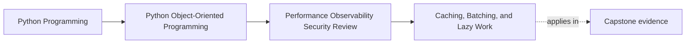

# Caching, Batching, and Lazy Work

<!-- page-maps:start -->
## Page Maps

<!-- page-maps:end -->

This lesson is about refusing to call a performance tradeoff "just an implementation
detail."

Caching, batching, and lazy work often sound like easy wins:

- cache the expensive view
- batch the repeated calls
- defer the costly work until somebody needs it

Each of those can help. Each of those also changes the behavior contract.

- caches change freshness
- batching changes timing and failure grouping
- laziness changes where cost and failure first appear

That means these are architectural decisions, not merely performance tricks.

## Keep one pressure path visible

Use one capstone route:

1. a caller asks for derived seat, incident, or certificate information
2. the system crosses one or more repository, projection, or adapter boundaries
3. repeated cost appears
4. somebody proposes a cache, batch, or deferred computation

Now hold one question in front of every choice:

- what meaning changes if this optimization is added carelessly?

That question protects you from optimizing the wrong thing or hiding the wrong cost.

## Start from measured pressure, not from favorite techniques

The weak way to choose an optimization is:

- caching sounds fast
- batching sounds scalable
- lazy work sounds elegant

The stronger way is:

- identify the repeated cost
- identify the boundary where the cost accumulates
- identify the user-visible behavior that could drift

Only after that should you ask which technique fits.

For example:

- if repeated cost lives in downstream projection publication, batching may fit
- if repeated cost lives in re-reading stable derived data, caching may fit
- if expensive formatting is only needed on rare operator paths, laziness may fit

Technique should follow diagnosis, not personal taste.

## Every speedup creates a new contract

The moment you add one of these techniques, you create new obligations.

Caching creates promises about:

- how stale data may become
- who owns invalidation
- what source remains authoritative
- what happens when cache and truth disagree

Batching creates promises about:

- when work is grouped
- what ordering still holds
- how partial failure is reported
- how retries are interpreted

Lazy work creates promises about:

- which call now pays the cost
- which caller now sees the first failure
- whether expensive work remains visible or is hidden behind harmless-looking access

If those promises are not explicit, the optimization remains difficult to review and
hard to operate.

## Cache only when freshness can be explained honestly

A weak cache story starts with:

- "this probably does not change often"

A stronger story answers all of these:

- what is the source of truth?
- how stale can the cached value become before it misleads a caller?
- who invalidates or refreshes it?
- what happens when cached and authoritative state diverge?

In the capstone, caching can be acceptable for:

- clearly labeled derived views
- bounded freshness dashboards
- expensive summaries that do not own truth

It is dangerous for:

- authoritative seat availability used in write decisions
- anything that encourages callers to treat a projection as the source of truth

If the cache blurs authority, the speedup is too expensive.

## Batch at the real repeated crossing

Batching is strongest when the measured cost comes from repeated crossings such as:

- repeated repository loads
- repeated projection publication
- repeated transport or storage adapter calls
- repeated codec or artifact work

The key question is:

- where is the cost actually being paid?

Batching at a convenient layer instead of the real crossing often adds complexity without
meaningful improvement.

Batching also needs explicit failure semantics:

- does one bad item poison the whole batch?
- can some items succeed while others fail?
- what ordering guarantee remains?
- how are retries tracked without duplicating visible effects?

Those are contract questions, not cleanup questions.

## Lazy work should remain honest about cost and failure

Deferred work can be useful, but it changes who experiences:

- the first expensive computation
- the first network call
- the first timeout
- the first delayed failure

If a property or innocent-looking accessor suddenly performs remote work, formatting, or
artifact generation, the API becomes less honest.

That does not make laziness wrong. It makes visibility essential.

Honest lazy work usually needs:

- naming that hints at deferred cost
- documentation that warns about first-access expense
- boundaries that keep deferred failure understandable

The goal is not to avoid laziness. The goal is to avoid surprising callers with hidden
behavior.

## Worked capstone tradeoff review

Suppose the capstone shows pressure in these places:

- repeated metric-view fetching for operator reports
- repeated projection publication after enrollment bursts
- expensive certificate rendering that only some workflows request

Now compare the options:

| Pressure point | Plausible move | Main contract at risk |
| --- | --- | --- |
| repeated metric-view reads | cache derived view | freshness and operator trust |
| repeated downstream publication | batch publication work | timing, ordering, and partial failure |
| rare expensive rendering | defer rendering until requested | hidden cost and moved failure |

The right design choice depends on which contract is easiest to preserve honestly.

You are not choosing the most fashionable speedup. You are choosing the least dangerous
way to reduce real measured cost.

## Prefer narrow optimizations over universal machinery

Students often reach too quickly for:

- a global cache layer
- a universal batching framework
- one generic lazy wrapper

Those tools often spread ownership confusion faster than they spread performance gains.

A narrower change is usually stronger:

- one cache with one explicit owner
- one batch path around one repeated crossing
- one deferred rendering surface with one clear first-access story

This keeps the optimization tied to the pressure that justified it.

## Build a tradeoff packet

For every candidate optimization, keep a short packet with:

- optimization type
- measured pressure it addresses
- boundary it touches
- semantic contract at risk
- owner of invalidation, grouping, or deferred failure
- first signal or proof that would reveal drift

This packet is what turns performance arguments into reviewable engineering decisions.

## Common failure modes

- choosing a technique before measuring the real cost
- caching a projection so aggressively that callers stop respecting authority
- batching at a convenient layer instead of the repeated crossing that actually hurts
- hiding expensive lazy work behind harmless-looking access
- adopting universal machinery before one narrow case has even been explained well

## Tradeoff review card

Use this card for each proposed speedup:

| Question | What a strong answer sounds like |
| --- | --- |
| what measured pressure does this address? | "repeated projection publication dominates post-persistence latency" |
| what behavior contract changes? | "visibility may lag briefly, but authority remains unchanged" |
| who owns the new complexity? | "the downstream publication boundary owns grouping and retry semantics" |
| what would reveal drift first? | "lag metrics and duplicate-publication checks" |
| what option was rejected and why? | "caching authority was rejected because it weakens truth under contention" |

## Capstone connection

Use this page to decide:

- which repeated crossing is the best batching candidate
- where a cache would most endanger freshness or authority
- which expensive step could be deferred only if the first-access cost stays visible
- which optimization should be rejected even if it looks faster

That is where performance technique becomes contract design.

## Exit check

Leave this lesson only when you can do all of these:

- explain one semantic tradeoff introduced by caching, batching, or lazy work
- identify one capstone pressure point and the most honest optimization candidate for it
- explain why a faster design can still be the wrong design if it weakens authority or
  clarity
