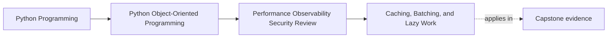

# Caching, Batching, and Lazy Work

<!-- page-maps:start -->
## Page Maps

<!-- page-maps:end -->

This lesson is about refusing to call a performance tradeoff "just an implementation
detail."

Caching, batching, and lazy work often arrive as easy wins.
They are not free.

Each one changes a public or operator-facing story:

- caches change freshness
- batching changes timing and failure grouping
- laziness changes when cost and failure are paid

That means these techniques belong in architectural review, not only in tuning
discussions.

## Keep one pressure route visible

Use one capstone path:

1. a caller asks for derived seat, incident, or report information
2. the system crosses one or more repository or adapter boundaries
3. a costly repeated operation tempts you to cache, batch, or defer work

Now ask:

What meaning changes if this optimization is added carelessly?

That question keeps the lesson about contract design rather than about generic speed
tricks.

## Every speedup creates a semantic contract

Adding a cache makes promises about:

- how stale the data may become
- who owns invalidation
- what happens on cache miss or disagreement with authority

Adding batching changes:

- when separate requests are grouped
- how partial failure is reported
- what latency or ordering tradeoff callers now experience

Adding lazy work changes:

- which call pays the cost
- which caller now sees the failure
- whether expensive work is obvious or hidden

If those promises are not explicit, the optimization remains hard to reason about.

## Cache only when freshness can be explained honestly

A weak cache story starts with:

- "this probably does not change often"

A stronger cache story starts with:

- what is the source of truth
- how stale may the answer become before it misleads a caller or operator
- who refreshes or invalidates it
- what happens when the cache and reality disagree

If you cannot answer those questions, the cache is likely to blur authority more than it
improves speed.

## Batch at the real repeated crossing

Batching is most useful when cost comes from repeated crossings such as:

- repository loads
- transport round trips
- repeated metric fetches
- repeated artifact or codec work

The batch boundary should match the real repeated cost.

Otherwise you risk adding complexity while optimizing the wrong layer.

Batching also needs explicit error semantics:

- does one bad item poison the whole batch
- can some items succeed while others fail
- what ordering promise remains
- how are retries handled

Those are contract questions, not cleanup questions.

## Lazy work should stay honest about where failure moves

Deferred work can be useful, but it changes who experiences:

- the first expensive computation
- the first remote call
- the first delayed failure

If a property or lightweight-looking call suddenly triggers expensive remote or
serialization work, the API becomes less honest.

That does not mean laziness is wrong.
It means the cost and failure shift should be visible through naming, documentation, or
call shape.

## Prefer narrow optimizations over universal machinery

Students often reach for:

- one global cache layer
- one generic batching framework
- one universal lazy wrapper

Those tools often spread ownership confusion faster than they spread performance gains.

A narrower move is usually stronger:

- one cache with one explicit owner
- one batch path around one repeated crossing
- one lazily computed surface with a documented cost story

This keeps the performance change tied to the real pressure instead of turning into a
new abstraction habit.

## A worked capstone review

Suppose the capstone repeatedly:

- loads incident summaries
- fetches related metric views
- builds operator-facing reports

Possible honest changes:

- batch repeated metric fetches at the adapter boundary
- cache one derived summary with an explicitly bounded freshness window
- defer one expensive formatting step until the report is actually requested

For each change, ask:

- what freshness changed
- what failure moved later
- which boundary now owns invalidation, grouping, or deferred recovery

The right answer is not "yes to all three."
The right answer is whichever tradeoff preserves meaning most honestly.

## Build a performance-tradeoff packet

For each candidate optimization, keep a short packet with:

- optimization type: cache, batch, or lazy work
- boundary it touches
- semantic contract at risk
- owner of invalidation, grouping, or deferred failure
- first proof or signal that should reveal drift

This packet makes performance choices reviewable instead of intuitive folklore.

## Common failure modes

- adding caches without a freshness story
- batching at a convenient layer instead of the real repeated crossing
- hiding expensive lazy work behind harmless-looking access
- generalizing helpers before one narrow case is even measured
- treating semantic drift as mere implementation detail because output still "usually
  works"

## Performance review card

Use this short card when reviewing a speedup:

| Question | What you want to see |
| --- | --- |
| is the semantic tradeoff of the cache, batch, or laziness stated clearly? | yes |
| does the optimization target a measured real cost? | yes |
| is the owner of invalidation, grouping, or deferred failure explicit? | yes |
| would a reviewer know what user-visible behavior changed? | yes |

## Capstone connection

Use this page to ask:

- which repeated boundary crossing is the strongest batching candidate
- where a cache would most endanger freshness or authority if added carelessly
- which deferred computation should remain visible because the first access is costly or
  failure-prone

That is where performance technique becomes contract design.

## Exit check

Leave this lesson only when you can do all of these:

- explain one semantic tradeoff introduced by caching, batching, or lazy work
- identify one capstone boundary where batching may help and one rule it must preserve
- identify one place where hidden laziness would make the API less honest
