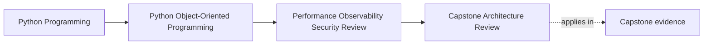

# Capstone Architecture Review

<!-- page-maps:start -->
## Page Maps

<!-- page-maps:end -->

## Why this review matters

By Module 10, the capstone should no longer be read as a pile of separate good ideas.

It should be reviewed as one working system with:

- ownership boundaries
- persistence boundaries
- public seams
- runtime pressure
- operational failure modes

That is the difference between "I read the lessons" and "I can review a real design."

## Use one concrete review route

Review this capstone path all the way through:

1. attendee requests a workshop seat
2. `WorkshopEnrollment` decides confirm or waitlist
3. repository persists the result under version control
4. projection and notification run downstream
5. later, `CertificateIssuanceService` consumes confirmed state

This path is useful because it crosses nearly every major boundary the course has taught.

If the architecture is strong, this path should still make sense when you ask:

- who owns truth
- who owns time and retries
- who owns translation
- who owns the public promise

## Step 1: Restate the structural promises

Before you look at performance or operations, restate what the design is already
claiming.

In this capstone, the claims are roughly:

- aggregates own core invariants
- policy variation does not steal authority
- repositories translate without redefining domain meaning
- public surfaces stay narrower than internal layout
- downstream projections and notifications are not sources of truth

If these promises are already drifting, operational hardening will only polish a weaker
system.

## Step 2: Identify the strongest preserved boundaries

Look for the parts of the system you most want to preserve.

For this capstone, the strongest boundaries are often:

- aggregate ownership of seat truth
- repository contract instead of row-shaped public logic
- narrow extension seams rather than deep-import intimacy

Name them explicitly.

A real architecture review should leave behind at least one sentence that says:

> "This boundary is strong and should not be weakened by later optimization or extension work."

## Step 3: Find the first place pressure will arrive

Do not ask "what might break eventually?"

Ask:

- where would scale or contention show up first?
- where would stale data or duplicate work first become visible?
- where would a new consumer first try to lean on the wrong layer?

Typical honest answers in this capstone are:

- repository save and concurrency path under bursts
- projection lag or duplicate downstream work
- public seam drift if examples keep teaching deep imports
- artifact generation or notification boundaries under retry pressure

You are looking for the first bending boundary, not the farthest hypothetical risk.

## Step 4: Add four operational lenses directly to the same path

Use the same end-to-end workflow and ask four different questions:

### Performance

- what step is most likely to get slower first?
- what measurement would prove it?

### Observability

- what signals would help an operator explain the failure path quickly?

### Trust boundary

- what data or external input could corrupt the path if treated casually?

### Governance

- what seam could quietly widen into an accidental public contract?

This keeps the review grounded in the architecture instead of turning into a detached
checklist.

## Step 5: Separate preserved strengths from next risks

A useful architecture review ends with two lists:

### Strengths to preserve

- aggregate-owned seat truth
- replaceable repositories defended by contract language
- extension seams that do not reach into private authority

### Risks to address next

- duplicate downstream side effects under retries
- projection lag or stale operational visibility
- public-surface drift through deep-import examples
- boundary-specific trust or logging leaks

Without this split, the review is commentary. With it, the review becomes actionable.

## Worked capstone review note

A short honest review might read:

> The capstone remains strongest where authority stays close to domain state: workshop
> enrollment still owns seat truth, and repositories still translate rather than define
> meaning. The first likely pressure point is the persistence-and-downstream fan-out path,
> where contention, retries, and projection lag can produce confusing operator signals or
> duplicate visible work. The next hardening pass should preserve aggregate ownership
> while tightening runtime idempotency and public-surface discipline.

That note is useful because it preserves one strength and names one next pressure point.

## Capstone connection

Use the capstone directly and answer all three:

- which boundary is strongest and worth protecting on purpose
- which boundary would feel scale or operational pressure first
- which improvement would strengthen the system without corrupting the ownership model

If you cannot answer those three from one path through the system, the architecture story
is still too scattered.

## Exit check

Leave this page only when you can do all of these:

- review the capstone as one system instead of many isolated modules
- name one preserved architectural strength and one likely pressure point
- state one next hardening move that strengthens the system without weakening ownership
