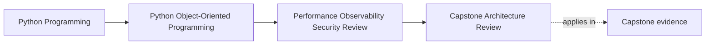

# Capstone Architecture Review

<!-- page-maps:start -->
## Page Maps

<!-- page-maps:end -->

This page turns the capstone into one review object instead of a pile of separate good
ideas.

The goal is to answer:

- which boundaries are strong enough to preserve on purpose?
- which path will feel operational pressure first?

If you cannot answer those questions from one route through the system, the architecture
story is still too scattered.

## Keep one review path visible

Use this whole-system path:

1. an attendee requests a workshop seat
2. `WorkshopEnrollment` decides confirmed or waitlisted
3. the repository saves authoritative state under contention pressure
4. projection and notification work make the result visible downstream
5. later, `CertificateIssuanceService` consumes confirmed state and publishes a visible
   outcome

This path is useful because it crosses:

- domain truth
- persistence and conflict handling
- derived visibility
- external side effects
- later workflow reuse

If the architecture still reads coherently across that path, the course has done real
work.

## Step 1: restate the design promises first

Do not start with performance, logging, or infrastructure.

Start by writing the promises the design is already making:

- aggregate boundaries own business truth
- repositories translate and preserve that truth rather than redefine it
- projections and notifications are derived visibility, not authority
- public seams stay narrower than the internal package layout
- later workflows such as certificate issuance depend on confirmed state rather than on
  incidental side effects

If these promises are already blurry, operational hardening will only polish a weaker
system.

## Step 2: name the strongest boundaries worth protecting

A useful architecture review should leave behind explicit strengths to preserve.

For this capstone, likely examples are:

- `WorkshopEnrollment` owns seat truth directly
- stale writes are a repository conflict problem, not a domain-side convenience hack
- public customization stays at narrow seams such as an incident sink, not at private
  runtime internals

Write at least one sentence like:

> This boundary is strong and must not be weakened by later optimization, extension, or
> recovery shortcuts.

Without that sentence, review often slides into vague appreciation instead of design
stewardship.

## Step 3: find the first bending boundary

Now ask where the path will feel real pressure first.

Do not ask for distant hypotheticals. Ask where the first costly confusion or distortion
would likely appear.

In this capstone, honest candidates include:

- repository save and conflict handling during bursts
- duplicate downstream work under retries
- projection lag that confuses operator visibility
- public-surface drift when examples keep teaching deep imports
- artifact publication or notification boundaries under interruption

You are looking for the first bending boundary, not the last imaginable disaster.

## Step 4: run four review lenses over the same path

Use the same workflow and ask four different questions.

### Meaning lens

- what truth must remain authoritative?
- what derived surface must never pretend to own that truth?

### Runtime lens

- where can interruption, retry, or contention distort visible behavior first?

### Governance lens

- where could consumers start depending on the wrong layer?

### Operations lens

- what signal or runbook would another maintainer need first when this path misbehaves?

These lenses keep the review coherent instead of turning it into unrelated checklists.

## Step 5: separate preserved strengths from next risks

A useful review ends with two explicit lists.

### Strengths to preserve

- aggregate-owned seat truth
- repository conflict handling as a first-class boundary
- narrow public and extension seams

### Risks to address next

- duplicate visible side effects under retry
- stale or lagging derived visibility
- weak operator signals around contention and downstream failure
- examples that could widen the public surface by accident

This split matters because it tells the next maintainer what to keep stable and what to
harden next.

## Worked review note

An honest short review note might say:

> The capstone remains strongest where authority stays close to domain state:
> `WorkshopEnrollment` still owns seat truth, and repositories still translate rather
> than define meaning. The first bending boundary is the persistence-and-downstream path,
> where contention, retries, and lag can produce confusing visible behavior before the
> domain model itself breaks. The next hardening pass should preserve aggregate ownership
> while tightening idempotency, operator signals, and public-surface discipline.

This note is useful because it protects one strength and names one pressure route.

## Build an architecture review packet

For the capstone, keep a short review packet with:

- whole-system review path
- strongest boundary worth preserving
- first boundary likely to bend
- first operator signal needed
- next hardening move that does not weaken ownership

That packet is small, but it forces the review to stay architectural instead of becoming
only a list of concerns.

## Capstone connection

Use this page directly and answer all of these:

- which boundary should you actively preserve even if a later optimization makes it
  inconvenient?
- which one path is most likely to create confusing visible behavior first?
- which next change would improve operability without moving truth to the wrong place?
- which operator artifact would help another maintainer explain failure fastest?

That is the whole goal of the architecture review.

## Exit check

Leave this page only when you can do all of these:

- review the capstone as one system rather than many isolated lessons
- name one strong boundary to preserve and one bending boundary to harden next
- explain which operational response would strengthen the system without weakening
  ownership
