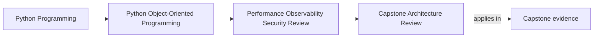

# Capstone Architecture Review

<!-- page-maps:start -->
## Page Maps

<!-- page-maps:end -->

Read the first diagram as a placement map: this page is one concept inside its parent
module, not a detached essay, and the capstone is the pressure test for whether the
idea holds. Read the second diagram as the working rhythm for the page: name the
problem, study the example, identify the boundary, then carry one review question
forward.

## Why this review matters

By Module 10, the capstone should be judged as a whole system, not just as a set of
separately good lessons.

The question is no longer:

- is each concept present somewhere?

It is:

- does the full design still hold when performance, observability, trust boundaries, and
  extension pressure are all considered together?

That is the difference between passing a course and being able to review a real system.

## Revisit the original structural promises

Start by checking whether the capstone still keeps its earlier promises around:

- value and entity semantics
- aggregate-owned invariants
- policy-based variation
- repository and unit-of-work boundaries
- public seams that do not leak private authority

If one of those promises already drifted, later operational hardening may be working on
top of a weakened model.

## Add the operational questions directly

Now review the same system through four operational lenses:

- where would performance pressure arrive first?
- which signals make the workflow explainable under failure?
- where do trust boundaries begin and end?
- which extension or compatibility seams carry the most governance cost?

This keeps operational review tied to the object model instead of becoming a detached
production checklist.

## Look for the first boundary that would bend

Strong review is not only about strengths. It is about pressure.

Ask:

- which repository or adapter boundary would feel growth first?
- which projection or reporting path would become hot under scale?
- which public or plugin seam would become fragile under version drift?
- which security or serialization boundary is still too generous?

The goal is to find the first honest tension points, not to admire the design in
general terms.

## Turn the review into preserved strengths and next risks

A useful architecture review should leave behind:

- strengths worth protecting
- risks worth addressing next
- one or two priorities for the next hardening pass

Without that, the review is only commentary. With it, the review becomes part of the
system’s evolution path.

## Capstone connection

Use the capstone directly:

- identify one boundary that is strongest and should be preserved
- identify one boundary likely to feel operational pressure first
- identify one improvement that would strengthen the system without corrupting the model

## Exit check

Leave this lesson only when you can do all of these:

- explain how to review the capstone as one system instead of many isolated topics
- name one preserved strength and one likely pressure point
- state one next hardening move that respects the existing ownership model
